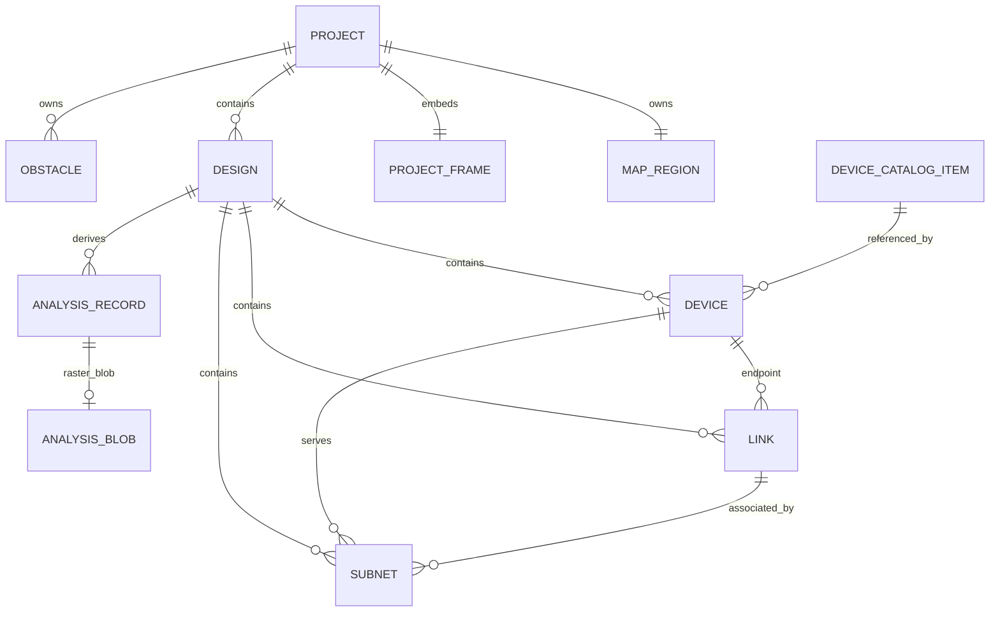

# NetScape — Data Model and Contracts

**Document:** `DATA_MODEL_AND_CONTRACTS.md`  
**Contract version:** 1.2 — frozen implementation baseline  
**Product:** NetScape — Smart Map-Based Network Infrastructure Planning Platform  
**Architecture authority:** `SYSTEM_ARCHITECTURE.md`, MVP baseline v1.3  
**UX authority:** `UI_UX_SPECIFICATION.md`  
**Implementation owners:** Agent 2 (canonical contracts/domain/storage), Agent 4 (engine and worker consumer review), Agent 1 (application orchestration consumer review)  
**Approval:** Project owner delegated final preflight reconciliation and Phase 0 approval on 2026-11-04. This is the frozen MVP contract baseline; further semantic changes follow `DEVELOPMENT_CONTRACTS.md` change control.

---

## 0. Purpose, authority and interpretation

This document is the canonical source for TypeScript data shapes, enums, command payloads, repository interfaces, engine inputs and outputs, worker messages, validation issues, constants and normative test vectors. All five agents consume these contracts. No feature or engine may define a local replacement type for an entity defined here.

The approved architecture owns system behaviour and MVP boundaries. This document makes the required data shapes concrete; it does not authorize new product scope. The UI specification owns screen composition and interaction. The roadmap owns implementation sequencing and phase gates. `AGENT_TASKS.md` owns file ownership and agent roles.

### 0.1 Binding architectural rules

1. One project has one active `MapRegion` and one immutable `ProjectFrame` in the MVP.
2. One project contains one or more designs and exactly one baseline design.
3. Obstacles are project-level and affect every design in the project.
4. Devices, links, subnets, logical layout and simulation setup belong to a design.
5. Geographic device positions and link geometries are WGS84 GeoJSON; React Flow layout positions are separate abstract coordinates.
6. Leaflet and React Flow are renderers/gesture surfaces, never authorities for authored records.
7. Dexie/IndexedDB is the only authority for saved authored data. A command is validated, committed in one transaction, and only then projected into Zustand.
8. Engines are pure TypeScript and receive project-local metric inputs, never longitude/latitude.
9. `domain/` and `engines/` are sibling layers and must not import each other.
10. Cost and IP execute synchronously through the analysis coordinator. Coverage and Simulation execute in their dedicated native Web Workers.
11. Analysis freshness is determined by the current canonical input hash, not by timestamps or raw revision equality.
12. Coverage raster arrays live in `analysisBlobs`, not inside a project, design or ordinary `AnalysisRecord` row.
13. Every modeled cost, coverage, latency and throughput value is an estimate. User-facing and report outputs must retain `isEstimate: true` and the assumptions used.
14. All project engineering settings apply to every design in the project. There are no per-design overrides for cost, coverage or simulation settings in the MVP.
15. No account system, backend, cloud sync, OSM building import, terrain, elevation, 3-D/multi-floor coverage, automatic AP optimization, interference/SINR, channel planning, IPv6, packet-level simulation, protocol-level OSPF/RIP, failure prediction, JSON import/export, undo/redo or app-managed offline tile downloads are included.

### 0.2 Source conflict resolutions

| Topic | Contract resolution | Source consequence |
|---|---|---|
| `AnalysisRecord` versus `AnalysisResult` | `AnalysisRecord` is the persisted cache envelope. `AnalysisResult` is its discriminated result payload. They are related types, not duplicate database entities. | Matches Architecture §3 R2. |
| Large coverage rasters | `CoverageResult` stores only grid metadata and a blob reference. Typed arrays are in `AnalysisBlob` / `analysisBlobs`. | Matches Architecture §3 R3 and §10. |
| Project boundary | Boundary geometry is `MapRegion.boundary`; `Project.regionId` references the region. | Matches Architecture §3 R5. |
| Cable catalogue | No cable database entity. `CABLE_SPECS` is a code-level registry keyed by `LinkMedium`; unit prices are project settings. | Matches Architecture §3 R6. |
| Subnet hosts | Host requirements are numeric fields on subnet records; endpoint hosts are not Device nodes. | Matches Architecture §3 R7. |
| Subnet/link association | `Subnet.linkId` is an optional informational association to a link in the same design. It does not force routing or represent a subnet route. Deleting the link clears the association in the same transaction. `Design.addressing.parentCidr` stores the design-specific VLSM parent pool. | Reflected in Architecture v1.3 and the selected UI/UX specification. |
| VLSM parent block | `Design.addressing.parentCidr` stores the parent network because address pools and allocations are design-specific and compared across alternative designs. | Reflected in Architecture v1.3 and UI/UX specification. |
| Project duplication | Included as an MVP project action. It creates an independent deep copy of the project, region, obstacles, settings and all designs in one transaction; remaps every project/design/entity reference; preserves exactly one copied baseline; retains references to app-wide catalogue items; and does not copy analysis caches/blobs. | Reflected in Architecture v1.3, Roadmap and Agent Tasks. |
| Link installation properties | `installationMethod` is an accepted Link field: `indoor`, `underground`, `aerial` for wired links; `null` for wireless or not-yet-classified wired links. Null wired installation classification makes the relevant cost estimate partial. | Reflected in Architecture v1.3 and UI/UX Link Inspector. |
| Simulation latency | MVP latency includes propagation, transmission and processing delay only. Queueing, packet loss and queue stability are not modelled. | Locked in Architecture v1.3; UI must not expose queue metrics. |
| Sample price amounts | The built-in catalogue and initial project pricing assumptions use the exact vendor-neutral synthetic teaching values in §0.3 and §3.5/§3.2. They are marked sample/illustrative and are not vendor specifications or quotes. | Explicitly approved as MVP demo defaults; values remain editable where the contract permits. |

### 0.3 Approved MVP defaults and fixed assumptions

Architecture v1.3 and this contract lock the following defaults for the MVP. Values described as illustrative are teaching/demo assumptions, not measured or vendor-sourced values. They remain editable only where the corresponding contract exposes a setting. The fixed power-duty ratio is not editable. Changes require the normal contract/ADR approval process.

| Setting | Approved initial value | Basis / treatment |
|---|---:|---|
| Coverage frequency | `2400 MHz` | Reference wall losses are 2.4 GHz values; users can change frequency. No wall-loss frequency scaling is applied. |
| Reference distance | `1 m` | Conventional reference point for the specified log-distance model. |
| Reference path loss | `40.0442 dB` | FSPL at 2.4 GHz and 1 m, retained at four decimals; display formatting may round to 2 decimals. |
| Path-loss exponent | `3.0` | A neutral illustrative starting value within the project plan's stated obstructed/outdoor ranges; not a universal indoor/outdoor value. |
| Coverage percentage threshold | `-75 dBm` | Fair-or-better coverage; the signal classes remain separately configurable. |
| Wall-loss seed values | Glass `3 dB`, drywall `3 dB`, brick `8 dB`, concrete `12.5 dB` per polygon-boundary crossing | Midpoints of original project-plan reference ranges at 2.4 GHz; fixed and not frequency-scaled. |
| Cable slack | `15%` | Midpoint of the stated 10–20% range. |
| Annual maintenance | `7.5%` of direct pre-contingency CAPEX | Midpoint of the stated 5–10% range. |
| Contingency | `12.5%` of direct CAPEX | Midpoint of the stated 10–15% range. |
| TCO horizon | `5 years` | Approved configurable MVP default. |
| Average packet size | `1500 bytes` | Approved illustrative transmission-delay assumption; explicitly disclosed and editable. Queueing is not calculated. |
| Per-hop processing delay | `1 ms` | Approved illustrative assumption; explicitly disclosed and editable. |
| Initial baseline design name | `Baseline` | Default label; may be renamed. |
| Device power duty ratio | `1.0` (100%) | Fixed continuous nameplate-draw assumption; not user-editable in the MVP and always disclosed in cost results. |
| Wired-link installation method | No silent default; user selects `indoor`, `underground` or `aerial` | `null` is allowed while designing but makes the applicable civil-work cost classification incomplete. |
| Wireless-link installation method | `null` | Installation method is not applicable to logical wireless links. |
| Built-in catalogue seed | Four generic illustrative items; no vendor brand/model claims | Synthetic device capabilities and sample INR prices are documented in §3.5. |
| Default cost price assumptions | Illustrative INR values in `DEFAULT_PROJECT_SETTINGS` | Editable project-wide assumptions; not vendor quotes. |

These defaults are frozen for the MVP. Do not let individual agents choose alternate values. Any change requires the contract-change process and synchronized updates to all affected specifications and test vectors.

---

# 1. TypeScript conventions and primitive types

The snippets in this document are normative. They may be split into files following the repository structure, but names, discriminants and semantics must remain stable. Use `strict: true`, `noUncheckedIndexedAccess: true` where compatible with the existing project, and avoid `any`.

## 1.1 Naming, timestamps and numeric values

- Interfaces/types: `PascalCase`.
- Values/functions: `camelCase`.
- Enum-like string unions use lower camel case for values.
- IDs are strings at runtime, with a branded TypeScript type and a fixed prefix.
- Timestamps are integer epoch milliseconds in UTC, not `Date` objects and not ISO strings.
- Lengths are metres (`M` suffix); areas are square metres (`M2` suffix); signal power is dBm; attenuation/path loss is dB; frequency is MHz; data rates/capacities/demand are Mbps; latency is ms; power is watts; energy tariff is money per kWh.
- Ratios are fractional numbers in `[0,1]`; percentage values are represented as fractional ratios in the data model unless the field name ends in `Pct` (then the documented value is percentage points, e.g. `15` means 15%).
- Money values are finite numbers in INR in this MVP. They are not floating strings. Round displayed monetary values to 2 decimal places; retain full precision in calculation inputs/results until formatting.
- Never use `NaN`, `Infinity`, `-Infinity` or `undefined` in persisted JSON-shaped records. Use explicit `null` for absent optional data where a stable serialized shape is useful.

```ts
export type Brand<T, Name extends string> = T & { readonly __brand: Name };

export type ProjectId = Brand<string, "ProjectId">;
export type DesignId = Brand<string, "DesignId">;
export type MapRegionId = Brand<string, "MapRegionId">;
export type DeviceId = Brand<string, "DeviceId">;
export type LinkId = Brand<string, "LinkId">;
export type SubnetId = Brand<string, "SubnetId">;
export type ObstacleId = Brand<string, "ObstacleId">;
export type CatalogItemId = Brand<string, "CatalogItemId">;
export type AnalysisId = Brand<string, "AnalysisId">;
export type AnalysisBlobId = Brand<string, "AnalysisBlobId">;
export type FlowId = Brand<string, "FlowId">;
export type FailureScenarioId = Brand<string, "FailureScenarioId">;
export type EpochMs = Brand<number, "EpochMs">;
export type InputHash = Brand<string, "InputHash">; // lower-case 64-character SHA-256 hex
export type IPv4Address = Brand<string, "IPv4Address">; // canonical dotted decimal
export type IPv4Cidr = Brand<string, "IPv4Cidr">; // canonical network-address/prefix
export type PercentRatio = Brand<number, "PercentRatio">; // 0..1
export type PositiveInt = Brand<number, "PositiveInt">;
```

`crypto.randomUUID()` is the only UUID generator. The application layer owns the `IdGenerator` and adds the prefixes below. The pure reducer and engines never call random APIs or clocks.

| Entity | Prefix | Example shape (UUID shortened for readability only) |
|---|---|---|
| Project | `prj_` | `prj_550e8400-e29b-41d4-a716-446655440000` |
| Design | `dsn_` | `dsn_550e8400-e29b-41d4-a716-446655440000` |
| Map region | `reg_` | `reg_550e8400-e29b-41d4-a716-446655440000` |
| Device | `dev_` | `dev_550e8400-e29b-41d4-a716-446655440000` |
| Link | `lnk_` | `lnk_550e8400-e29b-41d4-a716-446655440000` |
| Subnet | `snt_` | `snt_550e8400-e29b-41d4-a716-446655440000` |
| Obstacle | `obs_` | `obs_550e8400-e29b-41d4-a716-446655440000` |
| Catalogue item | `cat_` | `cat_550e8400-e29b-41d4-a716-446655440000` |
| Analysis record | `ana_` | `ana_550e8400-e29b-41d4-a716-446655440000` |
| Analysis blob | `blb_` | `blb_550e8400-e29b-41d4-a716-446655440000` |
| Simulation flow | `flw_` | `flw_550e8400-e29b-41d4-a716-446655440000` |
| Failure scenario | `scn_` | `scn_550e8400-e29b-41d4-a716-446655440000` |

The prefixes for `MapRegionId`, `AnalysisBlobId`, `FlowId` and `FailureScenarioId` are additional supporting IDs required by the architecture's records. They do not introduce new user-facing features.

```ts
export interface IdGenerator {
  project(): ProjectId;
  design(): DesignId;
  mapRegion(): MapRegionId;
  device(): DeviceId;
  link(): LinkId;
  subnet(): SubnetId;
  obstacle(): ObstacleId;
  catalogItem(): CatalogItemId;
  analysis(): AnalysisId;
  analysisBlob(): AnalysisBlobId;
  flow(): FlowId;
  failureScenario(): FailureScenarioId;
}

export interface Clock {
  now(): EpochMs;
}
```

An ID validator must check both the correct prefix and UUID v4 form. Do not accept a prefix-only string. Test code injects deterministic `IdGenerator` and `Clock` implementations.

## 1.2 Shared numeric, geometry and money types

```ts
export type CurrencyCode = "INR";

export interface Money {
  amount: number;             // >= 0, INR units (₹), finite
  currency: CurrencyCode;     // MVP: "INR" only
}

export type Longitude = Brand<number, "Longitude">; // -180..180 degrees
export type Latitude = Brand<number, "Latitude">;   // -90..90 degrees

/** GeoJSON Point, always [longitude, latitude] in WGS84 / EPSG:4326. */
export interface GeoPoint {
  type: "Point";
  coordinates: [Longitude, Latitude];
}

export type LonLat = [Longitude, Latitude];

/** GeoJSON Polygon. coordinates[0] is the exterior ring; later rings are holes. */
export interface GeoPolygon {
  type: "Polygon";
  coordinates: LonLat[][];
}

/** GeoJSON LineString used by Link.geometry. */
export interface GeoLineString {
  type: "LineString";
  coordinates: LonLat[];
}

/** WGS84 bbox in [west, south, east, north] order, degrees. */
export type BoundingBox = [Longitude, Latitude, Longitude, Latitude];

/** Abstract React Flow coordinate. Never pass to a geospatial/engineering function. */
export interface LogicalPoint {
  coordinateSpace: "logical";
  x: number; // abstract canvas px
  y: number; // abstract canvas px
}

/** Project-local metric coordinate, east/north metres. */
export interface Vec2 {
  coordinateSpace: "projectMetric";
  x: number; // east metres
  y: number; // north metres
}

export interface MetricBounds {
  minX: number;
  minY: number;
  maxX: number;
  maxY: number;
}
```

Validation constraints:

- WGS84 coordinates must be finite and within geographic bounds.
- GeoJSON position order is always `[longitude, latitude]`; never `[latitude, longitude]`.
- A polygon must have a closed exterior ring, at least three distinct vertices before closure, positive area, and no self-intersection. Holes, if present, must be valid and contained; MVP UI drawing normally creates one exterior ring without holes.
- A LineString requires at least two coordinate positions. For a `Link`, the first point must equal the source device position and the last point must equal the target device position after the associated move command has cascaded.
- Logical positions are finite abstract pixels and must never be serialized into a GeoJSON object.
- Project-metric values are finite metres and must never be stored in fields typed as `GeoPoint` or `LogicalPoint`.
- `Money.amount` must be finite and non-negative. A missing price is `null`, not zero.

---

# 2. Enumerations and constants

```ts
export type DeviceType = "router" | "switch" | "accessPoint" | "server";
export type LinkMedium = "copper" | "fiber" | "wireless";
export type LinkInstallationMethod = "indoor" | "underground" | "aerial";
export type ObstacleMaterial = "glass" | "drywall" | "brick" | "concrete" | "custom";
export type AnalysisType = "cost" | "coverage" | "simulation";
export type AnalysisStatus = "notCalculated" | "running" | "current" | "outOfDate" | "cancelled" | "failed";
export type SignalClass = "excellent" | "good" | "fair" | "weak" | "deadZone";
export type PriceProvenance = "sample" | "userEntered";
export type CatalogOrigin = "builtIn" | "custom";
export type SubnetAllocationStatus = "notAllocated" | "current" | "outOfDate" | "unallocated";
export type TopologyTemplateKind = "star" | "tree";
export type WorkerTaskKind = "coverage.compute" | "simulation.run";
```

### 2.1 Locked limits and engine constants

```ts
export const DATABASE_NAME = "netscape" as const;
export const DATABASE_VERSION = 1 as const;
export const WORKER_PROTOCOL_VERSION = 1 as const;

export const DESIGN_LIMITS = {
  maxDevices: 500,
  maxLinks: 1000,
} as const;

export const COVERAGE_LIMITS = {
  maxAccessPoints: 100,
  maxGridCells: 1_000_000,
  maxObstacleSegments: 5_000,
  defaultGridResolutionM: 5,
  targetCells: 250_000,
  targetAccessPoints: 10,
  targetObstacleSegments: 200,
  targetRuntimeMs: 5_000,
} as const;

export const GEOGRAPHY_LIMITS = {
  maxPlanningExtentM: 20_000,
} as const;

export const SIMULATION_DEFAULTS = {
  perHostDemandMbps: 5,
  routingWeight: 1,
  propagationSpeedMps: 200_000_000,
} as const;

export const COST_DEFAULTS = {
  currency: "INR" as const,
  cableSlackPct: 15,
  annualMaintenanceRatePct: 7.5,
  contingencyRatePct: 12.5,
  tcoHorizonYears: 5,
  devicePowerDutyRatio: 1, // fixed 100% continuous nameplate draw; not user-editable
} as const;

export const COVERAGE_DEFAULTS = {
  frequencyMhz: 2400,
  referenceReceiverGainDbi: 0, // fixed reference-client assumption; not a user-editable project setting
  referenceDistanceM: 1,
  referenceLossDb: 40.0442,
  pathLossExponent: 3,
  minimumAcceptableRssiDbm: -75,
  gridResolutionM: 5,
  signalThresholdsDbm: {
    excellentMin: -55,
    goodMin: -67,
    fairMin: -75,
    weakMin: -85,
  },
  wallLossDbPerCrossing: {
    glass: 3,
    drywall: 3,
    brick: 8,
    concrete: 12.5,
  },
} as const;

export const SIMULATION_ASSUMPTIONS = {
  averagePacketSizeBytes: 1500,
  processingDelayMsPerHop: 1,
  queueingModel: "none" as const,
} as const;

export const ENGINE_IDS = {
  ip: "netscape.ip",
  cost: "netscape.cost",
  coverage: "netscape.coverage",
  simulation: "netscape.simulation",
} as const;

/** Bump an engine version whenever its results or input semantics change. */
export const ENGINE_VERSIONS = {
  ip: 1,
  cost: 1,
  coverage: 1,
  simulation: 1,
} as const;

export const NO_SIGNAL_RSSI_DBM = -127;
export const OUTSIDE_COVERAGE_MASK_INDEX = 254;
export const NO_SERVING_AP_INDEX = 255;
```

`NO_SIGNAL_RSSI_DBM` is the reserved no-signal RSSI value. `OUTSIDE_COVERAGE_MASK_INDEX` (`254`) and `NO_SERVING_AP_INDEX` (`255`) are reserved serving-index values; neither is a valid AP index because a coverage run supports at most 100 APs.

### 2.2 Cable specification registry

There is no persisted Cable entity or user-editable cable catalogue. These specifications are code-level constants; only their unit prices are overridden in `ProjectSettings.cost.pricing`.

```ts
export interface CableSpec {
  medium: "copper" | "fiber";
  label: string;
  maxSegmentLengthM: number | null;
  attenuationDbPerKm?: number | null;
  referenceWavelengthNm?: number | null;
}

export const CABLE_SPECS: Readonly<Record<"copper" | "fiber", CableSpec>> = {
  copper: {
    medium: "copper",
    label: "Ethernet copper (Cat5e/Cat6 reference)",
    maxSegmentLengthM: 100,
    attenuationDbPerKm: null,
    referenceWavelengthNm: null,
  },
  fiber: {
    medium: "fiber",
    label: "Single-mode fibre (1310 nm reference)",
    maxSegmentLengthM: null,
    attenuationDbPerKm: 0.35,
    referenceWavelengthNm: 1310,
  },
};
```

The original plan specifies 100 m for copper Ethernet and approximately 0.35 dB/km for single-mode fibre at 1310 nm. Do not invent a maximum fibre distance without a transceiver power-budget contract. `wireless` has no cable specification and no cable-per-metre CAPEX.

---

# 3. Core domain entities

## 3.1 Project frame and map region

```ts
export interface ProjectFrame {
  kind: "azimuthalEquidistant";
  origin: GeoPoint;              // immutable WGS84 centre captured at project creation
  units: "m";
  definition: string;             // canonical proj4 +proj=aeqd definition stored for reproducibility
}

export interface MapRegion {
  id: MapRegionId;
  projectId: ProjectId;
  label: string;
  center: GeoPoint;
  bbox: BoundingBox | null;
  boundary: GeoPolygon | null;
  createdAt: EpochMs;
  updatedAt: EpochMs;
}
```

Rules:

- `ProjectFrame.origin` is created from the initial selected geocoding result/current map view and never changes. Editing `MapRegion.center`, `bbox` or `boundary` does not move the frame origin.
- The local frame definition is equivalent to `+proj=aeqd +lat_0=<origin latitude> +lon_0=<origin longitude> +datum=WGS84 +units=m`; it is persisted once to make calculations reproducible.
- One project has one active region in the MVP. `MapRegion.projectId` is unique.
- A missing `boundary` is valid during initial project setup. Coverage cannot run until a valid boundary exists.
- `bbox` describes the selected place/extent, not an engineering boundary; `boundary` is the user-authored planning polygon.
- The region's geographic centre can be updated from selected geocoder results but the frame origin remains fixed.

## 3.2 Project settings

All engineering assumptions are project-level and apply to every design in the project. Do not add design-level setting overrides.

```ts
export interface ProjectSettings {
  cost: CostSettings;
  coverage: CoverageSettings;
  simulation: SimulationSettings;
}

/** Canonical defaults copied into each newly created Project; never share a mutable object reference. */
export const DEFAULT_PROJECT_SETTINGS: ProjectSettings = {
  cost: {
    currency: "INR",
    cableSlackPct: COST_DEFAULTS.cableSlackPct,
    tcoHorizonYears: COST_DEFAULTS.tcoHorizonYears,
    electricityTariffPerKwh: { amount: 8, currency: "INR" }, // illustrative tariff, editable
    maintenanceRatePctPerYear: COST_DEFAULTS.annualMaintenanceRatePct,
    contingencyRatePct: COST_DEFAULTS.contingencyRatePct,
    taxRatePct: null, // explicitly pre-tax until a rate is supplied
    annualSupportCost: { amount: 0, currency: "INR" }, // explicit assumption: no support contract cost
    pricing: {
      copperPerM: { amount: 35, currency: "INR" },
      fiberPerM: { amount: 80, currency: "INR" },
      copperTerminationPerEnd: { amount: 100, currency: "INR" },
      fiberTerminationPerEnd: { amount: 250, currency: "INR" },
      trenchingPerM: { amount: 150, currency: "INR" },
      aerialMountingPerM: { amount: 75, currency: "INR" },
      installationLabourPerDevice: { amount: 500, currency: "INR" },
      installationLabourPerM: { amount: 15, currency: "INR" },
      softwareLicencesOneTime: { amount: 0, currency: "INR" }, // explicit assumption: no licence cost
    },
  },
  coverage: {
    model: "logDistance",
    frequencyMhz: COVERAGE_DEFAULTS.frequencyMhz,
    referenceDistanceM: COVERAGE_DEFAULTS.referenceDistanceM,
    referenceLossDb: COVERAGE_DEFAULTS.referenceLossDb,
    pathLossExponent: COVERAGE_DEFAULTS.pathLossExponent,
    minimumAcceptableRssiDbm: COVERAGE_DEFAULTS.minimumAcceptableRssiDbm,
    gridResolutionM: COVERAGE_DEFAULTS.gridResolutionM,
    signalThresholdsDbm: { ...COVERAGE_DEFAULTS.signalThresholdsDbm },
    wallLossDbPerCrossing: { ...COVERAGE_DEFAULTS.wallLossDbPerCrossing },
  },
  simulation: {
    perHostDemandMbps: SIMULATION_DEFAULTS.perHostDemandMbps,
    propagationSpeedMps: SIMULATION_DEFAULTS.propagationSpeedMps,
    averagePacketSizeBytes: SIMULATION_ASSUMPTIONS.averagePacketSizeBytes,
    processingDelayMsPerHop: SIMULATION_ASSUMPTIONS.processingDelayMsPerHop,
    queueingModel: "none",
  },
};

export const DEFAULT_BASELINE_DESIGN_NAME = "Baseline" as const;

export interface CostSettings {
  currency: "INR";
  cableSlackPct: number;                 // 0..100; approved default 15
  tcoHorizonYears: number;               // integer 1..50; approved default 5
  electricityTariffPerKwh: Money | null; // ₹/kWh; null means unknown/incomplete when device energy applies
  maintenanceRatePctPerYear: number;     // 0..100; approved default 7.5
  contingencyRatePct: number;            // 0..100; approved default 12.5
  taxRatePct: number | null;             // null explicitly means pre-tax / tax not included; not incomplete
  annualSupportCost: Money | null;       // ₹/year; null means unknown/incomplete; explicit ₹0 means no support charge assumed
  pricing: CostPricing;
}

export interface CostPricing {
  copperPerM: Money | null;              // ₹/m
  fiberPerM: Money | null;               // ₹/m
  copperTerminationPerEnd: Money | null; // ₹/termination
  fiberTerminationPerEnd: Money | null; // ₹/fibre termination end
  trenchingPerM: Money | null;           // ₹/m of underground link
  aerialMountingPerM: Money | null;      // ₹/m of aerial link
  installationLabourPerDevice: Money | null; // ₹/device
  installationLabourPerM: Money | null; // ₹/m
  softwareLicencesOneTime: Money | null; // ₹ one-time
}

export interface CoverageSettings {
  model: "logDistance";
  frequencyMhz: number;                 // MHz; approved default 2400
  referenceDistanceM: number;           // m; approved default 1
  referenceLossDb: number;              // dB; approved default 40.0442 (FSPL at 2.4 GHz / 1 m)
  pathLossExponent: number;             // dimensionless; approved default 3.0
  minimumAcceptableRssiDbm: number;      // dBm; approved default -75
  gridResolutionM: number;               // m; locked initial 5
  signalThresholdsDbm: {
    excellentMin: number;                // dBm, inclusive
    goodMin: number;                     // dBm, inclusive
    fairMin: number;                     // dBm, inclusive
    weakMin: number;                     // dBm, inclusive
  };
  wallLossDbPerCrossing: Record<Exclude<ObstacleMaterial, "custom">, number>;
}

export interface SimulationSettings {
  perHostDemandMbps: number;             // Mbps per configured subnet host; locked initial 5
  propagationSpeedMps: 200_000_000;      // fixed MVP nominal speed
  averagePacketSizeBytes: number;        // approved default 1500; used for transmission delay
  processingDelayMsPerHop: number;       // approved default 1 ms
  queueingModel: "none";                // MVP: no M/M/1 calculation
}
```

Validation:

- `tcoHorizonYears` is an integer in `[1,50]`.
- All rates, prices and counts are finite and non-negative.
- `cableSlackPct`, maintenance, contingency and tax rates are percentages, so their stored number `15` means 15%, not `0.15`.
- `frequencyMhz`, `referenceDistanceM`, `gridResolutionM` and `averagePacketSizeBytes` must be positive. `processingDelayMsPerHop` must be finite and non-negative; zero is valid when explicitly set.
- Path-loss exponent must be positive. For UI guidance, values outside the ranges described in the original project plan may show a warning but must not be silently clamped.
- RSSI thresholds must be strictly descending numerically: `excellentMin > goodMin > fairMin > weakMin` (e.g. `-55 > -67 > -75 > -85`). `minimumAcceptableRssiDbm` must be finite.
- Wall losses must be finite and non-negative. `custom` obstacles store their own `lossDbPerCrossing`.
- A `null` required price/rate means unknown and makes the applicable estimate bucket partial. An explicit `{ amount: 0, currency: "INR" }` means a known zero-cost assumption. `taxRatePct: null` is the deliberate exception: it explicitly excludes tax and leaves a complete pre-tax estimate complete.
- `taxRatePct: null` means tax is not included. `annualSupportCost: null` means no support assumption was supplied and must be disclosed; it does not prove support is free.

**Cost completeness rule:** missing optional price/rate assumptions create explicit `CostIssue` entries. The engine may return known subtotals, but a final total is `null` whenever a required line item for the selected design cannot be priced. Do not present partial totals as complete project cost.

## 3.3 Project

```ts
export interface Project {
  id: ProjectId;
  name: string;
  description: string | null;
  regionId: MapRegionId;
  frame: ProjectFrame;
  settings: ProjectSettings;
  revision: number;                    // integer >= 1; increments on project-level changes
  createdAt: EpochMs;
  updatedAt: EpochMs;
  lastOpenedAt: EpochMs | null;
}
```

- `Project` is the aggregate root for region, frame, project settings and project-level obstacles.
- Project-level obstacles are stored in their own table and referenced by `projectId`.
- The initial project, region, a deep copy of `DEFAULT_PROJECT_SETTINGS` and baseline design are created in one Dexie transaction. The baseline design name uses `DEFAULT_BASELINE_DESIGN_NAME` unless a future approved input contract permits a caller-supplied name.
- Project name is required and trimmed; empty names are invalid. Description may be `null`.
- `lastOpenedAt` is metadata and is updated through `ProjectService.openProject`/open workflow; it does not affect analysis hashes.
- Project revision increments for project settings, region or obstacle changes. It is not a substitute for analysis input hashing.

## 3.4 Design and design-specific addressing/simulation setup

```ts
export interface DesignAddressing {
  parentCidr: IPv4Cidr | null;
  allocationStatus: SubnetAllocationStatus;
  lastAllocatedAt: EpochMs | null;
}

export interface Design {
  id: DesignId;
  projectId: ProjectId;
  name: string;
  notes: string | null;
  isBaseline: boolean;
  parentDesignId: DesignId | null;      // source design when duplicated; otherwise null
  revision: number;                    // integer >= 1
  logicalLayout: Record<DeviceId, LogicalPoint>;
  addressing: DesignAddressing;
  simulationSetup: SimulationSetup;
  createdAt: EpochMs;
  updatedAt: EpochMs;
}
```

Rules:

- Exactly one design in a project has `isBaseline: true`. The invariant is enforced transactionally in `DesignRepository.setBaseline` and project creation. The boolean is not indexed in IndexedDB.
- A project must always have at least one design. The baseline cannot be deleted unless a replacement baseline is selected in the same transaction.
- `logicalLayout` is keyed by `DeviceId`. Every committed device has a deterministic initial logical position generated by the domain topology helper. It stores only abstract canvas pixels.
- `addressing.parentCidr` and allocation status belong to a design so two alternative network designs can have independent addressing plans.
- `simulationSetup` belongs to the design and is remapped when a design is duplicated.
- Layout-only changes update the design revision but do not affect cost, coverage or simulation input hashes.
- Design revision increments once per successful command commit, regardless of how many rows are upserted in that transaction.

## 3.5 Device catalog and supported device specifications

```ts
export interface DevicePortCounts {
  copperEthernet: number;               // physical copper interfaces
  fiber: number;                        // physical fibre interfaces
  wireless: number;                      // wireless interfaces; not an RF client model
}

export interface CommonDeviceSpecs {
  ports: DevicePortCounts;
  capacityMbps: number | null;           // supported aggregate interface/capacity assumption
  processingDelayMs: number | null;      // optional device processing assumption; null uses project simulation setting
}

export interface RouterSpecs extends CommonDeviceSpecs {
  type: "router";
  routingCapacityMbps: number | null;
}

export interface SwitchSpecs extends CommonDeviceSpecs {
  type: "switch";
  switchingCapacityMbps: number | null;
}

export interface AccessPointSpecs extends CommonDeviceSpecs {
  type: "accessPoint";
  radio: {
    txPowerDbm: number;
    antennaGainDbi: number;
  };
}

export interface ServerSpecs extends CommonDeviceSpecs {
  type: "server";
  serviceCapacityMbps: number | null;
}

export type DeviceSpecifications = RouterSpecs | SwitchSpecs | AccessPointSpecs | ServerSpecs;

export interface DeviceCatalogItem {
  id: CatalogItemId;
  type: DeviceType;
  label: string;
  brand: string | null;
  model: string | null;
  specs: DeviceSpecifications;
  powerW: number | null;                 // watts
  lifespanYears: number | null;          // years; used for replacement reserve
  unitPrice: Money | null;               // null means no price supplied
  priceProvenance: PriceProvenance | null;
  priceUpdatedAt: EpochMs | null;
  origin: CatalogOrigin;
  builtInCatalogVersion: number | null;  // required for built-in, null for custom
  createdAt: EpochMs;
  updatedAt: EpochMs;
}


/** Synthetic teaching/demo catalogue; never represents a real vendor/model quote. */
export interface BuiltinCatalogSeedDefinition {
  id: CatalogItemId;
  type: DeviceType;
  label: string;
  brand: null;
  model: null;
  specs: DeviceSpecifications;
  powerW: number;
  lifespanYears: number;
  unitPrice: Money;
  priceProvenance: "sample";
  origin: "builtIn";
  builtInCatalogVersion: 1;
}

/** Stable IDs and generic specifications are deliberately vendor-neutral. */
export const BUILTIN_CATALOG_SEED: readonly BuiltinCatalogSeedDefinition[] = [
  {
    id: "cat_550e8400-e29b-41d4-a716-446655440001" as CatalogItemId,
    type: "router",
    label: "Illustrative Router — 4 Copper / 1 Fibre / 1 Wireless",
    brand: null, model: null,
    specs: { type: "router", ports: { copperEthernet: 4, fiber: 1, wireless: 1 }, capacityMbps: 1000, processingDelayMs: null, routingCapacityMbps: 1000 },
    powerW: 15, lifespanYears: 5, unitPrice: { amount: 8000, currency: "INR" }, priceProvenance: "sample", origin: "builtIn", builtInCatalogVersion: 1,
  },
  {
    id: "cat_550e8400-e29b-41d4-a716-446655440002" as CatalogItemId,
    type: "switch",
    label: "Illustrative Switch — 24 Copper / 2 Fibre",
    brand: null, model: null,
    specs: { type: "switch", ports: { copperEthernet: 24, fiber: 2, wireless: 0 }, capacityMbps: 24000, processingDelayMs: null, switchingCapacityMbps: 24000 },
    powerW: 35, lifespanYears: 5, unitPrice: { amount: 6000, currency: "INR" }, priceProvenance: "sample", origin: "builtIn", builtInCatalogVersion: 1,
  },
  {
    id: "cat_550e8400-e29b-41d4-a716-446655440003" as CatalogItemId,
    type: "accessPoint",
    label: "Illustrative Wi-Fi Access Point — Dual-band Reference",
    brand: null, model: null,
    specs: { type: "accessPoint", ports: { copperEthernet: 1, fiber: 0, wireless: 1 }, capacityMbps: 1200, processingDelayMs: null, radio: { txPowerDbm: 20, antennaGainDbi: 3 } },
    powerW: 12, lifespanYears: 4, unitPrice: { amount: 4500, currency: "INR" }, priceProvenance: "sample", origin: "builtIn", builtInCatalogVersion: 1,
  },
  {
    id: "cat_550e8400-e29b-41d4-a716-446655440004" as CatalogItemId,
    type: "server",
    label: "Illustrative Server — 2 Copper",
    brand: null, model: null,
    specs: { type: "server", ports: { copperEthernet: 2, fiber: 0, wireless: 0 }, capacityMbps: 1000, processingDelayMs: null, serviceCapacityMbps: 1000 },
    powerW: 150, lifespanYears: 5, unitPrice: { amount: 45000, currency: "INR" }, priceProvenance: "sample", origin: "builtIn", builtInCatalogVersion: 1,
  },
] as const;
```

Rules:

- Built-in catalogue entries are immutable in the UI and storage API. Agent 2 seeds them from versioned built-in data.
- Custom catalogue items may be created/edited. A custom item cannot be deleted while referenced by any device in any design.
- Re-seeding on `BUILTIN_CATALOG_VERSION` increase is an upsert by stable built-in ID. It must never overwrite custom items or a user-edited built-in (built-ins are read-only, so such an edit should not exist).
- `unitPrice: null` is allowed. A catalogue row with a sample price must set `priceProvenance: "sample"`; a user-entered value must set `"userEntered"`. `priceUpdatedAt` is required when `unitPrice` is non-null.
- Every built-in sample amount must be explicitly labelled “Sample price” in the UI and report. The four generic synthetic entries in `BUILTIN_CATALOG_SEED` are the approved MVP seed dataset; they make no real vendor/model claim.
- `type` must equal `specs.type`. `type` is immutable after device creation.
- Port counts must be non-negative integers. Non-null device capacity fields must be finite and greater than zero; power and lifespan must be finite and non-negative. AP radio parameters are required only for access-point items.
- No custom cable catalog or cable type editor exists.

## 3.6 Sparse device overrides and Device

Only explicitly listed fields may be overridden on an individual placed device. Do not add arbitrary JSON properties.

```ts
export interface DeviceOverrides {
  powerW?: number | null;                // W; null explicitly clears inherited power data
  lifespanYears?: number | null;         // years
  unitPrice?: Money | null;              // ₹; null explicitly clears inherited price
  capacityMbps?: number | null;          // Mbps
  ports?: Partial<DevicePortCounts>;
  routingCapacityMbps?: number | null;   // router only, Mbps
  switchingCapacityMbps?: number | null;// switch only, Mbps
  serviceCapacityMbps?: number | null;   // server only, Mbps
  radio?: Partial<AccessPointSpecs["radio"]>; // AP only
  processingDelayMs?: number | null;      // ms; optional device-specific sim assumption
}

export interface Device {
  id: DeviceId;
  designId: DesignId;
  catalogItemId: CatalogItemId;
  type: DeviceType;                       // immutable; must match catalog item type
  name: string;                           // required, non-empty after trim
  hostname: string | null;
  notes: string | null;
  position: GeoPoint;                     // WGS84 GeoJSON Point
  overrides: DeviceOverrides;             // sparse; empty object when none
  createdAt: EpochMs;
  updatedAt: EpochMs;
}

export interface ResolvedDevice {
  id: DeviceId;
  designId: DesignId;
  catalogItemId: CatalogItemId;
  type: DeviceType;
  name: string;
  positionLocalM: Vec2;
  specs: DeviceSpecifications;
  powerW: number | null;
  lifespanYears: number | null;
  unitPrice: Money | null;
  priceProvenance: PriceProvenance | null;
}
```

`resolveDevice(device, catalogItem, projectFrame)` is a pure domain resolver. It validates same-type catalogue selection, applies only type-compatible sparse overrides and converts the device position into project-local metres for engine input builders. It does not mutate either record. Engines receive `ResolvedDevice`, never a catalogue item plus an unprocessed override map.

Device rules:

- The `Device` row belongs to one design and must reference an existing catalogue item of the same type.
- A device always has a geographic position. Devices cannot be created on the React Flow canvas without first being placed geographically.
- Device type is immutable. Catalogue item may change only to another item of the same type.
- A catalogue item change removes overrides that do not apply to the new item's spec shape.
- Outside-boundary device placement is a warning, not a blocking error, unless a future approved rule changes this.
- Device status is authored/validation/simulation context only. The model has no live hardware state or connectivity polling.

## 3.7 Link

```ts
export interface Link {
  id: LinkId;
  designId: DesignId;
  sourceDeviceId: DeviceId;
  targetDeviceId: DeviceId;
  medium: LinkMedium;
  installationMethod: LinkInstallationMethod | null;
  geometry: GeoLineString;                // WGS84, endpoints follow source/target device positions
  capacityMbps: number | null;            // Mbps; required for simulation to provide throughput
  routingWeight: number;                  // non-negative; default 1 (one hop)
  lengthOverrideM: number | null;         // user override in metres; computed length is never stored
  createdAt: EpochMs;
  updatedAt: EpochMs;
}

export interface ResolvedLink {
  id: LinkId;
  sourceDeviceId: DeviceId;
  targetDeviceId: DeviceId;
  medium: LinkMedium;
  installationMethod: LinkInstallationMethod | null;
  lengthM: number;                        // derived from geometry in local project frame, or validated override
  capacityMbps: number | null;
  routingWeight: number;
}
```

Rules:

- Both endpoint devices must exist in the same design and must be distinct.
- The MVP disallows parallel links between the same unordered device pair, regardless of medium. This matches the architecture's link validation flow; supporting parallel paths requires an architecture decision.
- The endpoint coordinates of `geometry` must match the current endpoint device positions. `device/move` updates connected link endpoints in the same command/change set.
- Map-created links are straight two-point LineStrings. Waypoints are not editable in the MVP, though the length resolver sums every segment if geometry later contains more than two points.
- `lengthM` is derived by projecting geometry into the immutable project-local AEQD frame and summing segment lengths. `lengthOverrideM`, if set, is the explicit engineering length used by cost/simulation and must be positive. Leaflet measurement, Web Mercator pixels and Turf distance/length are forbidden for engineering length.
- `capacityMbps` must be `null` or a finite value greater than zero. `null` means capacity is unspecified, not zero; simulation flags missing capacity for affected flows rather than assuming infinite capacity.
- `routingWeight` must be finite and non-negative. The default is `1`.
- Medium/device port compatibility and port budgets are validated using resolved `DevicePortCounts`. A link consumes one compatible port at each endpoint. Exact supported compatibility is defined below.

### 3.7.1 Link compatibility matrix

| Medium | Required port capability on each endpoint | Cost treatment | Engineering note |
|---|---|---|---|
| `copper` | `copperEthernet >= 1` available | Cable length × project copper price + configured copper terminations | Copper Ethernet reference max segment 100 m; over-limit is a warning, not an invented automatic switch insertion. |
| `fiber` | `fiber >= 1` available | Cable length × project fibre price + two configured termination ends | Single-mode 1310 nm reference loss is 0.35 dB/km; splice counts are not represented in the MVP; no maximum length unless a transceiver budget is later contracted. |
| `wireless` | `wireless >= 1` available on both endpoints | No physical cable length charge; no cable slack | MVP connectivity graph only. It does not compute interference/channel allocation. |

A compatible endpoint pair must pass the capability check at both ends. This contract does not create vendor-specific port negotiation. If the team needs a different compatibility rule, raise it before implementation and update the table; do not encode different rules independently in the map and topology feature.

## 3.8 Subnet and IPv4 addressing records

```ts
export interface Subnet {
  id: SubnetId;
  designId: DesignId;
  name: string;
  hostsRequired: number;                  // integer >= 1; numeric host requirement, not device nodes
  servedByDeviceId: DeviceId | null;       // device used as the subnet's graph attachment
  linkId: LinkId | null;                  // optional link association; cleared when the link is deleted
  allocatedCidr: IPv4Cidr | null;
  usableHostCapacity: number | null;      // count; filled by successful VLSM allocation
  wastedUsableHosts: number | null;       // usableHostCapacity - hostsRequired
  allocationStatus: SubnetAllocationStatus;
  createdAt: EpochMs;
  updatedAt: EpochMs;
}
```

Rules:

- Subnet hosts are numeric requirements and are not separate Device records.
- `hostsRequired` must be a positive integer.
- `servedByDeviceId`, when present, must reference a router or switch in the same design. (The simulation starts the subnet flow at this attachment device.)
- `linkId`, when present, identifies the preferred physical/logical attachment link recorded for planning context. It must reference a Link in the same design; it is informational and is not an instruction to force routing over that link. The MVP UI may leave it unset unless the user explicitly selects an attachment link. Deleting the referenced link clears the association in the same transaction.
- `allocatedCidr`, `usableHostCapacity` and `wastedUsableHosts` are output fields from the last successful allocation. They are cleared or marked out of date when the parent CIDR or host requirements change.
- `wastedUsableHosts = usableHostCapacity - hostsRequired`; do not confuse it with total unallocated IP addresses in the parent pool.
- VLAN, interface address assignment, per-host address objects and IPv6 are out of scope.
- `Design.addressing.parentCidr` is the parent pool. The allocator normalizes no invalid input silently; a non-network CIDR with host bits set must be rejected or explicitly normalized with a visible warning. The normative contract chooses rejection.

## 3.9 Project-level obstacle

```ts
export interface Obstacle {
  id: ObstacleId;
  projectId: ProjectId;
  label: string;
  geometry: GeoPolygon;
  material: ObstacleMaterial;
  lossDbPerCrossing: number;              // fixed dB per polygon-boundary crossing
  source: "manual";                      // OSM/building import is deferred
  createdAt: EpochMs;
  updatedAt: EpochMs;
}
```

Rules:

- Obstacles are project-level, not design-level. A manual obstacle update affects the coverage input hash of every design in the project.
- MVP obstacles are drawn and edited manually. `source` is always `manual`.
- Built-in material values seed the obstacle inspector; a custom obstacle uses its explicit `lossDbPerCrossing`.
- Each polygon-boundary crossing contributes the fixed configured loss. Polygon edges count as crossings according to the coverage kernel contract; there is no frequency scaling in Coverage v1.
- Obstacle height, floors, terrain, building import and 3-D propagation are not modeled.

---

# 4. Simulation authored setup

```ts
export interface SimulationFlow {
  id: FlowId;
  name: string;
  sourceSubnetId: SubnetId;
  destinationDeviceId: DeviceId;          // must reference a Server in this design
  demandMbpsOverride: number | null;      // null => hostsRequired × perHostDemandMbps
  enabled: boolean;
}

export interface FailureScenario {
  id: FailureScenarioId;
  name: string;
  failedDeviceIds: DeviceId[];
  failedLinkIds: LinkId[];
}

export interface SimulationSetup {
  flows: SimulationFlow[];                // empty => derive defaults from subnet/server relationships
  failureScenarios: FailureScenario[];
}
```

Rules:

- If `flows` is empty, the simulation input builder derives one flow from each subnet with `servedByDeviceId` to every Server in the design. Default offered demand per derived flow is `hostsRequired × ProjectSettings.simulation.perHostDemandMbps`.
- If the user configures flows, only enabled configured flows are run. A non-null `demandMbpsOverride` replaces the derived subnet demand for that flow and must be finite and greater than zero.
- A flow source is its subnet's non-null `servedByDeviceId`; the target must be a Server. A configured flow whose subnet has no serving device is invalid and must be fixed before a run. When `flows` is empty, only subnets with a serving device participate in auto-derived flows. Deleting a source device clears the subnet association and removes affected configured flows in the same transaction; deleting the destination also removes affected flows. Flow demand must be finite and greater than zero.
- Failure scenario arrays contain unique IDs that must exist in the same design. They are sets semantically; canonical serialization sorts them by ID.
- Failure scenarios remove selected devices/links from the simulation graph for that scenario only. They do not edit the authored design.
- No packet stream, packet animation, transport protocol, OSPF/RIP configuration or failure prediction is modeled.

---

# 5. Relationships, ownership and lifecycle

## 5.1 Relationship model



`ProjectFrame` is embedded in the Project record, not a separate table. `AnalysisResult` is embedded in `AnalysisRecord`; it is not a second database table. `CoverageGrid` metadata is embedded in the coverage result; raster arrays are separate `AnalysisBlob` data. `DesignComparison` and `ReportModel` are transient derived objects, not persisted entities.

## 5.2 Referential integrity

Dexie does not enforce foreign keys. Repository transactions must enforce:

- `Project.regionId` references exactly one `MapRegion` whose `projectId` matches.
- `Design.projectId` references a Project.
- `Device.designId`, `Link.designId` and `Subnet.designId` all identify the owning Design.
- `Device.catalogItemId` references an existing same-type catalogue item.
- Link endpoint IDs reference devices in the same design.
- Subnet device/link references point to records in the same design.
- Simulation flow/scenario references point to existing subnets/devices/links in the same design.
- Every AnalysisRecord points to an existing design and matching project; every AnalysisBlob points to a matching coverage AnalysisRecord.
- Exactly one design per project is baseline.
- No duplicate unordered endpoint pair exists in a design.

## 5.3 Deletion cascades

All cascades occur in one repository transaction and are reflected in a single committed projection.

| Deleted record | Required dependent changes |
|---|---|
| Project | Delete all its designs, devices, links, subnets, project obstacles, region, analysis records and analysis blobs. Do not delete global catalogue items or app preferences. Project deletion is blocked if a repository integrity check finds an unresolved child outside the aggregate; do not orphan records. |
| Design | Delete its devices, links, subnets, simulation setup via the design row, analysis records and unreferenced analysis blobs. If it is the baseline, require a replacement baseline in the same transaction. A project cannot be left with zero designs. |
| Device | Delete all connected links; remove its `logicalLayout` key; set matching `Subnet.servedByDeviceId` to `null`; remove it from simulation failed-device sets; remove any configured flow whose source subnet becomes invalid or whose destination is this device (return a warning in the change set); remove references from template draft state. |
| Link | Delete the link; clear matching `Subnet.linkId`; remove it from every failure scenario's `failedLinkIds`; preserve other flows. |
| Subnet | Remove configured simulation flows that reference it; no individual host entities exist. |
| Obstacle | No authored geometry dependent records. Project coverage hashes change; cached coverage remains as an old-hash record and is not published as current. |
| Custom catalogue item | Deletion is blocked while referenced by any device. Built-in catalogue items cannot be deleted. |
| AnalysisRecord | Delete its AnalysisBlob only if no other record references that blob. Authored data is unaffected. |

Project and design rows are hard-deleted in the local MVP. Soft deletion/tombstones are not required because cloud sync is deferred. Do not implement sync-oriented tombstone fields.

## 5.4 Design duplication

`DesignRepository.duplicate` performs one Dexie transaction:

1. Copy the source design with a new `DesignId`, `parentDesignId` set to the source ID, `isBaseline: false`, `revision: 1`, new timestamps and chosen name.
2. Create a new `DeviceId` for every source device and build an old→new ID map.
3. Create a new `LinkId` for every source link; remap source/target device IDs and preserve medium, geometry, length override and supported properties. Link geometry is copied, because device geographic positions are identical at duplication time.
4. Create a new `SubnetId` for every source subnet; remap `servedByDeviceId` and `linkId`; preserve numeric host requirements and current allocation data.
5. Remap keys in `logicalLayout` to new device IDs, preserving logical positions.
6. Remap flow IDs, source subnet IDs, destination device IDs, failed device IDs and failed link IDs in `simulationSetup`.
7. Do not copy AnalysisRecord or AnalysisBlob rows. The new IDs and design context require new analysis inputs/cache entries.
8. Preserve the existing baseline invariant; duplication never changes which design is baseline.

If any reference cannot be remapped, the transaction fails; do not create a partial copy.

### 5.5 Project duplication (Projects screen action)

Project duplication is part of the UI/service behaviour explicitly listed in Architecture §7.1 and §7.3. `ProjectService.duplicateProject` builds a `ProjectDuplicationBundle` before opening the repository transaction; `ProjectRepository.duplicateWithContents` commits it atomically across `projects`, `mapRegions`, `designs`, `devices`, `links`, `subnets` and `obstacles`.

Rules:

1. Create a new ProjectId and MapRegionId. Copy the source project's name with a clear `Copy` suffix unless the caller supplies a name; validate uniqueness only as a display convenience, not as a global ID constraint.
2. Copy `ProjectSettings` and the immutable `ProjectFrame` exactly; copy MapRegion label, centre, bbox and boundary. Reset `lastOpenedAt` to `null`; use the injected timestamp for new records.
3. Create a new DesignId for every source design. Preserve names, notes, addressing, logical positions and simulation settings/setup; set revisions to `1`, timestamps to the duplication time, and preserve the one baseline by mapping its source design to the new ID. Set each copied design's `parentDesignId` to `null`: the copied project is a self-contained project lineage, not a design branch in the source project.
4. Create new DeviceIds, LinkIds, SubnetIds, ObstacleIds, FlowIds and FailureScenarioIds and remap every reference. `Device.catalogItemId` remains unchanged because the local catalogue is application-wide and shared across projects; do not clone catalogue entries.
5. Copy device geographic positions, link geometries/overrides, project-level obstacles and all authored settings. Preserve exact coordinate values so metric calculations are stable under the copied ProjectFrame.
6. Do not copy AnalysisRecord or AnalysisBlob rows. They are derived cache entries and are rebuilt by input-hash lookup/run for the new project/design IDs.
7. The repository checks all remapped references and the exactly-one-baseline invariant before commit. Any failure rolls back the entire duplicate.

The project copy is independent after creation: later edits to its settings, boundary, obstacles, devices, links, subnets or designs do not affect the source project. Global catalogue rows remain shared references by design.

---

# 6. Geography and coordinate contracts

## 6.1 Coordinate ownership and transforms

- All persisted geographic coordinates use WGS84 / EPSG:4326 GeoJSON and `[longitude, latitude]` tuple ordering.
- Each project has one immutable local azimuthal-equidistant engineering frame centred at project creation.
- `proj4` is used only in `domain/geo/localFrame.ts` for GeoPoint ⇄ Vec2 conversions.
- Turf.js may be used for geographic topology helpers such as bbox, point-in-polygon, centroid, simplify and geometry validity. Turf distance/length/area/along APIs are banned for engineering measurements.
- Leaflet uses Web Mercator for display only. Leaflet/Geoman-reported lengths or areas are never used in engine inputs, cost, coverage or report numeric figures.
- Engine inputs are already projected to local metres by `domain/inputBuilders`; engines never receive GeoPoint, GeoPolygon or raw lng/lat.

```ts
export interface LocalFrameTransform {
  toLocal(point: GeoPoint): Vec2;
  toGeo(point: Vec2): GeoPoint;
  polygonToLocal(polygon: GeoPolygon): Vec2[][];
  lineToLocal(line: GeoLineString): Vec2[];
}
```

The interface is consumed by domain code only. React components must not call `proj4` directly.

## 6.2 Extent and geometry rules

- The planning boundary's bounding-box diagonal in the local frame must be ≤ 20,000 m.
- Every placed device must be within 20,000 m of the immutable project-frame origin for coverage computations. Projects outside the guard may still be viewed/edited; affected coverage is blocked with `AREA_TOO_LARGE`.
- `MapRegion.boundary` may be `null` until the user draws a planning polygon.
- Boundary validation: closed rings, ≥3 distinct points, no self-intersection, positive area, valid ring/hole relationship and extent guard.
- Obstacle polygons follow the same validity checks and must intersect or lie within the project's plausible planning envelope. An obstacle outside the boundary is a warning unless the validator detects invalid coordinates.
- Link geometry has two or more points. For MVP-created links it has exactly two. Source/target endpoints remain aligned with device positions after every device move.
- Distances and areas are calculated after conversion to the project's local frame.

## 6.3 Domain conversion helper signatures

```ts
export function geoPointToLocal(point: GeoPoint, frame: ProjectFrame): Vec2;
export function localPointToGeo(point: Vec2, frame: ProjectFrame): GeoPoint;
export function geoPolygonToLocal(polygon: GeoPolygon, frame: ProjectFrame): Vec2[][];
export function geoLineStringToLocal(line: GeoLineString, frame: ProjectFrame): Vec2[];
export function deriveLinkLengthM(link: Link, devicesById: Record<DeviceId, Device>, frame: ProjectFrame): number;
```

`deriveLinkLengthM` returns `lengthOverrideM` if non-null and valid; otherwise it projects all geometry vertices and sums Euclidean segment lengths. The caller must verify that the geometry endpoints match current endpoint devices.

---

# 7. Domain commands and change sets

## 7.1 Command design

A command is a user-intent operation. `designSession` injects IDs and timestamps before calling the pure reducer; the reducer itself performs no I/O, random generation or clock reads. The reducer validates the complete aggregate, applies cascades and returns a `DesignChangeSet`.

```ts
export interface CommandStamp {
  commandId: string;
  committedAt: EpochMs; // injected by application layer
}

export type DesignCommand =
  | { type: "project/update"; patch: { name?: string; description?: string | null } }
  | { type: "project/settingsUpdate"; patch: DeepPartial<ProjectSettings> }
  | { type: "region/update"; patch: { label?: string; center?: GeoPoint; bbox?: BoundingBox | null } }
  | { type: "region/setBoundary"; boundary: GeoPolygon | null }
  | { type: "device/add"; catalogItemId: CatalogItemId; position: GeoPoint; name?: string }
  | { type: "device/update"; deviceId: DeviceId; patch: DevicePatch }
  | { type: "device/move"; deviceId: DeviceId; position: GeoPoint }
  | { type: "device/delete"; deviceId: DeviceId }
  | { type: "link/add"; sourceDeviceId: DeviceId; targetDeviceId: DeviceId; medium: LinkMedium; installationMethod?: LinkInstallationMethod | null; capacityMbps?: number | null; routingWeight?: number }
  | { type: "link/update"; linkId: LinkId; patch: LinkPatch }
  | { type: "link/delete"; linkId: LinkId }
  | { type: "subnet/add"; name: string; hostsRequired: number; servedByDeviceId?: DeviceId | null; linkId?: LinkId | null }
  | { type: "subnet/update"; subnetId: SubnetId; patch: SubnetPatch }
  | { type: "subnet/delete"; subnetId: SubnetId }
  | { type: "addressing/setParentCidr"; parentCidr: IPv4Cidr | null }
  | { type: "addressing/applyAllocation"; allocations: VlsmSubnetAllocation[]; parentCidr: IPv4Cidr; allocatedAt: EpochMs }
  | { type: "obstacle/add"; label?: string; geometry: GeoPolygon; material: ObstacleMaterial; lossDbPerCrossing?: number }
  | { type: "obstacle/update"; obstacleId: ObstacleId; patch: ObstaclePatch }
  | { type: "obstacle/delete"; obstacleId: ObstacleId }
  | { type: "layout/set"; positions: Record<DeviceId, LogicalPoint> }
  | { type: "simulation/setup"; setup: SimulationSetup }
  | { type: "template/apply"; template: TopologyTemplateRequest };

export interface DevicePatch {
  name?: string;
  hostname?: string | null;
  notes?: string | null;
  catalogItemId?: CatalogItemId;
  overrides?: DeviceOverrides;
}

export interface LinkPatch {
  medium?: LinkMedium;
  installationMethod?: LinkInstallationMethod | null;
  capacityMbps?: number | null;
  routingWeight?: number;
  lengthOverrideM?: number | null;
}

export interface SubnetPatch {
  name?: string;
  hostsRequired?: number;
  servedByDeviceId?: DeviceId | null;
  linkId?: LinkId | null;
}

export interface ObstaclePatch {
  label?: string;
  geometry?: GeoPolygon;
  material?: ObstacleMaterial;
  lossDbPerCrossing?: number;
}

export type DeepPartial<T> = {
  [K in keyof T]?: T[K] extends object ? DeepPartial<T[K]> : T[K];
};
```

`project/settingsUpdate` accepts only keys in `ProjectSettings`; it is never a generic arbitrary object merge. `DeepPartial` is a type convenience, not permission to accept unknown properties at runtime.

### 7.1.1 Topology template request

```ts
export type TopologyTemplateRequest =
  | {
      kind: "star";
      rootDeviceId: DeviceId;
      memberDeviceIds: DeviceId[];
      medium: LinkMedium;
    }
  | {
      kind: "tree";
      rootDeviceId: DeviceId;
      parentByDeviceId: Record<DeviceId, DeviceId>;
      medium: LinkMedium;
    };
```

Star creates one link from the selected root to each distinct member. Tree uses the explicit parent map; each non-root selected device must have exactly one parent, the root must not have a parent, every parent must be in the selected set, and the graph must be connected and acyclic. The preview must display the exact device/link changes before commit. There is no automatic topology optimization or inferred branching factor.

## 7.2 Pure reducer and prepared command

```ts
export interface DesignAggregate {
  project: Project;
  region: MapRegion;
  design: Design;
  devicesById: Record<DeviceId, Device>;
  linksById: Record<LinkId, Link>;
  subnetsById: Record<SubnetId, Subnet>;
  obstaclesById: Record<ObstacleId, Obstacle>;
  catalogById: Record<CatalogItemId, DeviceCatalogItem>;
}

export interface GeneratedCommandIds {
  device?: DeviceId[];
  link?: LinkId[];
  subnet?: SubnetId[];
  obstacle?: ObstacleId[];
  flow?: FlowId[];
  failureScenario?: FailureScenarioId[];
}

export interface PreparedDesignCommand {
  command: DesignCommand;
  stamp: CommandStamp;
  generatedIds: GeneratedCommandIds;
}

export interface DesignChangeSet {
  project: Project | null;
  region: MapRegion | null;
  design: Design;
  upsertDevices: Device[];
  deleteDeviceIds: DeviceId[];
  upsertLinks: Link[];
  deleteLinkIds: LinkId[];
  upsertSubnets: Subnet[];
  deleteSubnetIds: SubnetId[];
  upsertObstacles: Obstacle[];
  deleteObstacleIds: ObstacleId[];
  affectedAnalysisTypes: AnalysisType[];
  validationIssues: ValidationIssue[]; // warnings only on success; errors cause rejection
}

export type ApplyCommandResult =
  | { ok: true; changeSet: DesignChangeSet; nextAggregate: DesignAggregate }
  | { ok: false; issues: ValidationIssue[] };

export function applyCommand(
  aggregate: DesignAggregate,
  prepared: PreparedDesignCommand,
): ApplyCommandResult;
```

Reducer rules:

- Pure deterministic function. No React, Zustand, Dexie, Web Worker, network, `Date.now`, `Math.random`, `crypto.randomUUID` or DOM imports.
- It must not mutate the input aggregate; return a new aggregate/change set.
- All blocking validation errors return `{ok:false, issues}` and no change set. Warnings may accompany a successful commit.
- It computes revision increments and all same-transaction cascades.
- It may use injected `stamp.committedAt`; it does not read the clock.
- Add operations use generated entity IDs supplied in `PreparedDesignCommand.generatedIds` by `designSession` before the reducer executes.
- A successful change set identifies exact rows to upsert/delete. It is the only input to the repository transaction.
- `affectedAnalysisTypes` is advisory; the authoritative staleness check is by recomputing each current input hash.

### 7.2.1 Command-specific behaviour

| Command | Validation / cascade | Revision and analysis impact |
|---|---|---|
| `project/update` | Trim name; reject empty name; validate description length. | Project revision increments; no analysis hash changes unless a consumed field changes (name/description do not). |
| `project/settingsUpdate` | Validate each known setting and preserve omitted values. | Project revision increments; hash comparison marks only affected cost/coverage/simulation results stale. |
| `region/update` | Validate center/bbox coordinate ranges. The project frame origin remains unchanged. | Project revision increments. Coverage changes only if the boundary or coverage input actually changes. |
| `region/setBoundary` | Validate polygon and 20 km planning extent. `null` removes the boundary; if boundary removed, coverage cannot run. | Project revision increments; coverage hash changes. |
| `device/add` | Catalogue item must exist; type is inferred from it; validate position/limits/port-independent fields. Create deterministic logical layout entry. Outside-boundary location is warning. | Design revision increments. Cost and Simulation usually change; Coverage changes only for AP with radio inputs. Hash inputs decide exactly. |
| `device/update` | Name non-empty; catalogue type unchanged; remove incompatible overrides. | Design revision increments; hashes recompute. |
| `device/move` | Valid GeoPoint; update device position and endpoints of all incident links atomically. | Design revision increments; affected coverage/cost/simulation inputs become stale only when consumed values change. |
| `device/delete` | Delete connected links; remove layout key; clear `servedByDeviceId`/`linkId` where appropriate; clean failure references and invalid flows. | One design revision increment. Related analyses stale by hash. |
| `link/add` | Distinct valid same-design endpoints; no parallel link; medium supported by both endpoint ports; port budget available. Create straight endpoint LineString. | Design revision increments; Cost and Simulation hashes change. |
| `link/update` | Validate supported medium, port compatibility, routing weight, capacity, installation and override. | Design revision increments; Cost/Simulation hashes as appropriate. |
| `link/delete` | Delete row; clear `Subnet.linkId`; remove failed-link references. | Design revision increments; Simulation/Cost hashes as appropriate. |
| `subnet/add/update/delete` | Validate host count, same-design optional device/link references; allocation becomes stale after parent/host input change. Clean simulation flows on delete. | Design revision increments; VLSM authored allocation state updates; Simulation hash changes. |
| `addressing/setParentCidr` | CIDR must be canonical network address. Null clears parent and allocation. | Design revision increments; all subnet allocations become `outOfDate`/null until allocation runs. Simulation changes only if host/servedBy relationships change, not parent CIDR alone. |
| `addressing/applyAllocation` | Parent must equal current parent; every allocation must reference a current subnet; allocations cannot overlap and must be within parent block. | Design revision increments; sets allocation fields/status and timestamp. |
| `obstacle/add/update/delete` | Validate project ownership, polygon, material and loss. | Project revision increments; coverage hashes for all designs in the project are recalculated. |
| `layout/set` | Keys must reference existing devices; coordinates finite; no geo conversion. | Design revision increments; no engineering analysis inputs change. |
| `simulation/setup` | Validate IDs, flow destinations are Servers, scenario device/link IDs exist; reject duplicates. | Design revision increments; Simulation hash changes. |
| `template/apply` | Validate template membership, parent mapping, medium/ports and duplicate links; one atomic multi-link change. | Design revision increments once; Cost/Simulation input hashes change. |

## 7.3 `designSession.dispatch` and commit protocol

```ts
export interface DispatchSuccess {
  status: "committed";
  designRevision: number;
  projectRevision: number;
  changeSet: DesignChangeSet;
  warnings: ValidationIssue[];
}

export interface DispatchRejected {
  status: "rejected";
  issues: ValidationIssue[];
}

export type DispatchResult = DispatchSuccess | DispatchRejected;

export interface DesignSession {
  open(designId: DesignId): Promise<DesignAggregate>;
  dispatch(command: DesignCommand): Promise<DispatchResult>;
  close(): Promise<void>;
  flushPendingDrafts(): Promise<void>;
}
```

- `dispatch` serializes commands through a per-design promise queue.
- Application layer injects `CommandStamp`, IDs and current time before `applyCommand`.
- Base design/project revisions are captured at command start. If the stored base revision no longer matches, repository commit rejects with `REVISION_CONFLICT`.
- The repository applies the change set in one Dexie transaction. Only after successful commit may `designSession` update `designStore` and emit `designEvents.committed`.
- If validation rejects, no write occurs. If the transaction fails, the Zustand projection remains unchanged and the promise rejects with a typed `StorageError`.
- High-frequency gestures commit once at gesture end: map marker `dragend`, React Flow `onNodeDragStop`. Form drafts commit on blur or 300 ms debounce and flush before in-app route changes.
- There is no manual Save command or undo/redo.

---

# 8. Validation and error contracts

## 8.1 ValidationIssue

```ts
export type ValidationSeverity = "error" | "warning";
export interface ValidationIssue {
  code: ValidationIssueCode;
  severity: ValidationSeverity;
  message: string;
  path: string;                         // field path, e.g. "devices.dev_x.position"
  entityType: "project" | "region" | "design" | "device" | "link" | "subnet" | "obstacle" | "catalog" | "analysis" | "simulation";
  entityId: string | null;
  relatedEntityIds: string[];
}

export type ValidationIssueCode =
  | "REQUIRED" | "INVALID_FORMAT" | "OUT_OF_RANGE" | "DUPLICATE_NAME"
  | "INVALID_GEOMETRY" | "SELF_INTERSECTION" | "AREA_TOO_LARGE"
  | "DEVICE_OUTSIDE_BOUNDARY" | "DEVICE_LIMIT_EXCEEDED" | "LINK_LIMIT_EXCEEDED"
  | "LINK_ENDPOINT_MISSING" | "LINK_SELF_CONNECTION" | "LINK_DUPLICATE"
  | "LINK_MEDIUM_INCOMPATIBLE" | "PORT_BUDGET_EXCEEDED" | "LINK_EXCEEDS_MAX_LENGTH"
  | "CATALOG_ITEM_MISSING" | "CATALOG_TYPE_MISMATCH" | "CATALOG_ITEM_IN_USE"
  | "INVALID_CIDR" | "HOST_REQUIREMENT_INVALID" | "SUBNET_REFERENCE_MISSING"
  | "ALLOCATION_OUT_OF_DATE" | "ALLOCATION_OVERLAP" | "INSUFFICIENT_ADDRESS_SPACE"
  | "OBSTACLE_LIMIT_EXCEEDED" | "COVERAGE_AP_LIMIT_EXCEEDED" | "COVERAGE_GRID_LIMIT_EXCEEDED"
  | "COVERAGE_BOUNDARY_REQUIRED" | "COVERAGE_ACCESS_POINT_REQUIRED"
  | "SIMULATION_FLOW_INVALID" | "SIMULATION_SCENARIO_INVALID"
  | "MISSING_COST_INPUT" | "MISSING_DEVICE_PRICE" | "MISSING_POWER_SPEC";
```

Error severity:

- `error` blocks the relevant commit or calculation.
- `warning` allows the operation but must be visible and associated with its entity/field.
- Validation functions return issues; expected user mistakes do not throw exceptions.

## 8.2 Typed errors

```ts
export type NetScapeErrorCode =
  | "VALIDATION_FAILED" | "REVISION_CONFLICT" | "QUOTA_EXCEEDED"
  | "DATABASE_UNAVAILABLE" | "DATABASE_BLOCKED" | "DATABASE_VERSION_CHANGE"
  | "STORAGE_READ_FAILED" | "STORAGE_WRITE_FAILED" | "REFERENTIAL_INTEGRITY_FAILED"
  | "WORKER_FAILED" | "WORKER_PROTOCOL_ERROR" | "WORKER_CANCELLED" | "WORKER_TIMEOUT"
  | "ENGINE_INPUT_INVALID" | "ENGINE_LIMIT_EXCEEDED" | "SERVICE_UNAVAILABLE"
  | "GEOCODER_RATE_LIMITED" | "PDF_GENERATION_FAILED" | "UNKNOWN_ERROR";

export interface NetScapeErrorOptions {
  cause?: unknown;
  details?: Record<string, unknown>;
  recoverable?: boolean;
}

export class NetScapeError extends Error {
  readonly code: NetScapeErrorCode;
  readonly details: Record<string, unknown> | null;
  readonly recoverable: boolean;
  constructor(code: NetScapeErrorCode, message: string, options?: NetScapeErrorOptions);
}

export class EngineInputError extends NetScapeError {
  constructor(message: string, details?: Record<string, unknown>);
}

export class StorageError extends NetScapeError {
  constructor(code: Extract<NetScapeErrorCode, "REVISION_CONFLICT" | "QUOTA_EXCEEDED" | "DATABASE_UNAVAILABLE" | "DATABASE_BLOCKED" | "DATABASE_VERSION_CHANGE" | "STORAGE_READ_FAILED" | "STORAGE_WRITE_FAILED" | "REFERENTIAL_INTEGRITY_FAILED">, message: string, options?: NetScapeErrorOptions);
}

export class ServiceError extends NetScapeError {
  constructor(code: Extract<NetScapeErrorCode, "SERVICE_UNAVAILABLE" | "GEOCODER_RATE_LIMITED" | "PDF_GENERATION_FAILED">, message: string, options?: NetScapeErrorOptions);
}
```

Implementation requirements:

- Errors carry stable codes and concise messages safe to show in the UI. Never throw strings.
- Expected domain conditions (unallocated subnet, unreachable flow, missing optional price) are returned in-band, not thrown as generic exceptions.
- Worker error messages use a serializable error DTO; do not structured-clone Error instances.
- Preserve `cause` for logs where supported, but do not persist stack traces in project records.

---

# 9. IndexedDB / Dexie storage schema

## 9.1 Database definition

```ts
export class NetScapeDatabase extends Dexie {
  projects!: Table<Project, ProjectId>;
  designs!: Table<Design, DesignId>;
  devices!: Table<Device, DeviceId>;
  links!: Table<Link, LinkId>;
  subnets!: Table<Subnet, SubnetId>;
  obstacles!: Table<Obstacle, ObstacleId>;
  deviceCatalog!: Table<DeviceCatalogItem, CatalogItemId>;
  analysisCache!: Table<AnalysisRecord, AnalysisId>;
  analysisBlobs!: Table<AnalysisBlob, AnalysisBlobId>;
  mapRegions!: Table<MapRegion, MapRegionId>;
  appMeta!: Table<AppMetaRecord, string>;
}
```

- Database name: `netscape`.
- Initial version: `1`.
- There are exactly eleven MVP tables listed above. Do not add separate `analysisResults`, `cables`, `reports`, `users`, `syncQueue` or `mapTiles` tables.
- `ProjectFrame` is embedded in `Project`; `AnalysisResult` is embedded in `AnalysisRecord`; `CoverageGrid` is embedded metadata; `AnalysisBlob` contains typed arrays; `DesignComparison` and `ReportModel` are computed in memory.

## 9.2 Dexie schema and indexes

Dexie schema declaration (v1):

```ts
this.version(1).stores({
  projects: "&id, name, lastOpenedAt, updatedAt, regionId",
  designs: "&id, projectId, parentDesignId, createdAt, updatedAt",
  devices: "&id, designId, catalogItemId, type, name, updatedAt",
  links: "&id, designId, sourceDeviceId, targetDeviceId, medium, updatedAt",
  subnets: "&id, designId, name, servedByDeviceId, linkId, updatedAt",
  obstacles: "&id, projectId, material, updatedAt",
  deviceCatalog: "&id, type, origin, label, updatedAt",
  analysisCache: "&id, designId, type, inputHash, computedAt, [designId+type+inputHash], [designId+type+computedAt]",
  analysisBlobs: "&id, analysisId, designId",
  mapRegions: "&id, &projectId, updatedAt",
  appMeta: "&key"
});
```

`isBaseline` is deliberately not indexed. Compound analysis indexes support exact cache hits and latest-record lookup. If Dexie syntax requires a compound unique key to be declared with brackets, retain the exact semantics above.

### 9.2.1 Table contract

| Table | Primary key | Indexed fields | Stored structure / relationship |
|---|---|---|---|
| `projects` | `id` | `name`, `lastOpenedAt`, `updatedAt`, `regionId` | `Project`; one active project root. |
| `designs` | `id` | `projectId`, `parentDesignId`, `createdAt`, `updatedAt` | `Design`; many per project. Baseline invariant is checked transactionally, not by index. |
| `devices` | `id` | `designId`, `catalogItemId`, `type`, `name`, `updatedAt` | `Device`; references `Design` and `DeviceCatalogItem`. |
| `links` | `id` | `designId`, `sourceDeviceId`, `targetDeviceId`, `medium`, `updatedAt` | `Link`; both endpoints must belong to its design. |
| `subnets` | `id` | `designId`, `name`, `servedByDeviceId`, `linkId`, `updatedAt` | `Subnet`; design-owned numeric host requirement and optional associations. |
| `obstacles` | `id` | `projectId`, `material`, `updatedAt` | `Obstacle`; project-level only. |
| `deviceCatalog` | `id` | `type`, `origin`, `label`, `updatedAt` | Built-in and custom `DeviceCatalogItem` records. |
| `analysisCache` | `id` | `designId`, `type`, `inputHash`, `computedAt`, compound design/type/hash and design/type/time | Persisted `AnalysisRecord`; derived, evictable. |
| `analysisBlobs` | `id` | `analysisId`, `designId` | `AnalysisBlob`; separate typed-array raster. |
| `mapRegions` | `id` | unique `projectId`, `updatedAt` | `MapRegion`; one active region per project. |
| `appMeta` | `key` | none | Small preference/metadata key-value rows. |

## 9.3 App preferences (`appMeta`)

```ts
export interface AppMetaRecord {
  key: string;
  value: AppPreferenceValue;
  updatedAt: EpochMs;
}

export interface AppPreferences {
  autoRecalculateCoverage: boolean;      // default false
  distanceDisplayUnit: "m" | "km";      // default "m"
  areaDisplayUnit: "m2" | "km2";        // default "m2"
}

export type AppPreferenceValue = boolean | string | number;
```

Only preferences defined above are part of the MVP. `autoRecalculateCoverage` is global and defaults off. It never recalculates during a drag; it may run after a completed relevant commit. Display-unit preferences do not change engine inputs or analysis hashes. No theme selector, user-defined theme, locale or account data is stored.

## 9.4 Repository operations and transaction requirements

- Every authored multi-row change uses one Dexie read-write transaction covering all affected tables.
- Hashing, geocoding, worker execution, PDF rendering or any non-Dexie async call must not be awaited inside a Dexie transaction.
- Compute IDs, timestamps and input hashes before opening a transaction.
- `designSession.dispatch` calls the pure reducer first, then `DesignRepository.commit(changeSet, expectedRevisions)`.
- `commit` rechecks base project/design revisions inside the transaction; writes all upserts/deletes; increments revision; commits. Only after transaction success does the application update Zustand.
- If the transaction fails, no Zustand projection update or success notification is allowed.
- `projects.createWithBaseline` is one transaction across `projects`, `mapRegions` and `designs`.
- Baseline changes are one transaction across the relevant designs; exactly one design is baseline when it commits.
- Design duplication is one transaction across `designs`, `devices`, `links`, `subnets`; simulation setup is inside the new `Design` row. New analysis is not copied.
- Project/design deletion cascades are one transaction. Project deletion must include all owned rows and unreferenced cache blobs.
- Analysis record and optional blob writes are one transaction after calculation and hashing are complete.
- Cache pruning is one transaction. Authored tables are never pruned automatically.

## 9.5 Catalogue seed and migration rules

```ts
export const BUILTIN_CATALOG_VERSION = 1;
```

- On first run, insert the versioned built-in catalogue data with stable IDs and `origin: "builtIn"`.
- On version increase, upsert built-in rows by stable ID; never overwrite `origin: "custom"` rows.
- Built-in rows are immutable through user-facing CRUD. Custom rows are not overwritten by seed updates.
- A custom catalogue item cannot be deleted while referenced by any Device.
- Schema changes require a new Dexie version and an explicit migration function. Never edit the meaning of a deployed v1 field in place.
- Migration tests must start from a database with the prior version and assert authored project/design integrity.

The four generic vendor-neutral records in `BUILTIN_CATALOG_SEED` are the approved MVP seed dataset. Their specifications and prices are synthetic teaching/demo assumptions, not supplier claims or vendor quotes. `priceProvenance: "sample"` is mandatory for every seeded price. Do not replace them with real vendor/model claims without a separately approved scope and data-source review.

## 9.6 Quota and multi-tab behaviour

- Request `navigator.storage.persist()` on first run as a best effort.
- On `QuotaExceededError`, reject the commit; leave current projection unchanged; show an explanatory `QUOTA_EXCEEDED` message and offer “Clear analysis cache”. Never delete a Project, Design, Device, Link, Subnet or Obstacle automatically.
- Cache clear/pruning may delete only `analysisCache` and unreferenced `analysisBlobs` rows.
- On Dexie `versionchange`, close the connection and show a reload-required prompt.
- On revision mismatch (e.g. same design open in another tab), reject with `REVISION_CONFLICT`, stop further writes in that session and offer “Reload design”. Do not auto-merge.

## 9.7 Analysis cache retention

Keep at most the latest three records per `(designId, analysisType)` by `computedAt` (recommended bounded retention from architecture). Exact cache hits may be promoted/retained as latest by access only if this does not alter `computedAt`; do not treat cache retrieval as a new computation.

When pruning an AnalysisRecord:

1. Delete the record.
2. If it references an AnalysisBlob, check whether another record references that blob.
3. Delete the blob only when unreferenced.
4. Never cascade from cache cleanup into authored project/design tables.

---

# 10. Analysis records, result payloads and caching

## 10.1 Analysis envelope and result union

```ts
export interface AnalysisRecordBase {
  id: AnalysisId;
  projectId: ProjectId;
  designId: DesignId;
  type: AnalysisType;
  engineId: string;
  engineVersion: number;
  inputHash: InputHash;
  parameters: AnalysisParameters;
  isEstimate: true;
  computedAt: EpochMs;
}

export type AnalysisParameters =
  | { type: "cost"; settings: CostSettings }
  | { type: "coverage"; settings: CoverageSettings }
  | { type: "simulation"; settings: SimulationSettings; setup: SimulationSetup };

export type AnalysisRecord =
  | (AnalysisRecordBase & { type: "cost"; parameters: Extract<AnalysisParameters, {type:"cost"}>; result: CostEstimate })
  | (AnalysisRecordBase & { type: "coverage"; parameters: Extract<AnalysisParameters, {type:"coverage"}>; result: CoverageResult })
  | (AnalysisRecordBase & { type: "simulation"; parameters: Extract<AnalysisParameters, {type:"simulation"}>; result: SimulationResult });

export type AnalysisResult = CostEstimate | CoverageResult | SimulationResult;
```

The TypeScript implementation should use a discriminated union that narrows `parameters` and `result` from `type`; avoid an uncorrelated generic union that permits cost parameters with a coverage result.

`AnalysisRecord` is persisted in `analysisCache`. `AnalysisResult` is the discriminated payload. Both are included because consumers need a shared result union while persistence requires an envelope with identity/hash/version/freshness metadata.

## 10.2 Analysis blob and coverage grid metadata

```ts
export interface AnalysisBlob {
  id: AnalysisBlobId;
  analysisId: AnalysisId;
  projectId: ProjectId;
  designId: DesignId;
  width: number;                        // columns
  height: number;                       // rows
  rssiDbm: Int8Array;                   // row-major, NO_SIGNAL_RSSI_DBM means no AP signal
  servingIndex: Uint8Array;              // row-major; 0..AP count-1; 254 outside mask; 255 no serving AP
  servingAccessPointIds: DeviceId[];     // index → stable DeviceId mapping
  createdAt: EpochMs;
}

export interface CoverageGrid {
  blobId: AnalysisBlobId;
  width: number;
  height: number;
  cellSizeM: number;
  topLeftLocalM: Vec2;                  // top-left corner of the raster in project metric frame
  totalIncludedCells: number;            // cells inside polygon mask
  rasterEncoding: "int8-rssi-dBm";
  servingIndexEncoding: "uint8-access-point-index-with-mask-sentinels";
  noSignalRssiDbm: -127;
  outsideMaskIndex: 254;
  noServingIndex: 255;
}
```

Raster contract:

- `rssiDbm.length === width * height`; `servingIndex.length === width * height`.
- Row-major index is `row * width + column`. Column 0 is the westernmost cell; row 0 is the northernmost cell. `topLeftLocalM` is the north-west/top-left raster corner; cell values represent cell centres.
- Cells outside the planning polygon are stored with `NO_SIGNAL_RSSI_DBM` and `OUTSIDE_COVERAGE_MASK_INDEX` (254). The map renderer must make these cells transparent.
- Cells inside the polygon with no usable AP signal use `NO_SIGNAL_RSSI_DBM` and `NO_SERVING_AP_INDEX` (255). This distinction lets rendering and dead-zone extraction exclude outside-mask cells while retaining true dead zones. `totalIncludedCells` must equal the count of cells whose serving index is not 254.
- Valid signalled cells use a serving index in `[0, accessPoints.length - 1]`. Quantized valid RSSI is clamped to `[-126, 127]` dBm so `-127` remains reserved for no-signal cells; the summary uses unrounded model values. The outside-mask index and no-serving index are distinct sentinels.
- `servingAccessPointIds[index]` resolves the byte index to the stable AP device ID; array order is canonical by DeviceId.
- The worker transfers both ArrayBuffers to the main thread. After transfer, the worker must not access the arrays. `CoverageGrid.outsideMaskIndex` and `noServingIndex` are mirrored by the same constants in the blob encoding.
- Blob records contain raw typed arrays; they are not embedded in `AnalysisRecord` or design/project records.

## 10.3 Cost result

```ts
export type CostCategory = "hardware" | "cabling" | "termination" | "civilWork" | "labour" | "licence" | "energy" | "maintenance" | "support" | "replacementReserve" | "contingency" | "tax";
export type CostCompleteness = "complete" | "partial";

export interface CostLineItem {
  id: string;
  category: CostCategory;
  label: string;
  quantity: number;
  unit: "device" | "m" | "termination" | "year" | "kWh" | "item";
  unitPrice: Money | null;
  amount: Money | null;
  provenance: PriceProvenance | "projectAssumption" | "derived" | "missing";
  sourceEntityId: DeviceId | LinkId | null;
  note: string | null;
}

export interface CostBucket {
  knownSubtotal: Money;
  total: Money | null;                   // null when required input missing
  completeness: CostCompleteness;
}

export interface CostIssue {
  code: "MISSING_DEVICE_PRICE" | "MISSING_CABLE_PRICE" | "MISSING_TERMINATION_RATE" | "MISSING_TARIFF" | "MISSING_LABOUR_RATE" | "MISSING_CIVIL_RATE" | "MISSING_SOFTWARE_LICENCE_COST" | "MISSING_INSTALLATION_METHOD" | "MISSING_LIFESPAN" | "MISSING_POWER_SPEC" | "SUPPORT_NOT_CONFIGURED" | "TAX_EXCLUDED";
  message: string;
  sourceEntityId: DeviceId | LinkId | null;
}

export interface CostEstimate {
  isEstimate: true;
  currency: "INR";
  completeness: CostCompleteness;
  capex: CostBucket;
  annualOpex: CostBucket;
  tco: CostBucket;
  tcoHorizonYears: number;
  byCategory: Partial<Record<CostCategory, Money>>;
  lineItems: CostLineItem[];
  issues: CostIssue[];
  assumptions: {
    settings: CostSettings;
    devicePowerDutyRatio: 1; // fixed 100% continuous nameplate draw; disclose in UI/report
  };
}
```

Cost formulas (all unit prices and rates are in INR):

- Device hardware: `Σ(quantity × resolved device unitPrice)`.
- Copper/fibre: `Σ(lengthM × (1 + cableSlackPct/100) × project medium price per metre)` for each physical wired Link. Wireless links contribute no cable length cost.
- Terminations: count exactly two termination ends per physical wired link (copper or fibre). The matching per-end rate is required whenever at least one such link exists. Fibre splice quantities are not modeled in the MVP because no splice-count input or route-segmentation contract exists; do not infer them from distance.
- Civil work: for an `underground` link, `lengthM × trenchingPerM`; for an `aerial` link, `lengthM × aerialMountingPerM`. An `indoor` link has no civil-work quantity. A wired link with `installationMethod: null` is unclassified and makes CAPEX partial; do not silently treat null as indoor. Pole/mount-point quantities are not modeled; do not infer pole spacing.
- Installation labour: `deviceCount × installationLabourPerDevice` plus `wiredLengthM × installationLabourPerM`. Both rates must be explicitly configured when their corresponding quantity is non-zero; use an explicit ₹0 value to state that a cost is intentionally excluded.
- Software licences: `softwareLicencesOneTime` is a single explicit one-time estimate. A value of `₹0` means no licence expense is assumed. `null` means the licence assumption is unknown and makes CAPEX/TCO partial; the UI/report must not silently omit it. The MVP has no licence quantity entity.
- Contingency: `directCapexSubtotal × contingencyRatePct / 100`.
- Tax: applied to `directCapexSubtotal + contingency` only when `taxRatePct` is set. If null, tax is explicitly excluded and the estimate is labelled “pre-tax / tax not included”; this does not make the pre-tax subtotal incomplete.
- Energy/year: `Σ(powerW × input.devicePowerDutyRatio) × 24 × 365 / 1000 × electricityTariffPerKwh.amount`. Duty ratio is fixed at `1` (continuous nameplate draw) in this MVP; it is part of the cost engine input and result assumptions, is included in the input hash, and must be disclosed in the UI/report. It is not a project setting. Every used device must have a known `powerW`, and the tariff must be configured for a complete energy line.
- Maintenance/year: `directCapexSubtotal × maintenanceRatePctPerYear / 100`.
- Support/year: `annualSupportCost` must be an explicit `Money`, including ₹0 when no support contract is assumed. `null` means unknown/not configured and makes annual OPEX/TCO partial.
- Replacement reserve/year: `Σ(resolved unitPrice / lifespanYears)` for each device. Missing price or lifespan makes this line incomplete; do not silently omit the device.
- `TCO = CAPEX + (annual OPEX × horizon years)`.

**Null and completeness rule:** null is never numeric zero. For a required line with a non-zero quantity, a null price/rate makes that bucket `partial` and its `total` `null`, while `knownSubtotal` contains only priced line items. A null power/tariff/lifespan/support value makes annual OPEX partial when the related line applies. A null software-licence amount always makes CAPEX/TCO partial until the user explicitly supplies a cost or `₹0`. Optional categories with no applicable quantity do not affect completeness. Explicit ₹0 means a known zero-cost assumption. `taxRatePct: null` is the one explicit exclusion case and is disclosed without invalidating the pre-tax estimate. `CostEstimate.completeness` is partial if CAPEX, annual OPEX or TCO is partial. UI text must distinguish “Known subtotal” from “Total estimate”.

## 10.4 Coverage result

```ts
export interface SignalClassCount {
  class: SignalClass;
  cellCount: number;
  areaM2: number;
}

export interface DeadZone {
  id: string;                            // deterministic ID derived from raster component index, not random
  centroidLocalM: Vec2;
  boundsLocalM: MetricBounds;
  areaM2: number;
  cellCount: number;
  worstRssiDbm: number;
}

export interface CoverageResult {
  isEstimate: true;
  model: "logDistance";
  coveragePercent: number;               // 0..100 for configured minimum acceptable RSSI
  minimumAcceptableRssiDbm: number;
  includedCellCount: number;
  coveredCellCount: number;
  classCounts: SignalClassCount[];
  deadZones: DeadZone[];
  grid: CoverageGrid;
  parameters: CoverageSettings;
  referenceReceiverGainDbi: 0;          // fixed reference-client gain; disclosed, not configurable
  limitationNotes: string[];
}
```

Coverage computation contract:

- For distance `d >= d0`, log-distance path loss is `PL(d) = PL(d0) + 10 × n × log10(d/d0)`. For `d < d0`, clamp the model distance to `d0` and use `PL(d0)`; do not evaluate a negative logarithm or extrapolate below the reference distance.
- Received power at a grid cell is `Prx = Ptx + Gtx + Grx - PathLoss - WallLoss`. `Grx` is the fixed reference-client gain of `0 dBi` (`COVERAGE_DEFAULTS.referenceReceiverGainDbi`); it is a disclosed engine constant, not a project setting. There is no interference/SINR, terrain, floors, shadow fading or antenna-height term.
- Optional FSPL reference is `FSPL(dB) = 20 log10(d_km) + 20 log10(f_MHz) + 32.44`. Use as a named reference/initial loss only when requested by the approved parameter set.
- Fixed `lossDbPerCrossing` is applied once for every crossing of an obstacle polygon boundary from AP to cell. The same geometry rule must be used in every run.
- The best-server AP is the AP with maximum RSSI at each included cell. Equal RSSI ties are resolved by lexical `DeviceId` order.
- Classification is inclusive at each lower threshold: `excellent >= excellentMin`; `good >= goodMin && < excellentMin`; `fair >= fairMin && < goodMin`; `weak >= weakMin && < fairMin`; `deadZone < weakMin` or no signal.
- Coverage percentage is `coveredCellCount / includedCellCount × 100`, where “covered” means best RSSI ≥ `minimumAcceptableRssiDbm`. If no included cells exist, return an input error.
- `coveragePercent` and class counts are based on cells inside the polygon only.
- Raster values quantize RSSI to integer dBm (nearest integer using the same documented deterministic rounding helper); summary calculations use the unrounded internal value before quantization. The exact quantization must be tested.
- Dead-zone regions are connected components of cells classified as dead zone, using 8-neighbour adjacency. Components are ordered by top-left raster index for stable IDs/order. Their geometry is summarized in project metric coordinates; the UI converts focus coordinates to WGS84 through domain helpers.
- AP positions/specs and project obstacles/boundary/settings form the coverage input. Logical layout, cost settings/prices and simulation setup do not.
- Coverage v1 max values: 100 APs, 1,000,000 grid cells, 5,000 obstacle boundary segments, project extent ≤ 20 km. No silent resolution coarsening.

## 10.5 Simulation result

```ts
export interface LatencyBreakdown {
  propagationMs: number;
  transmissionMs: number;
  processingMs: number;
  totalMs: number;
  queueingMs: null;                       // queueing model is not run in this contract
}

export interface LinkUtilization {
  linkId: LinkId;
  capacityMbps: number;
  offeredLoadMbps: number;
  deliveredLoadMbps: number;
  utilizationRatio: number;               // deliveredLoad / capacity, may exceed 1 only if invalid input; normally <=1
  isCongested: boolean;
}

export type SimulationUnreachableReason = "sourceFailed" | "destinationFailed" | "noPath";
export type SimulationThroughputCompleteness = "complete" | "missingCapacity" | "notApplicable";

export interface SimulationIssue {
  code: "MISSING_LINK_CAPACITY";
  message: string;
  linkId: LinkId;
}

export interface SimulationFlowResult {
  flowId: FlowId;
  sourceSubnetId: SubnetId;
  sourceDeviceId: DeviceId;
  destinationDeviceId: DeviceId;
  reachable: boolean;                    // graph reachability only; independent of capacity completeness
  unreachableReason: SimulationUnreachableReason | null;
  throughputCompleteness: SimulationThroughputCompleteness;
  pathDeviceIds: DeviceId[];
  pathLinkIds: LinkId[];
  hopCount: number;
  offeredDemandMbps: number;
  bottleneckCapacityMbps: number | null;
  deliveredRateMbps: number | null;       // null if a reachable path lacks capacity input; 0 if unreachable
  latency: LatencyBreakdown | null;       // null if unreachable or a path capacity needed for transmission delay is missing
  issues: SimulationIssue[];
}

export interface NetworkMetrics {
  totalFlowCount: number;
  reachableFlowCount: number;
  unreachableFlowCount: number;
  incompleteFlowCount: number;
  completeness: "complete" | "partial";
  aggregateOfferedDemandMbps: number;
  aggregateDeliveredRateMbps: number;     // sum of known rates; completeness explains omitted unknown rates
  meanReachableLatencyMs: number | null;  // arithmetic mean among reachable flows with a computed latency
  latencyFlowCount: number;
  maxReachableLatencyMs: number | null;
  linkUtilization: LinkUtilization[];
}

export type ScenarioMetricKey = "reachableFlowCount" | "unreachableFlowCount" | "aggregateDeliveredRateMbps" | "meanReachableLatencyMs";

export interface ScenarioMetricDelta {
  key: ScenarioMetricKey;
  baselineValue: number | null;
  scenarioValue: number | null;
  deltaScenarioMinusBaseline: number | null;
  percentageChange: number | null;       // null when baseline is null or zero
}

export interface FlowScenarioDelta {
  flowId: FlowId;
  baselineReachable: boolean;
  scenarioReachable: boolean;
  reachabilityChanged: boolean;
  baselineDeliveredRateMbps: number | null;
  scenarioDeliveredRateMbps: number | null;
  deliveredRateDeltaMbps: number | null;
  baselineLatencyMs: number | null;
  scenarioLatencyMs: number | null;
  latencyDeltaMs: number | null;
}

export interface ScenarioComparison {
  scenarioId: FailureScenarioId;
  metrics: ScenarioMetricDelta[];
  flows: FlowScenarioDelta[];
}

export interface FailureScenarioResult {
  scenarioId: FailureScenarioId;
  name: string;
  failedDeviceIds: DeviceId[];
  failedLinkIds: LinkId[];
  metrics: NetworkMetrics;
  flowResults: SimulationFlowResult[];
  comparisonToBaseline: ScenarioComparison;
}

export interface SimulationResult {
  isEstimate: true;
  routingAlgorithm: "dijkstra";
  graphModel: "undirected";
  baselineMetrics: NetworkMetrics;
  baselineFlows: SimulationFlowResult[];
  scenarios: FailureScenarioResult[];
  assumptions: SimulationSettings;
  limitations: string[];
}
```

Simulation model:

- Devices are graph vertices and Links are undirected edges. Link `capacityMbps` is the only capacity bottleneck enforced by the MVP simulator. Device catalogue capacity fields are descriptive specifications and are not enforced as additional node bottlenecks; do not infer or silently copy them into link capacity. No switch internals, ARP, VLAN/STP, TCP/UDP, packet retransmission, protocol implementation or live network state.
- Dijkstra uses each Link's non-negative `routingWeight`; default `1` means hop-count path selection. Ties are broken deterministically by stable device/link ID order.
- A flow starts at its Subnet's `servedByDeviceId` and ends at a Server. If `flows` is empty, derive flows from every subnet with a serving device to every Server.
- Default offered demand is `hostsRequired × perHostDemandMbps`; a flow override replaces it.
- `reachable` means that a graph path exists, not that throughput/latency can be calculated. `unreachableReason` is only `sourceFailed`, `destinationFailed` or `noPath`. Invalid/missing source associations are rejected by domain validation before engine execution. If any link on a reachable path lacks `capacityMbps`, retain the path and `reachable: true`, set `throughputCompleteness: "missingCapacity"`, set `deliveredRateMbps` and `latency` to `null`, and add one `MISSING_LINK_CAPACITY` issue per missing link. Do not call a capacity-data gap graph-unreachable and do not substitute zero.
- When multiple enabled flows traverse one link, divide that link's capacity equally among those flows. A flow's delivered rate is the minimum of its demand and all per-link equal shares along its path. This is a deterministic equal-share estimate, not max-min fairness or a packet scheduler.
- Link utilization is aggregate known delivered rate divided by configured capacity. `isCongested` is true when utilization is `>= 1`; it is a capacity-saturation indicator, not a queueing model. If any traversing flow is throughput-incomplete, mark the enclosing `NetworkMetrics.completeness` as `partial`; do not imply the known-rate sum is the complete network total. Values above 1 are an engine invariant failure, not a normal utilization.
- Propagation delay per hop: `lengthM / propagationSpeedMps × 1000` milliseconds.
- Transmission delay per hop: `averagePacketSizeBytes × 8 / (capacityMbps × 1,000,000) × 1000` milliseconds. Use the link's configured capacity for the per-hop transmission term; do not imply queue behavior.
- Processing delay: device-specific `processingDelayMs` when present, otherwise project `processingDelayMsPerHop`, summed once per forwarding hop. Document the endpoint-count convention in tests; the v1.0 convention is one processing delay for each intermediate device (not source/destination hosts).
- Total latency is the sum of propagation, transmission and processing. Queueing delay is `null`; do not show M/M/1, packet loss or queue stability.
- A valid unreachable flow is an expected result, not an application/worker failure.

---

# 11. IPv4 and VLSM engine contract

## 11.1 Types

```ts
export interface VlsmSubnetRequirement {
  subnetId: SubnetId;
  name: string;
  hostsRequired: number;
}

export interface VlsmEngineInput {
  parentCidr: IPv4Cidr;
  subnets: VlsmSubnetRequirement[];
}

export interface VlsmSubnetAllocation {
  subnetId: SubnetId;
  cidr: IPv4Cidr;
  networkAddress: IPv4Address;
  broadcastAddress: IPv4Address;
  firstUsableAddress: IPv4Address;
  lastUsableAddress: IPv4Address;
  allocatedAddressCount: number;
  usableHostCapacity: number;
  hostsRequired: number;
  wastedUsableHosts: number;
}

export interface UnallocatedSubnet {
  subnetId: SubnetId;
  reason: "INSUFFICIENT_SPACE";
  hostsRequired: number;
  requiredPrefix: number;
}

export interface VlsmEngineOutput {
  parentCidr: IPv4Cidr;
  allocations: VlsmSubnetAllocation[];
  unallocated: UnallocatedSubnet[];
  remainingAddressSpace: IPv4Cidr[];
  totalAllocatedAddresses: number;
  totalWastedUsableHosts: number;
  isComplete: boolean;
}

export interface IpEngine {
  parseCidr(cidr: string): ParsedIPv4Cidr;
  allocateVlsm(input: VlsmEngineInput): VlsmEngineOutput;
}

export interface ParsedIPv4Cidr {
  address: IPv4Address;
  prefix: number;
  networkAddress: IPv4Address;
  broadcastAddress: IPv4Address;
  totalAddresses: number;
  usableHostCount: number;
}
```

## 11.2 Rules

- Parse IPv4 dotted decimal and CIDR prefixes `/0` through `/32` for general validation utilities. `totalAddresses = 2^(32-prefix)`; for the traditional host model, `usableHostCount = max(0, totalAddresses - 2)`, so `/31` and `/32` parse successfully with zero ordinary usable hosts.
- VLSM allocation uses traditional usable-host arithmetic `2^(32-prefix) - 2`; `/31` and `/32` are not allocated to ordinary host subnets in this MVP. Since `hostsRequired >= 1`, the smallest allocatable host subnet is `/30`.
- Required block size is the smallest power of two that contains `hostsRequired + 2` addresses.
- Sort subnet requirements by descending block size; ties sort by `subnetId` lexical order (not input order or display name).
- Allocate each block at the next correctly aligned network boundary within the parent block, starting at the lowest available address.
- The parent CIDR must be a canonical network address with no host bits set.
- Overlapping or duplicate subnet IDs are invalid input. Subnet requirements must have `hostsRequired >= 1`.
- If the parent pool lacks space for a requirement, emit `UnallocatedSubnet` with the required prefix. Do not silently reduce the requested host count.
- `remainingAddressSpace` is the sorted list of free CIDR blocks after all successful allocations; it is not “usable host count”.
- The output is deterministic for identical input. No current clock or random IDs are used.
- Time complexity is dominated by sorting, `O(n log n)`, plus range allocation; do not enumerate every address in a large parent range.

---

# 12. Cost engine contract

```ts
export interface CostDeviceInput {
  deviceId: DeviceId;
  type: DeviceType;
  unitPrice: Money | null;
  priceProvenance: PriceProvenance | null;
  powerW: number | null;
  lifespanYears: number | null;
}

export interface CostLinkInput {
  linkId: LinkId;
  medium: LinkMedium;
  lengthM: number;                         // derived in domain builder
  installationMethod: LinkInstallationMethod | null;
}

export interface CostEngineInput {
  currency: "INR";
  devices: CostDeviceInput[];
  links: CostLinkInput[];
  settings: CostSettings;
  devicePowerDutyRatio: 1; // fixed assumption included in the canonical input hash
}

export interface CostEngine {
  estimate(input: CostEngineInput): CostEstimate;
}
```

- Cost calculations are pure synchronous TypeScript on the main thread.
- Every `CostLinkInput.lengthM` is derived by the domain input builder from the local metric frame (or validated `lengthOverrideM`).
- Cost output is deterministic and does not call storage, clock, randomness or external pricing services.
- Missing pricing inputs are issues, not exceptions and not zeros. Invalid negative/non-finite inputs throw `EngineInputError`.
- No live supplier, retailer or procurement data is retrieved.
- All results are INR estimates. A user-entered price is still an estimate, not a supplier quote.

---

# 13. Coverage engine contract

```ts
export interface CoverageAccessPointInput {
  deviceId: DeviceId;
  positionM: Vec2;
  txPowerDbm: number;
  antennaGainDbi: number;
}

export interface CoverageObstacleInput {
  obstacleId: ObstacleId;
  polygonM: Vec2[][];
  lossDbPerCrossing: number;
}

export interface CoverageEngineInput {
  designId: DesignId;
  boundaryM: Vec2[][];
  accessPoints: CoverageAccessPointInput[]; // max 100
  obstacles: CoverageObstacleInput[];      // max 5,000 boundary segments total
  settings: CoverageSettings;
  receiverAntennaGainDbi: 0;             // fixed reference-client gain; included in the hashed input
}

export interface CoverageWorkerOutput {
  result: Omit<CoverageResult, "grid"> & {
    grid: Omit<CoverageGrid, "blobId">;
  };
  rssiDbm: Int8Array;
  servingIndex: Uint8Array;
  servingAccessPointIds: DeviceId[];
}

export interface CoverageEngine {
  compute(input: CoverageEngineInput, context: RunContext): Promise<CoverageWorkerOutput>;
}
```

- The public engine accepts only prepared local-metre coordinates, numeric radio parameters and obstacle polygons already transformed by domain code.
- Coverage execution is asynchronous inside a dedicated worker because it is CPU-heavy and cancelable. The pure calculation logic is still independent of React, Dexie, Zustand and the DOM.
- The grid is rasterized within the polygon bounds at `gridResolutionM`; outside cells are masked. The worker returns the typed arrays and summary metadata.
- Spatial pruning is required to target the agreed 250k cells × 10 APs × 200 wall segments under approximately 5 seconds on a mid-range laptop. Benchmark on the actual target laptop.
- The worker must emit truthful phase/progress callbacks and cooperative cancellation checkpoints at least every ~25 ms.
- Inputs above any limit return an `EngineInputError` with `ENGINE_LIMIT_EXCEEDED` or the worker failure DTO's stable code; never start an unbounded run.

---

# 14. Simulation engine contract

```ts
export interface SimulationNodeInput {
  deviceId: DeviceId;
  type: DeviceType;
  processingDelayMs: number | null;
}

export interface SimulationEdgeInput {
  linkId: LinkId;
  sourceDeviceId: DeviceId;
  targetDeviceId: DeviceId;
  medium: LinkMedium;
  lengthM: number;
  capacityMbps: number | null;
  routingWeight: number;
}

export interface SimulationFlowInput {
  flowId: FlowId;
  subnetId: SubnetId;
  sourceDeviceId: DeviceId;
  destinationDeviceId: DeviceId;
  demandMbps: number;                     // finite and > 0
}

export interface SimulationScenarioInput {
  scenarioId: FailureScenarioId;
  name: string;
  failedDeviceIds: DeviceId[];
  failedLinkIds: LinkId[];
}

export interface SimulationEngineInput {
  nodes: SimulationNodeInput[];
  edges: SimulationEdgeInput[];
  flows: SimulationFlowInput[];
  scenarios: SimulationScenarioInput[];
  settings: SimulationSettings;
}

export interface SimulationWorkerOutput {
  result: SimulationResult;
}

export interface SimulationEngine {
  run(input: SimulationEngineInput, context: RunContext): Promise<SimulationWorkerOutput>;
}
```

- Graph is undirected. Link direction in storage is retained for display/creation identity only; it does not change route availability.
- Dijkstra uses non-negative routing weights. The default weight is 1 per hop.
- Run one baseline outcome and one outcome per configured failure scenario. Report baseline-to-scenario deltas.
- Use deterministic tie-breaking by stable IDs; no randomness.
- Complexity per Dijkstra run is `O((V+E) log V)` with a binary heap; repeat for flows/scenarios as needed. Avoid unnecessary graph rebuilds where possible.
- Worker emits progress at least between scenarios and supports cancellation.
- No packet-level simulator, dynamic routing protocol, Bellman-Ford or failure prediction.

---

# 15. Analysis input builders, hashing and freshness

## 15.1 Engine input builders

```ts
export interface AnalysisInputBuilders {
  buildCostInput(aggregate: DesignAggregate): CostEngineInput;
  buildCoverageInput(aggregate: DesignAggregate): CoverageEngineInput;
  buildSimulationInput(aggregate: DesignAggregate): SimulationEngineInput;
  buildVlsmInput(aggregate: DesignAggregate): VlsmEngineInput;
}
```

Input builders live in `domain/inputBuilders`. They:

- Validate cross-entity references and resolved catalogue records.
- Resolve sparse device overrides.
- Convert all engine geometry/coordinates to local metres using the immutable project frame.
- Derive link lengths.
- Select only fields that affect the requested engine.
- Return field-level `ValidationIssue[]` before invoking an engine if inputs are invalid.

`domain/` must not import `engines/`; builders return the contracts' engine input interfaces.

## 15.2 Input dependency matrix

| Analysis | Included in canonical input | Explicitly excluded |
|---|---|---|
| Cost | Resolved device price/power/lifespan and quantities; link medium/derived or override length/installation; cable specs/version; cable slack; currency; pricing; labour/civil rates; tax/contingency; tariff; maintenance; support; TCO horizon | Map viewport; logical positions; coverage raster; simulation setup/flows |
| Coverage | Boundary geometry; AP positions and resolved radio specs; project obstacles/material losses; path-loss parameters; frequency; fixed 0 dBi reference receiver gain; grid resolution; RSSI thresholds | Logical layout; cost prices; simulation flows; unrelated non-AP device fields |
| Simulation | Devices and links in graph; routing weights; capacities/lengths; failure setup; configured/derived flows; subnet host counts/serving associations; traffic and latency assumptions | Map viewport; logical layout; cost prices; coverage raster |
| VLSM | Parent CIDR; subnet IDs/names/host requirements; allocator version | Physical positions; wireless settings; cost data |

A project revision increment alone does not make every analysis stale. Current input hashes decide freshness. Moving a React Flow node must not stale any engineering result.

## 15.3 Canonical serialization and SHA-256

```ts
export interface HashService {
  hashCanonical(value: unknown): Promise<InputHash>;
}

export interface AnalysisHashInput<T> {
  engineId: string;
  engineVersion: number;
  input: T;
}
```

`cacheKey = SHA256(canonicalJson({ engineId, engineVersion, input }))`.

Canonical JSON rules:

1. Sort object keys lexically.
2. Omit no fields silently; `undefined` is forbidden in inputs. Use explicit `null` where absent.
3. Sort semantically-set arrays by stable ID before serialization (e.g. devices, links, obstacles, failed IDs, AP list). Preserve order only where order is semantically meaningful.
4. Normalize `-0` to `0`; reject non-finite numbers.
5. Serialize strings as JSON strings with standard escaping; no locale-specific number formatting.
6. UTF-8 encode canonical JSON and hash with Web Crypto SHA-256 in `application/hashService.ts`.
7. Engines and kernel do not import `crypto.subtle`.

## 15.4 Record lookup and stale-result policy

- Look up exact `(designId, type, inputHash)` first. If found, publish cached record without recomputation.
- If no hit, execute the engine, then persist the result under its own input hash.
- The request carries a `DesignStamp` with project/design revisions and input hash.
- On response, first check that the response request ID remains the latest active request for `(analysisType, designId)`, then recompute/compare the current input hash.
- Latest request + current hash: publish as current.
- Superseded request or old input hash: persist only under its own hash; do not publish as current. Keep any prior result visible only with “Out of date”.
- If a user edits while a run is in flight, do not automatically cancel merely because a commit occurred. When the result arrives, hash comparison determines whether it is current. A new run for the same `(type, designId)` cancels/supersedes the previous run.
- `AnalysisRecord.computedAt` is informational only, never the freshness key.
- Engine version changes invalidate previous cache hits automatically.

```ts
export interface DesignStamp {
  projectId: ProjectId;
  designId: DesignId;
  projectRevision: number;
  designRevision: number;
  inputHash: InputHash;
}
```

---

# 16. Worker communication contracts

## 16.1 Run context

```ts
export interface RunContext {
  shouldCancel(): boolean;
  reportProgress(fraction: number, phase: string): void;
  yieldToEventLoop(): Promise<void>;
}
```

Engine code can receive callbacks through its `RunContext`, but worker payloads are plain structured-clone data. The worker runtime supplies the context; the UI never passes functions to the worker.

## 16.2 Task map and envelopes

```ts
export interface WorkerTaskMap {
  "coverage.compute": {
    input: CoverageEngineInput;
    output: CoverageWorkerOutput;
  };
  "simulation.run": {
    input: SimulationEngineInput;
    output: SimulationWorkerOutput;
  };
}

export interface WorkerRequest<K extends WorkerTaskKind = WorkerTaskKind> {
  protocolVersion: 1;
  requestId: string;
  taskId: string;
  kind: K;
  payload: WorkerTaskMap[K]["input"];
  stamp: DesignStamp;
}

export interface WorkerProgressMessage {
  protocolVersion: 1;
  requestId: string;
  type: "progress";
  fraction: number;                    // 0..1
  phase: string;
}

export interface WorkerSuccessMessage<K extends WorkerTaskKind = WorkerTaskKind> {
  protocolVersion: 1;
  requestId: string;
  type: "success";
  result: WorkerTaskMap[K]["output"];
}

export interface SerializedWorkerError {
  name: string;
  code: NetScapeErrorCode;
  message: string;
  details: Record<string, unknown> | null;
  recoverable: boolean;
}

export interface WorkerFailureMessage {
  protocolVersion: 1;
  requestId: string;
  type: "failure";
  error: SerializedWorkerError;
}

export interface WorkerCancelledMessage {
  protocolVersion: 1;
  requestId: string;
  type: "cancelled";
}

export interface WorkerCancelMessage {
  protocolVersion: 1;
  requestId: string;
  type: "cancel";
}

export type WorkerResponse<K extends WorkerTaskKind = WorkerTaskKind> =
  | WorkerProgressMessage
  | WorkerSuccessMessage<K>
  | WorkerFailureMessage
  | WorkerCancelledMessage;
```

`requestId` uniquely identifies one request/response lifetime; `taskId` identifies the logical task from the coordinator. One worker instance exists per task kind, lazily created and reused. Each request is latest-wins per `(kind, designId)` at coordinator level.

## 16.3 WorkerClient interface

```ts
export interface WorkerRunHandle<K extends WorkerTaskKind> {
  requestId: string;
  result: Promise<WorkerTaskMap[K]["output"]>;
}

export interface WorkerClient {
  run<K extends WorkerTaskKind>(
    kind: K,
    payload: WorkerTaskMap[K]["input"],
    stamp: DesignStamp,
    onProgress?: (message: WorkerProgressMessage) => void,
  ): WorkerRunHandle<K>;
  cancel(requestId: string): Promise<void>;
  dispose(): void;
}
```

Worker rules:

- Validate `protocolVersion`, `kind`, required payload structure and request ID before execution.
- Progress fractions must be finite and within `[0,1]`, and phase text must describe the active phase. Never fabricate progress in the UI.
- Coverage transfers `rssiDbm.buffer` and `servingIndex.buffer` to the main thread in the success message. The worker must not touch them after transfer.
- Simulation output uses structured-clone-safe objects/arrays only; do not send `Map`, `Set`, class instances or functions.
- Cooperative cancellation is primary. Engines yield via `MessageChannel` at least every ~25 ms so the runtime can process a cancel message.
- If cooperative cancellation does not resolve within 500 ms, `WorkerClient` terminates the worker, rejects the task with `WORKER_CANCELLED`, and lazily recreates the worker on the next request.
- A cancelled or failed task never persists partial output as a completed AnalysisRecord.
- Worker crashes are typed failures; project/design authored data remains untouched.

---

# 17. Application services and repository interfaces

Feature components do not import Dexie, WorkerClient internals or external service adapters directly. They call application services and read stores.

## 17.1 Repository composition

```ts
export interface Repositories {
  projects: ProjectRepository;
  designs: DesignRepository;
  devices: DeviceRepository;
  links: LinkRepository;
  subnets: SubnetRepository;
  obstacles: ObstacleRepository;
  catalog: CatalogRepository;
  analyses: AnalysisRepository;
}
```

Repository interfaces expose domain records and transaction semantics, never the Dexie database object or raw table handles.

```ts
export interface RevisionExpectation {
  projectRevision: number;
  designRevision: number;
}

export interface ProjectDuplicationBundle {
  project: Project;                    // new ProjectId and regionId; source settings/frame copied
  region: MapRegion;                    // new MapRegionId and projectId
  designs: Design[];                    // new DesignIds; exactly one copied baseline remains baseline
  devices: Device[];                    // all design IDs and entity IDs remapped
  links: Link[];                        // link IDs and endpoint IDs remapped
  subnets: Subnet[];                    // IDs and servedBy/link references remapped
  obstacles: Obstacle[];                // obstacle IDs and projectId remapped
}

export interface ProjectRepository {
  list(): Promise<Project[]>;
  get(projectId: ProjectId): Promise<Project | null>;
  createWithBaseline(input: { project: Project; region: MapRegion; baseline: Design }): Promise<void>;
  duplicateWithContents(input: ProjectDuplicationBundle): Promise<{ projectId: ProjectId; baselineDesignId: DesignId }>;
  rename(projectId: ProjectId, name: string, updatedAt: EpochMs): Promise<Project>;
  updateSettings(projectId: ProjectId, settings: ProjectSettings, expectedRevision: number, updatedAt: EpochMs): Promise<Project>;
  updateRegion(region: MapRegion, expectedProjectRevision: number): Promise<void>;
  delete(projectId: ProjectId, expectedRevision: number): Promise<void>;
  markOpened(projectId: ProjectId, at: EpochMs): Promise<void>;
}

export interface DesignRepository {
  listByProject(projectId: ProjectId): Promise<Design[]>;
  get(designId: DesignId): Promise<Design | null>;
  loadAggregate(designId: DesignId): Promise<DesignAggregate>;
  commit(changeSet: DesignChangeSet, expected: RevisionExpectation): Promise<void>;
  duplicate(designId: DesignId, newDesignId: DesignId, ids: IdGenerator, name: string, at: EpochMs): Promise<DesignId>;
  setBaseline(projectId: ProjectId, designId: DesignId, expectedProjectRevision: number, at: EpochMs): Promise<void>;
  delete(designId: DesignId, replacementBaselineId: DesignId | null, expectedProjectRevision: number): Promise<void>;
}

export interface DeviceRepository {
  listByDesign(designId: DesignId): Promise<Device[]>;
  listByCatalogItem(catalogItemId: CatalogItemId): Promise<Device[]>; // used to find designs affected by catalogue edits
  get(deviceId: DeviceId): Promise<Device | null>;
}

export interface LinkRepository {
  listByDesign(designId: DesignId): Promise<Link[]>;
  get(linkId: LinkId): Promise<Link | null>;
}

export interface SubnetRepository {
  listByDesign(designId: DesignId): Promise<Subnet[]>;
  get(subnetId: SubnetId): Promise<Subnet | null>;
}

export interface ObstacleRepository {
  listByProject(projectId: ProjectId): Promise<Obstacle[]>;
  get(obstacleId: ObstacleId): Promise<Obstacle | null>;
}

export interface CatalogRepository {
  list(filters?: { type?: DeviceType; query?: string }): Promise<DeviceCatalogItem[]>;
  get(catalogItemId: CatalogItemId): Promise<DeviceCatalogItem | null>;
  createCustom(item: DeviceCatalogItem): Promise<void>;
  updateCustom(item: DeviceCatalogItem): Promise<void>;
  deleteCustom(catalogItemId: CatalogItemId): Promise<void>; // rejects if referenced
  seedBuiltIns(version: number, items: DeviceCatalogItem[]): Promise<void>;
}

export interface AnalysisRepository {
  findByHash(designId: DesignId, type: AnalysisType, inputHash: InputHash): Promise<AnalysisRecord | null>;
  getLatest(designId: DesignId, type: AnalysisType): Promise<AnalysisRecord | null>;
  getBlob(blobId: AnalysisBlobId): Promise<AnalysisBlob | null>;
  put(record: AnalysisRecord, blob?: AnalysisBlob): Promise<void>;
  deleteRecord(analysisId: AnalysisId): Promise<void>;
  clearDerivedCache(projectId?: ProjectId): Promise<{ deletedRecords: number; deletedBlobs: number }>;
  prune(maxPerDesignAndType: number): Promise<{ deletedRecords: number; deletedBlobs: number }>;
}
```

`DesignRepository.commit` owns transaction boundaries and relational enforcement. The entity-specific read repositories are thin query interfaces, not independent write paths. All authored writes go through `DesignSession`/`ProjectService` and the aggregate transaction APIs.

## 17.2 Geocoding and tile services

```ts
export interface GeocodeResult {
  providerId: string;
  label: string;
  center: GeoPoint;
  bbox: BoundingBox;
}

export interface GeocodingService {
  search(query: string, options?: { signal?: AbortSignal; limit?: number; viewbox?: BoundingBox }): Promise<GeocodeResult[]>;
}

export interface TileSourceConfig {
  urlTemplate: string;
  attribution: string;
  maxZoom: number;
  minZoom: number;
}
```

- Geocoding uses explicit user-submitted query only; no autocomplete, background or bulk requests.
- Public Nominatim is rate-limited to at most one request per second. Use normal browser request metadata/Referer and visible attribution. A small client-side query/result cache is allowed; service-worker geocoding cache is not.
- Search query text is disclosed to the geocoding provider. Never send project names, device labels, IP plans, analysis values or private notes as part of geocoding.
- OSM raster tiles are best-effort. Show attribution. Do not bulk prefetch, app-cache or offer offline region downloads for the public OSM tile endpoint. App-shell/static assets only are precached.
- If geocoding fails/offline, local project editing remains available. If tiles fail, render authored geometries on a neutral canvas.

## 17.3 ProjectService

```ts
export interface CreateProjectInput {
  name: string;
  description?: string | null;
  initialRegion: {
    label: string;
    center: GeoPoint;
    bbox: BoundingBox | null;
  };
}

export interface DuplicateProjectInput {
  sourceProjectId: ProjectId;
  name?: string;
}

export interface ProjectWorkspaceSummary {
  project: Project;
  designs: Design[];
  baselineDesignId: DesignId;
}

export interface ProjectService {
  listProjects(): Promise<Project[]>;
  getProject(projectId: ProjectId): Promise<Project | null>;
  listDesigns(projectId: ProjectId): Promise<Design[]>;
  openProject(projectId: ProjectId): Promise<ProjectWorkspaceSummary>; // marks lastOpenedAt after successful read
  createProject(input: CreateProjectInput): Promise<{ projectId: ProjectId; baselineDesignId: DesignId }>;
  duplicateProject(input: DuplicateProjectInput): Promise<{ projectId: ProjectId; baselineDesignId: DesignId }>;
  renameProject(projectId: ProjectId, name: string): Promise<Project>;
  deleteProject(projectId: ProjectId): Promise<void>;
  updateProjectSettings(projectId: ProjectId, patch: DeepPartial<ProjectSettings>): Promise<Project>;
  setProjectRegion(projectId: ProjectId, patch: Partial<Pick<MapRegion, "label" | "center" | "bbox" | "boundary">>): Promise<void>;
  duplicateDesign(designId: DesignId, name?: string): Promise<DesignId>;
  renameDesign(designId: DesignId, name: string): Promise<Design>;
  deleteDesign(designId: DesignId, replacementBaselineId?: DesignId): Promise<void>;
  setBaseline(projectId: ProjectId, designId: DesignId): Promise<void>;
  setAppPreference<K extends keyof AppPreferences>(key: K, value: AppPreferences[K]): Promise<void>;
}
```

Project duplication is included because Architecture §7.1 explicitly lists it on the Projects screen and §7.3 assigns it to `projectService`. The omission from the roadmap MVP bullet list is a documentation gap, not authority to remove the architectural route action. `duplicateProject` calls `ProjectRepository.duplicateWithContents` as one Dexie transaction and returns the new project and its copied baseline design IDs.

## 17.4 Feature-facing application services

Feature modules call these application-layer APIs. They must not import `IpEngine`, Dexie repositories, `WorkerClient`, geocoding adapters or tile configuration modules directly.

```ts
export interface AddressingSnapshot {
  designId: DesignId;
  parentCidr: IPv4Cidr | null;
  allocationStatus: SubnetAllocationStatus;
  subnets: Subnet[];
  preview: VlsmEngineOutput | null;
  isPreviewCurrent: boolean;
}

export interface AddressingService {
  getSnapshot(designId: DesignId): Promise<AddressingSnapshot>;
  setParentCidr(designId: DesignId, parentCidr: IPv4Cidr | null): Promise<DispatchResult>;
  allocate(designId: DesignId): Promise<VlsmEngineOutput>;
}

export type CreateCustomCatalogItemInput = Omit<DeviceCatalogItem,
  "id" | "origin" | "builtInCatalogVersion" | "createdAt" | "updatedAt" | "priceUpdatedAt"
> & { priceUpdatedAt?: EpochMs | null };

export interface CatalogService {
  listItems(filters?: { type?: DeviceType; query?: string }): Promise<DeviceCatalogItem[]>;
  getItem(catalogItemId: CatalogItemId): Promise<DeviceCatalogItem | null>;
  createCustomItem(input: CreateCustomCatalogItemInput): Promise<DeviceCatalogItem>;
  updateCustomItem(catalogItemId: CatalogItemId, patch: Partial<Omit<CreateCustomCatalogItemInput, "type">>): Promise<DeviceCatalogItem>;
  deleteCustomItem(catalogItemId: CatalogItemId): Promise<void>;
}

export interface MapWorkspaceService {
  searchLocations(query: string, options?: { signal?: AbortSignal; limit?: number; viewbox?: BoundingBox }): Promise<GeocodeResult[]>;
  getTileSourceConfig(): TileSourceConfig;
}
```

Service behaviour:

- `AddressingService` loads the current design aggregate, builds the VLSM input through the domain input builder, invokes the synchronous pure `IpEngine`, and persists successful allocations through `DesignSession.dispatch({ type: "addressing/applyAllocation", ... })`. It returns only after the commit succeeds. It never calls Dexie directly. VLSM is not stored in `analysisCache`.
- `CatalogService` lists and reads catalogue items and validates custom item create/update/delete operations through the catalogue repository. Built-in records are immutable. A custom item's `type` is immutable after creation; edits cannot change the device type under existing devices. Deletion is rejected while any device references the item. It publishes `catalogItemChanged` only after a successful mutation.
- `MapWorkspaceService` is the only feature-facing API for explicit place search and tile-source configuration. It delegates to the configured geocoding adapter; no feature calls Nominatim or reads provider configuration directly.
- `ProjectService` is the feature-facing API for project/design list, open, create, duplicate, rename, delete and baseline operations. Features do not import repositories directly.

## 17.5 Application data-change events and cross-design freshness

```ts
export interface ProjectDataChangedEvent {
  projectId: ProjectId;
  projectRevision: number;
  source: "settings" | "region" | "obstacles";
}

export interface CatalogItemChangedEvent {
  catalogItemId: CatalogItemId;
  action: "created" | "updated" | "deleted";
}

export interface ApplicationDataEvents {
  onProjectDataChanged(listener: (event: ProjectDataChangedEvent) => void): () => void;
  onCatalogItemChanged(listener: (event: CatalogItemChangedEvent) => void): () => void;
}

export interface AnalysisFreshnessEntry {
  type: AnalysisType;
  status: "notCalculated" | "current" | "outOfDate";
  currentInputHash: InputHash;
  record: AnalysisRecord | null;
}

export interface AnalysisInspection {
  designId: DesignId;
  byType: Record<AnalysisType, AnalysisFreshnessEntry>;
}
```

Rules:

1. A successful project settings/region update emits `projectDataChanged` only after its Dexie transaction succeeds. Project-level obstacle commands emit the same event after their command transaction succeeds.
2. Successful custom catalogue create/update/delete operations emit `catalogItemChanged` after persistence. A failed or rolled-back operation emits no event.
3. `AnalysisCoordinator` subscribes to both events. A project event enumerates every design in that project. A catalogue event uses `DeviceRepository.listByCatalogItem(catalogItemId)` and deduplicates the affected design IDs.
4. For each affected design, the coordinator rebuilds the current Cost, Coverage and Simulation input hashes and compares them with the latest cached record hashes. It marks only analyses whose input hash differs as `outOfDate`; unrelated analysis types remain current.
5. Reconciliation is **hash inspection only**. It must not run an engine, create a new analysis record or launch a worker.
6. `inspect(designId)` loads the current aggregate and returns latest records with their hash-based freshness. The Comparison UI uses this API for both open and closed designs; comparison must not infer freshness from timestamps or revisions.
7. Event handling must be idempotent. Repeated events may be coalesced, but the latest committed revision must eventually be inspected. On project/design open and before comparison/report generation, the coordinator performs an inspection so changes made in another tab or while the design was closed are reflected.
8. Project/design revisions remain useful for optimistic concurrency and worker stamps, but are not by themselves a reason to mark every analysis stale.

## 17.6 DesignEvents

```ts
export interface DesignCommittedEvent {
  projectId: ProjectId;
  designId: DesignId;
  changeSet: DesignChangeSet;
  projectRevision: number;
  designRevision: number;
}

export interface DesignEvents {
  on(event: "committed", listener: (payload: DesignCommittedEvent) => void): () => void;
  on(event: "opened", listener: (payload: { designId: DesignId }) => void): () => void;
  on(event: "closed", listener: (payload: { designId: DesignId }) => void): () => void;
}
```

Only `designSession` emits the `committed`, `opened` and `closed` lifecycle events. After an obstacle command commits, `designSession` also publishes the corresponding `ApplicationDataEvents.projectDataChanged` notification. `ProjectService` publishes project events after project-level settings/region operations. `CatalogService` publishes catalogue events after successful catalogue mutations. These are in-process coordination events, not a persistent audit/activity log.

## 17.7 AnalysisCoordinator

```ts
export interface AnalysisRunProgress {
  type: AnalysisType;
  designId: DesignId;
  fraction: number;
  phase: string;
}

export interface AnalysisRunResult {
  record: AnalysisRecord;
  cacheHit: boolean;
  freshness: "current" | "outOfDate";
}

export interface AnalysisCoordinator {
  inspect(designId: DesignId): Promise<AnalysisInspection>; // read-only freshness inspection; never runs engines
  refreshProject(projectId: ProjectId): Promise<void>; // rehash all designs; no calculations
  refreshCatalogItem(catalogItemId: CatalogItemId): Promise<void>; // rehash only designs referencing the item
  run(type: "cost", designId: DesignId): Promise<AnalysisRunResult>;
  run(type: "coverage", designId: DesignId): Promise<AnalysisRunResult>;
  run(type: "simulation", designId: DesignId): Promise<AnalysisRunResult>;
  cancel(type: "coverage" | "simulation", designId: DesignId): Promise<void>;
  getLatest(designId: DesignId, type: AnalysisType): Promise<AnalysisRecord | null>;
  getCoverageBlob(record: Extract<AnalysisRecord, {type:"coverage"}>): Promise<AnalysisBlob | null>;
}
```

- Cost calls the pure cost engine synchronously on the main thread after hash/cache lookup.
- Coverage and Simulation call their worker client task through the coordinator.
- The coordinator builds/hashes inputs, reads/writes analysis repositories, tracks latest run ID, handles cancellation, checks freshness and publishes analysisStore state.
- Only the coordinator writes analysisStore. Only designSession writes designStore.
- Progress is emitted only from a worker response; synchronous cost may show a short calculating state without fabricated numeric progress.

---

# 18. Design comparison and report model

## 18.1 Comparison contract

```ts
export type ComparisonDirection = "higherIsBetter" | "lowerIsBetter" | "informational";
export interface MetricComparison {
  key: string;
  label: string;
  unit: "INR" | "%" | "ms" | "Mbps" | "count" | "m" | null;
  valueA: number | null;
  valueB: number | null;
  deltaBMinusA: number | null;
  direction: ComparisonDirection;
  betterDesign: "A" | "B" | "tie" | "notComparable";
}

export interface StructuralDeviceGroup {
  catalogItemId: CatalogItemId;
  type: DeviceType;
  position: GeoPoint;
  countA: number;
  countB: number;
  deltaBMinusA: number;
}

export interface StructuralEndpointSignature {
  catalogItemId: CatalogItemId;
  type: DeviceType;
  position: GeoPoint;
}

export interface StructuralLinkGroup {
  medium: LinkMedium;
  installationMethod: LinkInstallationMethod | null;
  endpointA: StructuralEndpointSignature;
  endpointB: StructuralEndpointSignature; // endpoints are canonically ordered for an undirected link diff
  countA: number;
  countB: number;
  deltaBMinusA: number;
}

export interface StructuralDesignDiff {
  devices: StructuralDeviceGroup[];       // grouped by catalog item + exact geographic position, never by remapped IDs
  links: StructuralLinkGroup[];           // grouped by medium + canonical endpoint signatures
  deviceCountA: number;
  deviceCountB: number;
  linkCountA: number;
  linkCountB: number;
}

export interface DesignComparison {
  projectId: ProjectId;
  designA: { id: DesignId; name: string; isBaseline: boolean };
  designB: { id: DesignId; name: string; isBaseline: boolean };
  structuralDiff: StructuralDesignDiff;
  metrics: MetricComparison[];
  freshness: Record<AnalysisType, { a: "current" | "outOfDate" | "missing"; b: "current" | "outOfDate" | "missing" }>;
}
```

`DesignComparison` is produced by a pure `compareDesigns` function using two design aggregates and latest AnalysisRecords. It is not persisted as a new table. Since design duplication remaps entity IDs, structural matching must never use DeviceId or LinkId across designs: devices are grouped by `catalogItemId + type + exact GeoPoint`, and links by medium, installation method and the canonically ordered endpoint signatures. A moved device is represented as a decrement at its former position and an increment at its new position. Endpoint signatures are ordered by canonical JSON lexical comparison of `(catalogItemId, type, longitude, latitude)`. Exact GeoPoint equality is intentional because a design duplicate copies the same coordinate values; no fuzzy spatial matching or rounding tolerance is applied. `valueA/valueB` are `null` when the source analysis is missing or the metric is incomplete. A stale stored value may be displayed only with its explicit stale status from `freshness`; it must not be presented as current. Direction differs by metric: lower cost/latency is generally favourable, higher coverage/reachability/delivered rate is generally favourable, structural counts are informational. Never compute one generic “winner” from unlike metrics.

## 18.2 Report model

```ts
export type ReportSectionStatus = "current" | "missing" | "outOfDate";

export interface ReportAnalysisSection<T extends AnalysisResult = AnalysisResult> {
  status: ReportSectionStatus;
  record: AnalysisRecord | null;
  result: T | null;
}

export interface ReportModel {
  generatedAt: EpochMs;
  project: Project;
  region: MapRegion;
  design: Design;
  devices: Device[];
  links: Link[];
  subnets: Subnet[];
  obstacles: Obstacle[];
  cost: ReportAnalysisSection<CostEstimate>;
  coverage: ReportAnalysisSection<CoverageResult>;
  simulation: ReportAnalysisSection<SimulationResult>;
  assumptions: ProjectSettings;
  disclaimers: string[];
}
```

- `ReportModel` is assembled from current authored records plus latest stored AnalysisRecords; the report builder does not silently recalculate anything.
- A missing analysis renders “Not computed”. A stale record renders “Computed on an earlier version of the design” and retains its previous values only with that explicit label.
- Report figures are dedicated schematic renderers from domain data, not screenshots of the live Leaflet map. No basemap tiles are required.
- PDF sections: cover/summary, design overview, device/link tables, schematic geographical and logical figures, IPv4 plan, cost breakdown, coverage heatmap/statistics/dead zones, simulation baseline/scenarios, assumptions and estimate disclaimers.
- PDF is generated on demand and downloaded. The PDF file is not required to be stored in IndexedDB.

---

# 19. Normative test vectors

These vectors are part of the shared contract and must be stored in `tests/vectors/**`, owned by Agent 2. Agent 4 may propose additions; Agent 2 merges canonical vector changes after review. The engine implementation must pass these vectors before it is considered complete.

All money examples below are INR. Integer address and count outputs require exact equality. Floating values use the stated tolerance. Numeric rounding must be applied by the same helper in engine and tests.

## 19.1 IPv4 and VLSM vectors

### IP-01 — Basic CIDR facts

Input: `192.168.10.0/24`

Expected:

| Field | Expected |
|---|---|
| Network | `192.168.10.0` |
| Broadcast | `192.168.10.255` |
| Total addresses | `256` |
| Usable hosts | `254` |
| First usable | `192.168.10.1` |
| Last usable | `192.168.10.254` |

Exact match required.

### IP-02 — Deterministic VLSM allocation

Parent: `192.168.10.0/24`

Requirements:

| Subnet ID | Hosts required |
|---|---:|
| `snt_00000000-0000-4000-8000-00000000000a` | 100 |
| `snt_00000000-0000-4000-8000-00000000000b` | 50 |
| `snt_00000000-0000-4000-8000-00000000000c` | 20 |
| `snt_00000000-0000-4000-8000-00000000000d` | 10 |

Expected allocations:

| Subnet | CIDR | Usable capacity | Wasted usable hosts |
|---|---|---:|---:|
| `snt_a` | `192.168.10.0/25` | 126 | 26 |
| `snt_b` | `192.168.10.128/26` | 62 | 12 |
| `snt_c` | `192.168.10.192/27` | 30 | 10 |
| `snt_d` | `192.168.10.224/28` | 14 | 4 |

Remaining address space: `192.168.10.240/28`.  
Total allocated addresses: `240`.  
Total wasted usable hosts: `52`.  
`isComplete: true`. Exact match required.

### IP-03 — Insufficient address space

Parent: `10.0.0.0/29`; requirements: 6 hosts for `snt_00000000-0000-4000-8000-00000000000a`, 6 hosts for `snt_00000000-0000-4000-8000-00000000000b`.

Expected: first requirement (stable lexical ID tie break) gets `10.0.0.0/29`; second requirement is `unallocated` with `INSUFFICIENT_SPACE`, `requiredPrefix: 29`; remaining address space is empty; `isComplete: false`.

### IP-04 — Invalid network alignment

Input parent: `192.168.10.1/24`.

Expected: `INVALID_CIDR` / `EngineInputError`; no allocation; do not silently normalize to `.0/24`.

### IP-05 — Host count boundary

`hostsRequired = 1` requires `/30` with 2 usable hosts under the traditional `2^h - 2` rule. `hostsRequired = 2` also requires `/30`. `hostsRequired = 0`, negative, fractional or non-finite values are invalid.

Exact match required.

### IP-06 — `/31` and `/32` parse boundary

`10.0.0.0/31` parses with 2 total addresses and 0 ordinary usable hosts; `10.0.0.1/32` parses with 1 total address and 0 ordinary usable hosts. Neither prefix may be allocated for a subnet with one or more ordinary hosts.

## 19.2 Dijkstra vectors

### SIM-01 — Shortest path

Undirected edges:

| Edge | Weight |
|---|---:|
| A–B | 1 |
| A–C | 4 |
| B–C | 2 |
| C–D | 1 |
| B–D | 5 |

Expected A→D: node path `A, B, C, D`; link path `AB, BC, CD`; total routing weight `4`; hop count `3`.

### SIM-02 — Stable equal-cost tie

Edges A–B, B–D, A–C, C–D all weight 1. With stable lexical device/link ordering, the engine selects A–B–D. The fixture uses valid UUID-v4 IDs with these exact label mappings: A=`dev_00000000-0000-4000-8000-00000000000a`, B=`dev_00000000-0000-4000-8000-00000000000b`, C=`dev_00000000-0000-4000-8000-00000000000c`, D=`dev_00000000-0000-4000-8000-00000000000d`; AB=`lnk_00000000-0000-4000-8000-0000000000ab`, AC=`lnk_00000000-0000-4000-8000-0000000000ac`, BD=`lnk_00000000-0000-4000-8000-0000000000bd`, CD=`lnk_00000000-0000-4000-8000-0000000000cd`. Do not let map insertion order decide.

### SIM-03 — Failure injection

Use SIM-01 graph. Failed link `BC` produces path A–B–D with total weight 6. Failed node `B` leaves the alternate path A–C–D available, with total weight 5 and hop count 2. Failed links `AB`, `AC` and `CD` together produce `noPath`. Exact match required.

## 19.3 FSPL and log-distance vectors

### RF-01 — FSPL at 2.4 GHz and 1 m

`d = 0.001 km`, `f = 2400 MHz`.

`FSPL = 20 log10(0.001) + 20 log10(2400) + 32.44 = 40.0442 dB`.

Expected: `40.0442 dB` before display rounding; `40.04 dB` when rounded to 2 decimals using the specified deterministic rounding helper. The default input must use the unrounded `40.0442 dB` value. Tolerance before rounding: ±0.01 dB.

### RF-02 — Log-distance at 10 m

`PL(d0)=40.0442 dB`, `d0=1 m`, `d=10 m`, `n=3`.

`PL = 40.0442 + 10 × 3 × log10(10/1) = 70.0442 dB`.

Expected: `70.0442 dB`, tolerance ±0.01 dB.

### RF-03 — Received power without wall crossings

`Ptx=20 dBm`, `Gtx=2 dBi`, `Grx=0 dBi`, `PL=70.0442 dB`, `WallLoss=0 dB`.

Expected `Prx = -48.0442 dBm`, tolerance ±0.01 dB.

### RF-04 — Fixed wall crossings

Brick loss `8 dB/crossing`; two polygon-boundary crossings produce `16 dB` total wall loss. One crossing produces `8 dB`. Exact arithmetic required.

### RF-05 — RSSI class boundaries

| RSSI | Expected class |
|---:|---|
| `-55` | excellent |
| `-55.1` | good |
| `-67` | good |
| `-67.1` | fair |
| `-75` | fair |
| `-75.1` | weak |
| `-85` | weak |
| `-85.1` | deadZone |

### RF-06 — Small coverage grid

Four included cells have best-server RSSI values `[-50, -60, -80, -90] dBm`; configured minimum acceptable is `-75 dBm`.

Expected: `includedCellCount=4`, `coveredCellCount=2`, `coveragePercent=50`; class counts Excellent 1, Good 1, Fair 0, Weak 1, Dead zone 1. Exact counts/percentage required.

## 19.4 Cost vectors

### COST-01 — CAPEX/OPEX/TCO arithmetic

Settings:

- Currency INR.
- Two devices, each unit price ₹1,000, total direct hardware ₹2,000.
- One copper link with 100 m derived length.
- Cable unit price ₹10/m.
- Slack `10%` for this vector.
- Two copper termination ends at ₹0 per end (explicitly excluded cost, not unknown).
- Link installation method `indoor`; no civil-work quantity applies.
- Installation labour per device = ₹0 and per metre = ₹0 (explicit zero assumptions).
- One-time software licence amount = ₹0 (no licence cost assumed).
- Contingency `10%`.
- Tax `0%` (explicit zero tax assumption for this vector).
- Each device power `10 W`; 100% duty assumption.
- Tariff ₹8/kWh.
- Maintenance `5%` of direct CAPEX subtotal.
- Each device lifespan 5 years.
- Annual support cost = ₹0 (no support cost assumed).
- TCO horizon 5 years.
- Non-applicable fibre, trenching and aerial mounting rates may remain null because the vector contains no such quantities.

Expected:

- Copper purchased length = `100 × 1.10 = 110 m`.
- Copper cost = `110 × ₹10 = ₹1,100`.
- Direct CAPEX subtotal = `₹2,000 + ₹1,100 = ₹3,100`.
- Contingency = `₹310`.
- CAPEX before tax = `₹3,410`.
- Energy = `20 W × 8760 h / 1000 = 175.2 kWh`.
- Energy cost = `175.2 × ₹8 = ₹1,401.60/year`.
- Maintenance = `₹3,100 × 5% = ₹155/year`.
- Replacement reserve = `₹1,000/5 + ₹1,000/5 = ₹400/year`.
- Known annual OPEX = `₹1,956.60/year`.
- TCO = `₹3,410 + (5 × ₹1,956.60) = ₹13,193.00`.

This vector is complete because every applicable quantity has an explicit rate, including zero-valued terminations, labour, licence, tax and support assumptions. A null support amount or a missing rate for a required, non-zero quantity is unknown—not zero—and makes the affected bucket partial with a null total. Tax `null` is different: it explicitly produces a pre-tax estimate and is disclosed as “Tax not included”; it does not make the pre-tax estimate incomplete.

Exact currency arithmetic; tolerance ±₹0.01.

## 19.5 Simulation latency and throughput vectors

### SIM-04 — Latency components

Two-link path A–B–C; each link length 1,000 m and capacity 10 Mbps. Average packet size 1,500 bytes. Per-hop processing delay 1 ms at the one intermediate device B. Propagation speed `2×10^8 m/s`.

- Propagation: `2 × (1000 / 200,000,000 × 1000) = 0.01 ms`.
- Transmission: `2 × (1500 × 8 / (10 × 1,000,000) × 1000) = 2.4 ms`.
- Processing: `1 ms` for intermediate device B.
- Total: `3.41 ms`.

Tolerance ±0.001 ms. Queueing is `null`.

### SIM-05 — Single-flow bottleneck

One reachable flow offers 25 Mbps over a path with link capacities 100 Mbps, 20 Mbps and 50 Mbps. Expected bottleneck 20 Mbps; delivered rate 20 Mbps; bottleneck link utilization 100%. Exact match.

### SIM-06 — Equal-share two flows

Two active flows each offer 20 Mbps and share one 30 Mbps link. Equal share is 15 Mbps per flow. Expected delivered rate 15 Mbps each; aggregate delivered 30 Mbps; utilization 100%. If either demand is below 15 Mbps, that flow receives its demand and unused equal share is not redistributed in v1.0; this simplification must be disclosed.

---

# 20. Constants, assumptions and contract freeze checklist

The following are locked:

- [x] Coverage defaults: 2400 MHz, 1 m reference distance, 40.0442 dB reference loss, path-loss exponent 3.0, -75 dBm minimum acceptable RSSI and the fixed wall-loss values in §2.1.
- [x] Cost defaults: 15% cable slack, 7.5% annual maintenance, 12.5% contingency and 5-year TCO horizon.
- [x] Continuous device power duty ratio: 1.0 (100%), fixed, not user-editable and disclosed in every cost estimate/report.
- [x] Simulation defaults: 5 Mbps per configured host, 1500-byte average packet, 1 ms per-intermediate-hop processing delay, propagation speed 2×10^8 m/s, one-hop default routing weight; queueing excluded.
- [x] Four vendor-neutral synthetic built-in catalogue items with illustrative sample INR prices/specifications; no real brands/models or vendor claims.
- [x] Cost null/zero semantics: null means unknown for applicable required inputs; explicit ₹0 means known zero; `taxRatePct: null` explicitly means tax excluded/pre-tax estimate.
- [x] Port compatibility: each endpoint must have one free port for the selected medium; copper↔copperEthernet, fibre↔fiber, wireless↔wireless. The simulator treats wireless as a graph edge; Coverage remains based only on AP radio specifications.
- [x] Link installation methods: `indoor`, `underground`, `aerial` for wired links; null is allowed but makes the applicable cost estimate incomplete. Wireless links use null.
- [x] `Subnet.linkId` is an optional informational attachment association and does not force routing; deletion clears it.
- [x] `Design.addressing.parentCidr` owns the design-specific VLSM pool.
- [x] Tree template uses an explicit `parentByDeviceId` map; preview displays exact links before commit.
- [x] Project duplication deep-copies region, obstacles, settings and all designs in one transaction, remaps owned IDs/references, retains catalogue references and does not copy analysis cache/blob records.
- [x] Baseline design label is `Baseline`.
- [x] `AddressingService`, `CatalogService`, `MapWorkspaceService` and project/catalogue-driven analysis freshness reconciliation are defined in §17.
**Freeze rule:** after sign-off, this document is versioned. Any shared field, enum, command, engine input/output, worker message or repository interface change requires the contract-change procedure in `DEVELOPMENT_CONTRACTS.md`.

---

# 21. Cross-document consistency and freeze report

## 21.1 Reconciled and frozen decisions

- The five-agent structure and primary ownership paths match `AGENT_TASKS.md` and `DEVELOPMENT_CONTRACTS.md`; there is no sixth agent.
- Architecture v1.3 defines system behaviour; this document v1.2 defines exact data/API shapes; the development contract v1.2 defines ownership and workflow.
- Project duplication is an MVP project operation. Agent 1 owns the application workflow; Agent 2 owns atomic persistence/deep-copy and ID/reference remapping.
- `Design.addressing.parentCidr` is the design-specific VLSM parent network. `Subnet.linkId` is an optional informational link association and does not force routing; deleting that link clears the association.
- Tree templates use the explicit `parentByDeviceId` mapping; the UI previews the exact links before a single command commit.
- Wired links use `indoor`, `underground` or `aerial` installation classifications. Wireless links have no installation method. A wired link with no classification remains authored but makes the applicable cost estimate incomplete.
- Port capability rules are frozen: each endpoint consumes one matching copper, fibre or wireless capability. Wireless links are graph-level connectivity only and do not perform Wi-Fi RF analysis.
- Cost defaults, null-versus-zero semantics, synthetic catalogue seed values, 100% power duty, coverage parameters and simplified no-queueing simulation assumptions are frozen in §0.3 and the typed constants/defaults.
- `AddressingService`, `CatalogService`, `MapWorkspaceService`, `ProjectService` read APIs, `ApplicationDataEvents` and cross-design freshness inspection are defined in §17.
- Project/catalogue changes cause hash-only freshness reconciliation across affected designs; they never trigger automatic calculation.
- The architecture's local-first, commit-then-project, pure-engine, metric-input, analysis hash, worker and offline rules remain unchanged.

## 21.2 Explicitly excluded from the MVP

Backend services, authentication, cloud sync, project import/export, undo/redo, OSM building import, terrain/elevation, 3-D/multi-floor coverage, SINR/channel planning, automatic network/AP optimization, protocol-level OSPF/RIP, packet-level simulation, queueing/M/M/1, packet loss and live device monitoring remain deferred.

## 21.3 Freeze status

No data-model or application-service contract gap remains that blocks Phase 0. Phase 0 may implement the repository/toolchain scaffold, TypeScript contract exports, pure kernel skeleton, test vectors/fixtures and in-memory repository test seam. Production Dexie repositories, domain commands, engineering engines, workers and product features are later phase work.

Any subsequent semantic change requires the shared-contract change procedure in `DEVELOPMENT_CONTRACTS.md`, synchronized document updates and relevant test/engine version changes.
