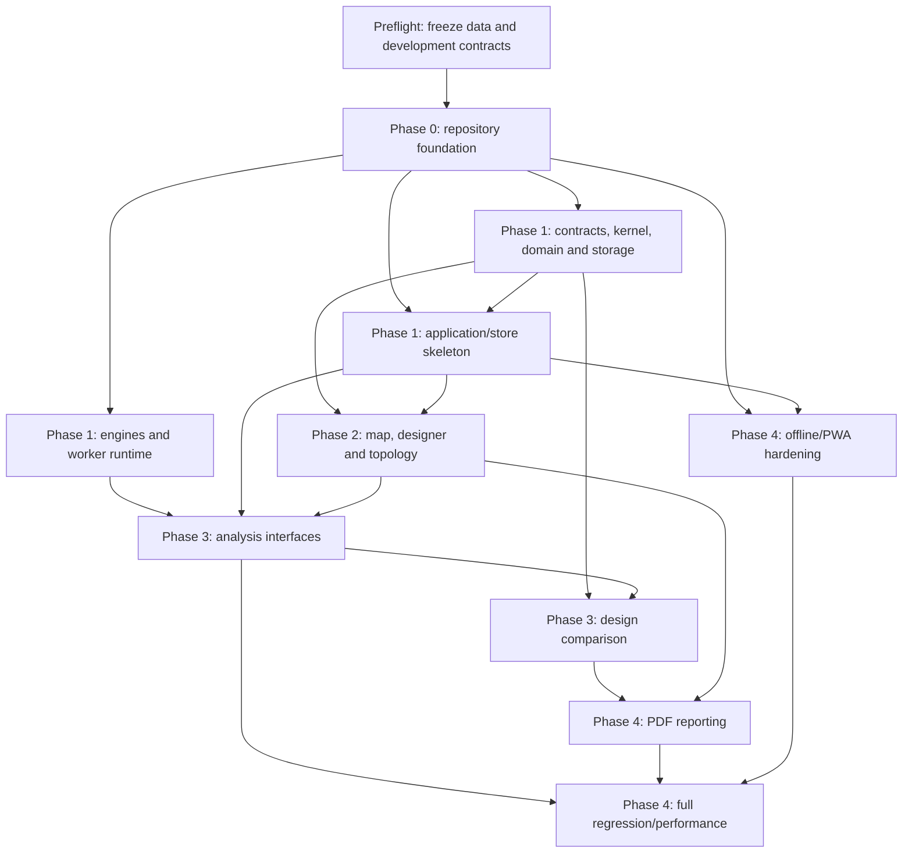

# NetScape — Development Roadmap

**Document:** `DEVELOPMENT_ROADMAP.md`  
**Product:** NetScape — Smart Map-Based Network Infrastructure Planning Platform  
**Project type:** College Data Communication and Computer Networks (DCCN) project  
**Roadmap baseline:** MVP v1.2  
**Planning horizon:** 14 weeks (the original project plan's estimate; adjust to the actual college deadline without changing phase gates)  
**Team structure:** Maximum five Antigravity agents, including one integration lead  
**Status:** Frozen implementation roadmap; preflight P-01–P-06 complete 2026-11-04

---

## 0. Document Authority and Reading Order

This roadmap turns the approved product and architecture specifications into an ordered implementation plan. It does not redefine the product, technology stack, domain model or algorithms.

Use these documents in this order:

1. `SYSTEM_ARCHITECTURE.md` — authoritative system behaviour, architecture, data flow, storage, workers, technical defaults and acceptance gates.
2. `UI_UX_SPECIFICATION.md` — authoritative screen structure, navigation, interaction behaviour and visual system.
3. `DATA_MODEL_AND_CONTRACTS.md` — frozen exact entities, commands, engine inputs/outputs, worker messages, repository APIs and application-service contracts.
4. `DEVELOPMENT_CONTRACTS.md` — frozen import boundaries, ownership rules, branch/merge process, testing gates and contract-change procedure.
5. `DEVELOPMENT_ROADMAP.md` — phase order, milestones, dependencies, gates and delivery schedule.
6. `AGENT_TASKS.md` — agent roles, file ownership, assigned work packages and handoff protocol.
7. `NetScape_Project_Plan_Updated.docx` — original feasibility, DCCN context, long-term concept and original 14-week estimate. Where the later approved architecture explicitly narrowed an MVP feature, the architecture takes precedence.

### 0.1 Conflict rule

- Architecture wins for technical behaviour and MVP boundaries.
- Data contracts win for exact field names, types, enum values, commands and engine/worker payload shapes.
- UI/UX specification wins for visual hierarchy and user interaction where it does not conflict with architecture or data contracts.
- This roadmap wins for implementation order and phase gates.
- No agent may silently reinterpret or expand scope. A contradiction must be raised to the Integration Lead and recorded as a decision before implementation continues.

### 0.2 Preflight status

Preflight P-01 through P-06 is complete for the current baseline. The canonical six documents are frozen for implementation:

- `SYSTEM_ARCHITECTURE.md` v1.3
- `UI_UX_SPECIFICATION.md` (selected first specification, reconciled to architecture v1.3)
- `DATA_MODEL_AND_CONTRACTS.md` v1.2
- `DEVELOPMENT_CONTRACTS.md` v1.2
- `DEVELOPMENT_ROADMAP.md` v1.2
- `AGENT_TASKS.md` (five-agent ownership baseline, amended)

The project owner delegated final preflight reconciliation and Phase 0 preparation on 2026-11-04. Further semantic changes follow the contract-change process; the Phase 0 prompt must not reopen settled defaults or start Phase 1 work.

---

# 1. Product Goal and MVP Definition

## 1.1 Product goal

NetScape is a local-first, desktop-first network infrastructure planning workstation. A user chooses a geographical area, creates a network design on a map, places and connects supported devices, and evaluates the design through IPv4/VLSM, cost estimation, wireless coverage estimation, simplified routing/failure simulation, alternative-design comparison and PDF reporting.

The map and logical topology are two projections of one shared design model. The application must not become a map drawing tool with disconnected calculators beside it: edits to authored network data must consistently drive all relevant views and analyses.

## 1.2 MVP feature list — frozen

The MVP includes:

1. Installable React PWA shell and local-first project workflow.
2. Project creation, local project list, project duplication, multiple designs per project, baseline designation and design duplication.
3. Leaflet map with explicit location search, planning-area context, manual boundary drawing and manual obstacle drawing.
4. Device palette and placement for routers, switches, wireless access points and servers.
5. Wired/wireless link creation, device/link properties, validation, and Star/Tree topology templates.
6. Logical topology view using React Flow, sharing the same device/link identities as the map.
7. IPv4 CIDR calculations and VLSM subnet allocation.
8. Editable local device catalogue with clearly labelled sample prices.
9. CAPEX, annual OPEX and TCO estimates in INR using project-level assumptions.
10. Coverage v1: log-distance propagation, best-server RSSI, fixed wall-loss crossings for manual project obstacles, grid heatmap, coverage percentage and dead-zone identification.
11. Simplified network simulation: undirected graph, Dijkstra routing, configured flows, node/link failure scenarios, reachability, paths, latency and throughput estimates within the approved model.
12. Manual analysis runs by default, stale-result indicators and cache-aware analysis coordination.
13. Design comparison using structure and latest available analysis records.
14. Basic on-demand PDF report with schematic geographical/logical figures and available stored analysis records.
15. Offline editing of previously saved projects and local execution of coverage/simulation after the application has loaded and the service worker has installed.
16. Project duplication as an independent local deep copy with ID/reference remapping and no copied analysis cache.
17. Tests for mathematical engines, domain commands, storage, worker integration and end-to-end user flows.

## 1.3 Explicitly out of scope for the MVP

Do not implement, create placeholder routes for, or spend time scaffolding:

- Authentication, user accounts, roles or profiles.
- Cloud storage, cloud backup, collaboration, sharing or project sync.
- FastAPI, PostgreSQL or PostGIS.
- OSM building import / Overpass integration.
- Terrain/elevation, diffraction, multi-floor or 3D propagation.
- Automatic AP placement, network optimisation or automatic design recommendations.
- SINR/interference, channel assignment, advanced capacity estimation or Monte Carlo shadow fading.
- ns-3 or packet-level simulation, animated packets, TCP/UDP modelling, protocol-level OSPF/RIP implementations or failure prediction.
- IPv6.
- Undo/redo.
- JSON project import/export.
- Offline map region downloads or app-managed bulk tile caching.
- Live vendor price/procurement integration.
- Basemap screenshots in PDF reports.
- User-defined themes, light mode or internationalisation.

A feature is not part of the MVP merely because it appears in an earlier brainstorming document or in an optional library.

---

# 2. Locked Technical Baseline

The roadmap assumes the following stack. Do not change it during implementation without a documented technical case and approval from the project owner.

| Area | Locked choice | Responsibility |
|---|---|---|
| Runtime and package manager | Node.js 24 LTS, npm | Build and test environment |
| Frontend/build | React, TypeScript, Vite | Client application |
| Navigation | React Router with `createHashRouter` | Route tree and offline/static-host-compatible navigation |
| Styling/components | Tailwind CSS, shadcn/ui | Visual system and reusable UI primitives |
| Icons | Lucide React | Consistent product icons |
| UI state | Zustand | Transient UI state and disposable design projection only |
| Map | Leaflet, React-Leaflet, Leaflet-Geoman Free | Geographical rendering and boundary/obstacle drawing gestures |
| Logical graph UI | React Flow (`@xyflow/react`) | Logical topology rendering and layout gestures |
| Geospatial utilities | Turf.js and proj4 | GeoJSON topology helpers and WGS84/local-metric conversion |
| Charts | Recharts | Analytical chart rendering only |
| Persistence | Dexie / IndexedDB | Sole authority for saved authored data and cached analysis records |
| Background computation | Native Web Workers | Coverage and simulation execution |
| PWA | `vite-plugin-pwa` and Workbox | App-shell precache and update prompt |
| Reports | jsPDF, html2canvas and jsPDF table support where required | Client-side PDF assembly; schematic figures only |
| Tests | Vitest, React Testing Library | Unit, component, contract, integration tests |

Permitted test/tooling additions already allowed by the architecture include `fake-indexeddb`, `jsdom`, Testing Library helpers, ESLint import-boundary tooling, dependency-cruiser and Prettier. Any other runtime dependency requires approval and a written reason.

## 2.1 Non-negotiable architectural rules

1. Dexie/IndexedDB is the only authority for saved authored project/design data.
2. Design writes use **commit-then-project**: validate/apply command → one Dexie transaction → update the Zustand design projection only after the commit succeeds.
3. Zustand is not persisted with its `persist` middleware and must not become a second database.
4. Engineering engines are pure TypeScript. No React, DOM, Dexie, Zustand, network calls, current clock or uncontrolled randomness inside engines.
5. `domain/` and `engines/` remain sibling layers. Neither imports the other.
6. Engines receive metric coordinates/units, not raw longitude/latitude. Geographic conversion occurs in domain input builders using the immutable project-local frame. Turf.js may be used for geometry/topology helpers, but Turf distance/length/area/along helpers must not be used for engineering measurements; use the project metric frame.
7. Stored geographic coordinates use WGS84 / EPSG:4326 as GeoJSON longitude/latitude.
8. Logical React Flow positions are abstract canvas coordinates, distinct from geographic coordinates.
9. Leaflet/React-Leaflet and React Flow are views, not authorities for authored device/link data.
10. Analysis freshness is based on the current input hash, not merely a timestamp or raw revision comparison.
11. Cost and IP calculations are pure synchronous TypeScript functions. Coverage and simulation run in workers.
12. Map and topology changes use the same domain commands and IDs.
13. All modelled cost, coverage, latency and throughput outputs are labelled estimates and expose assumptions.
14. No automatic recalculate-on-every-edit behaviour. Manual runs are the default; optional coverage auto-recalculation is off by default and must not run during a drag gesture.
15. Service workers precache the application shell/static assets only. Do not add an app-managed cache, prefetch or download flow for public OSM tiles.
16. Reports use generated schematic figures, not screenshots of the live Leaflet map.

## 2.2 Key numerical and modelling constraints

Use the exact values and rules in the architecture/data contracts. The current architecture baseline defines these guardrails:

- Maximum 500 devices and 1,000 links per design.
- Maximum 100 access points in a coverage run.
- Maximum 1,000,000 coverage grid cells.
- Maximum 5,000 obstacle boundary segments.
- Initial coverage performance target: 250,000 cells × 10 APs × 200 wall segments in under approximately 5 seconds on a mid-range laptop, using spatial pruning. Measure on the target laptop rather than assuming the target has been met.
- Planning extent guard: a local project engineering frame and area limit as specified by the architecture; do not substitute Leaflet/Web Mercator measurements.
- Coverage v1 default grid resolution: 5 m.
- Default simulation demand assumption: 5 Mbps per configured host, visibly labelled and configurable through approved project settings.
- Default simulation graph: undirected; Dijkstra uses non-negative routing weights, default 1 per hop.
- Link geometry: straight endpoint-to-endpoint lines in the MVP; engineering length is derived in the project-local metric frame.

---

# 3. Delivery Strategy

## 3.1 Phase overview

The implementation follows the architecture's five delivery phases. The suggested 14-week schedule is mapped onto these phases in Section 4.

| Phase | Name | Main outcome | Exit gate |
|---|---|---|---|
| P — Preflight | Contract and ownership freeze | Required companion specifications, agent ownership and task boundaries are complete | **Passed 2026-11-04**; frozen baselines are listed in §0.2 |
| 0 | Foundations | Reproducible repository, toolchain, shared contracts, kernel skeleton, test vectors and repository fake | Clean install, typecheck, lint, tests, dependency boundaries and production build pass |
| 1 | Parallel cores | Storage, domain, engines and worker infrastructure implemented independently and tested | Core package tests and shared vectors pass in isolation |
| 2 | Application and UI shells | Project workflow, map editor, designer, topology and autosave vertical slice | Create → edit → connect → reload → same data restored |
| 3 | Analysis UIs | VLSM, cost, coverage, simulation and design comparison usable end-to-end | Each analysis scenario is integrated, tested, labelled and freshness-aware |
| 4 | Reporting and hardening | PDF, PWA/offline behaviour, error recovery, performance and demo readiness | Offline checklist, full regression and final acceptance checklist pass |

## 3.2 Critical path

The critical path is:

`Preflight contracts (complete) → Phase 0 foundation → Phase 1 shared domain/persistence contracts → project/design session → map/design vertical slice → analysis coordinator + engine contracts → coverage/simulation UIs → comparison/reporting → offline and final regression`.

Work outside this path may proceed in parallel only when its inputs and public interfaces are frozen. Visual shell work and non-interactive component scaffolding can proceed earlier; agents must not invent substitute domain records or worker payloads.

## 3.3 Dependency graph



---

# 4. Suggested 14-Week Schedule

The original project plan estimates approximately 14 weeks. This is a planning baseline, not a guarantee. If the actual deadline is shorter, reduce optional polish and report depth before cutting tests, persistence correctness or the working end-to-end slice.

| Week | Phase | Primary focus | Expected checkpoint |
|---:|---|---|---|
| 1 | P | Complete `DATA_MODEL_AND_CONTRACTS.md` and `DEVELOPMENT_CONTRACTS.md`; review the selected UI/UX specification against architecture; resolve open decisions needed for coding | All shared contracts signed off; no agent begins feature implementation on invented types |
| 2 | 0 | Vite/React/TypeScript scaffold; package scripts; routing skeleton; lint/type/test setup; folder structure; CI/check workflow; contracts and kernel skeleton; test fixture/vector format | Fresh clone installs and checks pass; baseline contracts compile |
| 3 | 1 | Domain commands/validation and Dexie schema/repositories; engine input/output scaffolds; worker protocol/runtime skeleton; app services/store skeleton | Storage/domain/engine interfaces compile against the same contracts |
| 4 | 1 | Complete core CRUD, cascades, local frame/input builders, catalog seeding; implement IP/cost core and begin coverage/simulation engine increments | Domain/storage and IP/cost vector tests pass; coverage/simulation test vectors established |
| 5 | 1 → 2 | Finish coverage/simulation pure engine increments and worker runtime; wire `designSession` and `projectService`; begin shell and map workspace integration | Create project and persist one design; engine/worker packages tested independently |
| 6 | 2 | Project list/create/open; map render; boundary/obstacle workflow; device palette and placement; commit-then-project autosave | Boundary/device persistence survives reload |
| 7 | 2 | Link creation on map; inspector; Star/Tree templates; React Flow topology; shared selection and logical layout | Map ↔ topology consistency and map/topology persistence gate pass |
| 8 | 3 | IPv4/CIDR/VLSM UI; cost configuration and breakdown UI; manual calculation and cache/stale states | Known IP/cost vectors and UI integration pass |
| 9 | 3 | Coverage parameters, worker execution, raster transfer/storage, heatmap overlay, dead-zone results and stale-state handling | Coverage integration tests and raster rendering pass |
| 10 | 3 | Simulation flow/scenario setup, worker integration, Dijkstra paths, failure injection, latency/throughput estimates | Simulation vectors and before/after scenario integration pass |
| 11 | 3 | Design duplication, baseline invariant, comparison table/structural diff, missing/stale analysis handling | Independent design records and comparison integration pass |
| 12 | 4 | Report model, schematic renderers, PDF sections/tables/charts, report preview and local download | PDF generates offline without live map tiles; missing/stale analysis is labelled accurately |
| 13 | 4 | PWA app-shell caching, update prompt, offline validation, failure UX, quota/revision/worker recovery, performance profiling | Offline and error-recovery acceptance checklist passes |
| 14 | 4 | Full regression, bug fixes, supported-browser checks, demo dataset/scenario preparation, user walkthrough and final freeze | All MVP acceptance criteria pass; demo can be performed from a clean installation |

### 4.1 Schedule overlap rules

- Phase 1 workstreams may run in parallel only after Phase 0 contracts are frozen.
- Phase 2 UI scaffolding can begin before every engine is complete, but integration must use frozen interfaces and deterministic fixtures.
- Phase 3 addressing/cost UI can start as soon as their pure engines and repository contracts pass; it need not wait for coverage/simulation.
- Coverage and simulation engine work can proceed in parallel, but each worker must use the shared worker protocol.
- Reporting can begin with the report model and schematic figure interfaces before every final chart is complete; PDF acceptance is not passed until the real records and final sections are integrated.
- Week 14 is a protected integration and demo buffer. Do not schedule new features in that week.

---

# 5. Phase Plans and Work Packages

Every work package has one accountable agent. Other agents may contribute through the published interfaces, but may not take ownership of the same files. Exact paths are defined in `AGENT_TASKS.md`.

## P — Preflight: Close the specification gaps

**Status: Complete (P-01 through P-06 passed on 2026-11-04).** This section is retained as the record of the gate, not as pending work.

| Task | Result | Evidence |
|---|---|---|
| P-01 — Canonical files | Passed | The six authoritative Markdown specifications are finalized with canonical filenames. |
| P-02 — Data contracts | Passed | Entities, commands, Dexie schema, repositories, application services, engine/worker contracts, defaults and deterministic vectors are frozen in `DATA_MODEL_AND_CONTRACTS.md` v1.2. |
| P-03 — Development contracts | Passed | Five-agent ownership, import restrictions, change control, branch workflow, testing and integration rules are frozen in `DEVELOPMENT_CONTRACTS.md` v1.2. |
| P-04 — Cross-document reconciliation | Passed | Architecture v1.3, selected UI/UX, roadmap and agent assignments are aligned. |
| P-05 — Defaults and MVP assumptions | Passed | Coverage/cost/simulation defaults, 100% device power duty, sample catalogue, port matrix, installation methods and cost completeness rules are locked. |
| P-06 — Owner sign-off | Passed | Project owner delegated final reconciliation and Phase 0 commencement on 2026-11-04. |

**Exit condition achieved:** no known contract ambiguity blocks repository/toolchain setup, shared code-contract exports, kernel skeleton, normative fixtures or the in-memory repository test seam. Any new semantic change follows `DEVELOPMENT_CONTRACTS.md` §8 and is not part of Phase 0 setup.

## Phase 0 — Foundations (sequential)

**Goal:** Create a reproducible engineering foundation before parallel implementation. Phase 0 is sequential: Agent 1 completes P0-01/P0-02 and passes the scaffold gate; only then does Agent 2 complete P0-03/P0-04. Agents 3–5 review only.

### P0-01 — Repository and toolchain

- Initialize a single Vite + React + TypeScript application using Node 24 LTS and npm.
- Commit `package-lock.json`; do not allow concurrent dependency installation.
- Enable TypeScript strict mode and consistent path aliases if approved in the contracts.
- Add Tailwind and configure shadcn/ui conventions and Lucide icons.
- Configure React Router with `createHashRouter` and the architecture route skeleton.
- Configure Vitest, React Testing Library, jsdom and fake-indexeddb for their respective test layers.
- Configure ESLint, Prettier and dependency/import boundaries.
- Add minimum scripts: `dev`, `build`, `preview`, `typecheck`, `lint`, `test`, `deps:check` and `check`.
- Make `check` run the required static checks and automated tests; production build is a separate required gate and may be included in `check:full`.
- Add a minimal CI workflow if the repository is hosted on GitHub; the same checks must remain runnable locally.

### P0-02 — Target repository structure

Create the architecture-approved structure, including `app/`, `features/`, `application/`, `stores/`, `domain/`, `engines/`, `kernel/`, `contracts/`, `workers/`, `storage/`, `services/`, `components/ui/`, `tests/` and `docs/`. Do not create a monorepo or a separate backend.

### P0-03 — Shared contracts and kernel skeleton

- Add the frozen shared type definitions, constants, branded IDs and typed errors.
- Add small pure kernel primitives needed by both domain and engines.
- Add deterministic ID/clock injection boundaries where specified; do not call clock or randomness from pure engines.
- Add canonical serialization/hash test fixtures; the asynchronous SHA-256 operation belongs to the application hash service, not engines/kernel.
- Add the normative test-vector format and initial fixtures.

### P0-04 — Repository test seam

- Define repository interfaces and a test/in-memory fake that follows the same observable semantics as Dexie repositories.
- The fake is for deterministic application/domain tests; it must not become an alternative production persistence layer.
- Add transaction and commit-failure test fixtures.

Phase 0 does **not** implement the functional map, device designer, VLSM UI, cost UI, coverage, simulation, PDF report, actual Dexie production repositories, cloud/backend code or feature screens. It creates the reproducible foundation and compile-time seams only. Do not start Phase 1 work under a Phase 0 task.

### Exit gate

- `npm ci` succeeds from a clean checkout.
- `npm run typecheck`, `npm run lint`, `npm test`, `npm run deps:check` and `npm run build` succeed.
- Router and application shell boot without feature-specific mock data.
- Shared contracts and vector fixtures compile.
- Dependency boundary checks prevent forbidden imports/cycles.
- No API/backend/database service is required to start the app.

## Phase 1 — Parallel core implementation

**Goal:** Build the pure core and persistence infrastructure independently from the React screens.

### P1-01 — Domain and command layer

- Implement project/design aggregate operations and pure command reducer (`applyCommand`).
- Implement `DesignCommand`, `DesignChangeSet`, validation issues and all required command cascades.
- Implement project-local azimuthal-equidistant frame creation and WGS84 ↔ local metric conversions.
- Implement geographic and logical coordinate separation.
- Implement resolved device specification lookup from catalogue data and permitted overrides.
- Implement topology helpers and deterministic logical-position suggestion/auto-layout as approved.
- Implement coverage/cost/simulation input builders with fully resolved metric inputs.
- Implement comparison-domain functions and structural diff helpers.
- Implement stable dependency-aware input hash construction at the application boundary.
- Add unit tests for invariants, cascades, validation and geographic conversion.

### P1-02 — Dexie storage and repositories

- Implement the `netscape` Dexie database and first migration/version.
- Implement tables and indexes for projects, designs, devices, links, subnets, obstacles, device catalog, analysis cache, analysis blobs, map regions and app metadata.
- Implement transaction-safe repositories and referential integrity; IndexedDB does not enforce foreign keys.
- Implement project creation transaction: project + map region + baseline design.
- Implement design duplication transaction with entity ID remapping and no copied analysis cache.
- Implement baseline invariant, cascade delete and revision checks transactionally.
- Seed built-in catalogue data using stable IDs and versioned upserts; never overwrite user custom entries.
- Keep raster arrays in `analysisBlobs`; never embed large raster arrays in project/design records.
- Implement analysis cache retention/pruning without deleting authored data.
- Implement quota handling and multi-tab/version-change handling.
- Never await unrelated non-Dexie promises inside an open Dexie transaction.

### P1-03 — IP and cost engines

- Implement deterministic IPv4/CIDR validation and calculations.
- Implement VLSM allocation: sort host requirements descending, allocate aligned blocks from the parent range, report unallocated requirements, address wastage and remaining space according to the contract.
- Implement CAPEX, annual OPEX and TCO using supported device, cable/fibre, installation, labour, tax/contingency, energy, maintenance and replacement assumptions from the approved plan/contracts.
- Use project currency (`INR` default) and clearly trace sample-price inputs.
- Implement missing/invalid-input outcomes; do not invent fallback prices.
- Keep engines pure and synchronous.

### P1-04 — Coverage engine

- Implement FSPL reference calculation and approved log-distance path-loss model.
- Implement project-local grid generation/masking inside the planning boundary.
- Implement best-server RSSI selection, configurable classification thresholds and coverage percentage.
- Implement fixed wall/material loss per polygon-boundary crossing using manual project-level obstacles.
- Implement dead-zone output and raster representation within the contract.
- Respect AP, wall, grid-cell and planning-extent limits.
- Add deterministic test vectors and performance benchmark fixtures.

### P1-05 — Simulation engine

- Implement simplified undirected graph construction.
- Implement Dijkstra using non-negative routing weights and stable tie-breaking.
- Implement baseline and failure-scenario rerouting/reachability.
- Implement supported latency components and throughput estimates exactly as the contract specifies.
- Queueing/M/M/1, packet loss and queue stability are deferred from the entire MVP. Label latency only as propagation + transmission + processing; never show queue-derived values.
- Implement deterministic equal-share throughput estimates for active flows sharing links.
- Add vectors for paths, equal-cost ties, failed source/destination, unreachable paths, bottlenecks and congestion.
- Do not implement packet-level simulation, Bellman–Ford, OSPF or RIP unless a later signed architecture change explicitly adds them.

### P1-06 — Worker runtime and client

- Implement the shared typed request/progress/success/failure/cancelled protocol.
- Implement worker client, task/request IDs, protocol version, progress reporting and error serialization.
- Implement cooperative cancellation/yielding and hard-terminate fallback.
- Implement one lazily created coverage worker and one simulation worker.
- Transfer coverage typed-array buffers rather than cloning large rasters.
- Keep workers free of React, DOM, Dexie and Zustand imports.

### Exit gate

- Domain, storage, IP, cost, coverage and simulation tests pass independently.
- Shared test vectors pass in both direct engine tests and worker integration tests where applicable.
- Worker cancellation and stale-result behaviour are tested.
- Storage cascades, design duplication, baseline invariant, cache/blob handling and failed-commit behaviour are tested.
- No engine imports UI, storage or application modules.

## Phase 2 — Application, map and topology vertical slice

**Goal:** Complete the first coherent end-to-end network-design workflow.

### P2-01 — Application services and stores

- Implement `designSession.open`, `dispatch` and `close`.
- Implement serialised per-design commit queue and commit-then-project semantics.
- Implement project service for create/open/rename/delete/duplicate, design duplication, set baseline, project settings and app preferences.
- Implement `editorStore`, `designStore`, `analysisStore` and `prefsStore` with exact write ownership.
- Implement typed design events and a save-state indicator based on actual commit state.
- Implement `analysisCoordinator`: build inputs, hash, cache lookup, choose sync engine vs worker, progress/cancel, stale policy, record/blob persistence and analysis store publication.
- Ensure an old worker result may be cached for its own input hash but never displayed as current.

### P2-02 — Application shell and project flow

- Implement Projects screen, project creation, design list and baseline handling.
- Implement global navigation, project context header, design selector, save/offline indicators, route error boundaries, loading/empty/error states.
- Implement catalog browser/custom catalogue item editor and application/project settings within approved scope.
- Implement explicit location search behind `GeocodingService`; no autocomplete; respect public-provider usage constraints.
- Implement map tile source through `TileSourceConfig` and display attribution.

### P2-03 — Map workspace and network designer

- Implement the canvas-first workspace per `UI_UX_SPECIFICATION.md`.
- Implement Leaflet map rendering and restore map viewport on route return.
- Implement Geoman drawing only for boundary and obstacle polygons. Remove temporary Geoman layers after emitting a domain command; committed geometry re-renders from the design projection.
- Implement manual obstacle editing using the approved material/fixed-loss contract; obstacles are project-level and affect every design in that project.
- Implement the device palette, placement mode, map markers, selection, drag-end commit, and properties inspector.
- Implement two-click map link creation using the same domain command used by React Flow. Geoman is not used for device links.
- Implement supported device/link validation and visible issue states.
- Implement only Star and Tree templates, with preview and a single approved commit path.

### P2-04 — Logical topology

- Render React Flow nodes from devices and edges from links.
- Use device IDs and link IDs as React Flow node/edge IDs.
- Store only abstract logical layout positions in `Design.logicalLayout`.
- Commit node layout once on drag stop.
- Support connect gesture through the same `link/add` command as the map.
- Preserve shared selection across map/topology routes.
- Ensure logical layout-only changes do not invalidate engineering analyses.

### Exit gate — persistence and visual consistency vertical slice

The following must work in a fresh browser profile:

1. Create a project and its baseline design.
2. Search a location when online; handle no result/service unavailable.
3. Draw and commit a boundary.
4. Draw and commit a manual obstacle.
5. Place, inspect, move and delete a device.
6. Create a link on the map.
7. Open topology and see the exact same device/link IDs.
8. Create a link from topology and see it on the map.
9. Change logical layout and reload without moving geographic markers or invalidating analyses.
10. Reload the app and confirm all committed authored data is restored.
11. Simulate a failed Dexie commit and verify the UI does not falsely show the edit as saved.

## Phase 3 — Analysis modules and design comparison

**Goal:** Turn the designed network into a measurable, explainable engineering plan.

### P3-01 — Addressing and VLSM UI

- Implement the parent IPv4 CIDR input and subnet requirement table.
- Support numeric host requirements and optional association to a serving device.
- Implement allocate/recalculate action and deterministic output display.
- Show assigned CIDR, usable capacity, wastage, unallocated entries and remaining space only as provided by the engine contract.
- Persist subnet requirements and approved allocation fields.
- Do not introduce individually placed endpoint nodes, IPv6, unsupported interface-address management or uncontracted VLAN features.

### P3-02 — Cost UI

- Implement catalogue price/specification display and project-level cost assumptions.
- Implement manual “Calculate estimate” / “Recalculate” action through `analysisCoordinator`.
- Show CAPEX, annual OPEX and TCO in INR, line-item breakdown, a restrained chart and assumptions.
- Clearly label seeded catalogue prices as `Sample price` / illustrative placeholder.
- Show missing-price/spec issues rather than inventing a value.
- Preserve the previous complete result with an `Out of date` label if current input hash changes.
- No live supplier quotes or per-design settings overrides.

### P3-03 — Coverage UI and map overlay

- Implement coverage settings in the map workspace right dock, not as a separate route.
- Expose only approved model parameters and limits.
- Invoke the coverage worker through `analysisCoordinator`.
- Show worker-provided progress and Cancel; do not fabricate progress percentages.
- Render a raster/image overlay, not thousands of vector shapes or a point-density heat plugin.
- Show legend, classes/thresholds, coverage percentage, dead-zone summary/list and estimate/model disclaimer.
- Preserve previous result as stale when inputs change; do not show stale output as current.
- Overlay visibility/opacity changes do not rerun the engine.

### P3-04 — Simulation UI

- Implement flow setup and failure-scenario configuration supported by contracts.
- Run explicit baseline and scenario analysis through the simulation worker.
- Show reachability, path/hop list, failed elements, bottleneck, delivered-rate estimate, utilisation and latency components only where computed and contracted.
- Show simplified-model disclaimer and traffic demand assumptions.
- Distinguish unreachable outcomes from application errors.
- Do not animate packets or expose protocol-level routing controls.

### P3-05 — Design duplication and comparison

- Implement design duplication with remapped entity IDs and references; do not duplicate analysis cache records.
- Enforce exactly one baseline per project transactionally.
- Implement comparison of two designs with structural differences and available latest analysis records.
- Show missing/stale results explicitly and provide targeted run actions for the selected design.
- Keep comparison read-only; edits return to the selected design workspace.

### Exit gate

- IP/VLSM and cost vectors pass and the UI consumes only their typed outputs.
- Coverage worker output, progress, cancellation, stale status, raster transfer/storage and image overlay work end-to-end.
- Simulation baseline/failure comparison works against deterministic fixtures.
- Design duplication and comparison preserve independent authored data and baseline invariants.
- All estimates show model/assumption status and correct units.

## Phase 4 — Reporting, offline behaviour and hardening

**Goal:** Complete the demonstrable MVP and protect user-authored data under realistic failures.

### P4-01 — Report model and PDF

- Build a plain `ReportModel` from the selected design, project settings and latest stored analysis records.
- Include cover/summary, project/design overview, device/link tables, schematic geographical figure, logical topology figure, IPv4 plan, cost breakdown, coverage figure/statistics/dead zones, simulation summary/scenarios, assumptions and estimate disclaimers.
- Render schematic figures from domain data using SVG/canvas; do not capture the live Leaflet map or require tiles.
- Use jsPDF and table support for document assembly. html2canvas may rasterise an offscreen report component/chart where needed, not the live map.
- Mark missing analysis as `Not computed` and stale analysis as computed on an earlier design input. Do not silently recalculate inside report generation.
- Support offline PDF generation and local download; no report server or cloud storage.

### P4-02 — PWA and offline behaviour

- Configure app-shell/static-asset precaching and the approved prompt-style service-worker update flow.
- Do not cache user project data through Workbox; it resides in IndexedDB.
- Do not install app-managed OSM tile caching, bulk prefetch or region-download code.
- Verify the app loads and opens saved projects offline after first successful load and service-worker installation.
- Verify map content remains editable over a neutral canvas if tiles are unavailable.
- Verify geocoding is unavailable offline with an accurate explanation.
- Verify coverage and simulation execute locally offline.
- Verify the update banner never forces reload during edits or active computations.

### P4-03 — Failure recovery and data protection

Test and polish:

- IndexedDB unavailable/blocked.
- Quota exceeded with “clear analysis cache” path; never delete authored data automatically.
- Revision conflict/multi-tab conflict.
- Worker crash, cancellation and hard-terminate/recreate path.
- Stale worker response.
- Geocoder rate limit/unavailable/offline.
- Tile provider unavailable.
- Invalid geometry and engine input.
- PDF generation failure.
- Service-worker update available.

### P4-04 — Performance, accessibility and visual polish

- Benchmark the agreed coverage budget on the team's actual target laptop.
- Verify no large coverage raster is stored inline in a design/project record.
- Profile map interaction, topology rendering and large tables at the architecture limits.
- Avoid recalculation during every drag or keystroke.
- Check the UI against the chosen text-only UX specification and locked palette.
- Verify keyboard access to navigation, tool activation/cancellation and forms, focus indicators, labels, error association and reduced-motion support.
- Fix overflow, panel resizing, narrow desktop layouts and empty/loading/error states.

### P4-05 — Release candidate and demonstration

- Run full `npm run check` and production build from a clean checkout.
- Run all unit, contract, integration and end-to-end acceptance checks.
- Verify the app can be installed and works on the target browser.
- Prepare one small, deterministic demo project with a realistic boundary, network devices, links, subnets, catalogue prices, coverage run and at least one failure scenario. Seed/demo data must be visibly labelled and must not be mistaken for user data.
- Rehearse the project creation → network design → analysis → comparison → report flow.
- Freeze the MVP branch and document known limitations honestly.

### Exit gate

All acceptance checks in Section 8 pass. There are no known data-loss defects, broken core routes, failing engine vectors or misleading analysis states. Remaining known issues must be documented and must not invalidate the DCCN demonstration.

---

# 6. Cross-Module Integration Contracts

The following integration rules are mandatory. The detailed type signatures live in `DATA_MODEL_AND_CONTRACTS.md`.

| Concern | Contract |
|---|---|
| Project and design identity | One project contains multiple independent designs and exactly one baseline design. |
| Boundary and obstacles | Boundary and obstacles are project/region-level; obstacles apply to all designs in that project in the MVP. |
| Devices and links | Devices and links belong to a design. Map and topology render the same IDs. |
| Geography | Device location is GeoJSON WGS84 `[longitude, latitude]`; metric calculations use the immutable project-local frame. |
| Logical layout | Abstract canvas coordinates are separate from geographic coordinates; layout-only changes do not stale analysis. |
| Device catalogue | Device stores catalogue reference plus supported sparse overrides; device type is immutable. Built-in items are read-only. |
| Link length | Derive from endpoints in the local metric frame; do not use Leaflet display measurements as engineering length. |
| Persistence | Domain command and validation → Dexie transaction → Zustand projection update. Failed commit leaves the projection unchanged. |
| Analysis cache | Cache key includes engine ID/version and canonical fully resolved inputs. Rasters live in separate blob records. |
| Workers | Coverage and simulation only; common typed protocol; serializable payloads; request IDs; cooperative cancellation; stale-result policy. |
| Cost/IP computation | Pure synchronous engines, invoked through the analysis coordinator/cache path. |
| Reports | Consume saved design and latest stored analysis; missing/stale status is explicit; no live basemap screenshot. |
| External services | Geocoder and tile provider behind service/config boundaries; no project contents leave the browser. |

---

# 7. Testing and Quality Plan

## 7.1 Test layers

| Layer | What to test | Owner |
|---|---|---|
| Pure unit tests | Domain commands, validation, local frame, topology helpers, IP, cost, coverage, simulation, comparison | Owning core/engine agent |
| Contract/vector tests | Exact inputs/outputs, units, tolerances, error cases and deterministic outputs | Core Domain & Persistence Agent maintains vectors; engine/domain owners implement tests |
| Storage tests | Dexie schema/migrations, transactions, cascades, baseline invariant, duplicate ID remapping, cache/blob pruning, quota errors | Core Domain & Persistence Agent |
| Worker tests | Protocol, progress, cancellation, error serialization, transferables and stale outputs | Engineering Engines & Workers Agent |
| Component tests | Main screen states, forms, panel behaviour, table interactions, tool state and accessibility hooks | UI agent owning the feature |
| Integration tests | Project service + repositories + design session + stores + UI; map/topology consistency; analysis coordinator integration | Integration Lead with owning agents |
| End-to-end/manual acceptance | Full MVP journeys, offline workflow, report download and demo rehearsal | Integration Lead; all agents fix assigned failures |

## 7.2 Required mathematical fixtures

At minimum, include known expected results for:

- IPv4 network/prefix, usable host count, block alignment, subnet allocation, insufficient pool and overlap cases.
- Dijkstra shortest path, stable equal-cost tie, no route, failed node, failed link and changed route.
- FSPL and log-distance path-loss calculations with explicit units and tolerance.
- Wall-loss crossing count and RSSI classification boundaries.
- Coverage percentage and dead-zone classification on a small deterministic grid.
- CAPEX, OPEX and TCO including cable slack, power consumption, maintenance and replacement reserve where supported.
- Propagation, transmission and processing latency using the frozen no-queueing MVP model; no M/M/1 queue instability, packet-loss or queue-stability outputs.
- Shared-link equal-share throughput and bottleneck capacity.

The vectors must state units, rounding/quantisation and floating-point tolerances. Do not use screenshots as proof that an algorithm is correct.

## 7.3 Required application journeys

1. Create project → baseline design exists → map opens.
2. Search location online → choose result → map frames to result.
3. Draw boundary → commit → reload → boundary persists.
4. Draw obstacle → commit → reload → obstacle persists and is project-level.
5. Place and move device → commit → reload → same device and position restored.
6. Create link on map → same link appears in topology.
7. Create link in topology → same link appears on map.
8. Change logical layout → persists without invalidating engineering analysis.
9. Edit/delete device/link/obstacle → cascades are correct and failed commits do not update projection.
10. Allocate VLSM → saved allocation and inputs restore.
11. Calculate cost → INR, sample-price provenance and assumptions are shown.
12. Run coverage → progress/cancel/result/raster/staleness states behave correctly.
13. Run simulation → baseline/failure reachability and supported estimate metrics are correct.
14. Duplicate design → independent records, remapped references and baseline invariant remain valid.
15. Compare designs → missing and stale analysis are explicit; targeted runs work.
16. Generate PDF offline → schematic figures included without basemap tiles.
17. Open/edit project offline → editing and local analysis work; geocoder explains unavailable state.
18. Simulate storage quota, revision conflict, worker failure, geocoder failure, tile failure and PDF failure → user-authored data is preserved.

## 7.4 Required repository checks

Minimum scripts:

```text
npm ci
npm run typecheck
npm run lint
npm test
npm run deps:check
npm run build
npm run check
```

The exact underlying command composition is fixed in Phase 0. No agent may mark a phase complete based only on a development server starting.

---

# 8. Definition of Done

A work package is done only when all relevant statements are true:

- Its assigned scope is implemented and matches the frozen architecture and UI specification.
- It uses the shared contracts; no duplicate or incompatible data types were introduced.
- It has tests covering happy path, invalid inputs and relevant failure paths.
- TypeScript strict mode passes without hiding errors behind `any`, broad casts or disabled lint rules.
- It does not violate module import boundaries or create circular dependencies.
- It has been reviewed and integrated by the Integration Lead.
- The relevant phase acceptance gate passes.
- The agent reports exact changed files, tests run, command results, known limitations and any contract-change request.

A screen that merely renders, a calculation that has no test vectors, or a save operation that only updates Zustand is **not done**.

---

# 9. Risk Register and Mitigations

| Risk | Likelihood / impact | Mitigation | Owner |
|---|---|---|---|
| Agents invent inconsistent entity shapes | High / high | Freeze data contracts before parallel implementation; only one contract owner; changes require approval | Integration Lead + Core Domain Agent |
| Dexie and Zustand diverge | Medium / critical | Enforce commit-then-project; test failed transactions and reload | Core Domain Agent + Integration Lead |
| Map and topology represent different networks | Medium / critical | Shared IDs and command path; no independently authored React Flow edges | Workspace UI Agent + Integration Lead |
| Geographic/Web Mercator measurement errors | Medium / high | Project-local metric frame; forbid Turf geodesic/display ruler for engineering calculations | Core Domain Agent |
| Coverage exceeds laptop budget | Medium / high | Grid/AP/wall caps, spatial pruning, worker execution, benchmark early | Engines/Workers Agent |
| Simulation UI implies packet-level fidelity | Medium / high | Use approved simplified model and explicit assumptions; no packet animation | Engines/Workers + Analysis UI Agent |
| Analysis result shown as current after edits | Medium / critical | Canonical input hash, stale policy, tests with design mutation during worker run | Integration Lead + Engines/Workers Agent |
| Local storage quota/data loss | Medium / critical | Evict only derived cache; never auto-delete authored data; test quota path | Core Domain Agent |
| Public map/geocoder policies misunderstood | Medium / high | Adapter boundary, explicit Nominatim search, no autocomplete/bulk requests, no OSM tile prefetch | Integration Lead |
| UI scope expands into deferred features | High / medium | MVP scope freeze, no stub routes, roadmap change control | Project Owner + Integration Lead |
| PDF fails due to live Leaflet canvas/CORS | Medium / medium | Schematic SVG/canvas renderer; no live map screenshot | Analysis UI/Reporting Agent |
| Parallel work creates merge churn | High / high | Five agents maximum, disjoint ownership, one integrator, contract-first handoffs | Integration Lead |

---

# 10. Scope and Change Control

- The MVP scope in Section 1.2 is frozen.
- Any new feature, runtime dependency, data-model field, command, worker task or architectural layer requires a written change request.
- A change request must state: problem, user value, proposed change, files/contracts affected, estimate, risks, test impact and which existing MVP work it displaces.
- The Integration Lead checks architectural consistency; the project owner makes the final product/scope decision.
- Approved changes are recorded in the relevant contract and, if architectural, an ADR. The roadmap and agent tasks are updated before implementation.
- Deferred features stay deferred; do not create placeholder UI or speculative abstractions for them.

---

# 11. Final Release Acceptance Checklist

The MVP can be called complete only when the project owner can verify all of the following:

### Product workflow

- [ ] Fresh application opens to Projects.
- [ ] User can create/open/rename/delete local projects.
- [ ] New project creates a baseline design transactionally.
- [ ] User can draw/edit a planning boundary and manual obstacles.
- [ ] User can add routers, switches, APs and servers from the local catalogue.
- [ ] User can create/edit/delete supported wired/wireless links.
- [ ] Star and Tree templates work within the approved contract.
- [ ] Map and topology show the same devices/links and share selection.
- [ ] Project/design changes persist after reload.

### DCCN analysis

- [ ] IPv4/CIDR/VLSM works against known vectors.
- [ ] CAPEX/OPEX/TCO works and uses INR/sample-price labels.
- [ ] Coverage v1 produces a labelled estimate, heatmap, coverage percentage and dead zones using configured APs and manual obstacles.
- [ ] Dijkstra simulation and failure scenarios produce deterministic path/reachability and supported latency/throughput estimates.
- [ ] Analysis results correctly show Current/Out of date/Failed/Cancelled states.
- [ ] No output is falsely presented as a measurement or packet-level simulation.

### Comparison and reporting

- [ ] Design duplication remaps identities and preserves the single-baseline invariant.
- [ ] Two designs can be compared using structure and available analyses.
- [ ] Missing/stale analysis is labelled rather than hidden.
- [ ] PDF is downloadable and contains schematic figures, tables, assumptions and estimate disclaimers.

### Offline, reliability and quality

- [ ] Saved projects open and edit offline after first app load/service-worker installation.
- [ ] Coverage and simulation run offline.
- [ ] Geocoder and basemap-unavailable states are honest and non-blocking to local work.
- [ ] No app-managed bulk OSM tile caching/prefetch exists.
- [ ] Quota, commit conflict, worker failure and PDF failure paths preserve authored data.
- [ ] Fresh clone passes all required checks and production build.
- [ ] UI matches the selected `UI_UX_SPECIFICATION.md` and locked palette.
- [ ] Demo flow has been rehearsed and known limitations are documented.

---

## 12. Roadmap Completion Statement

This roadmap defines a single-repository, browser-only MVP delivered through one sequential foundation phase followed by controlled parallel core, workspace, analysis and hardening phases. It deliberately limits the team to five agents and makes one agent accountable for integration. The first implementation task is not to build a screen: it is to finish and freeze the data and development contracts so every subsequent agent works against the same system.
