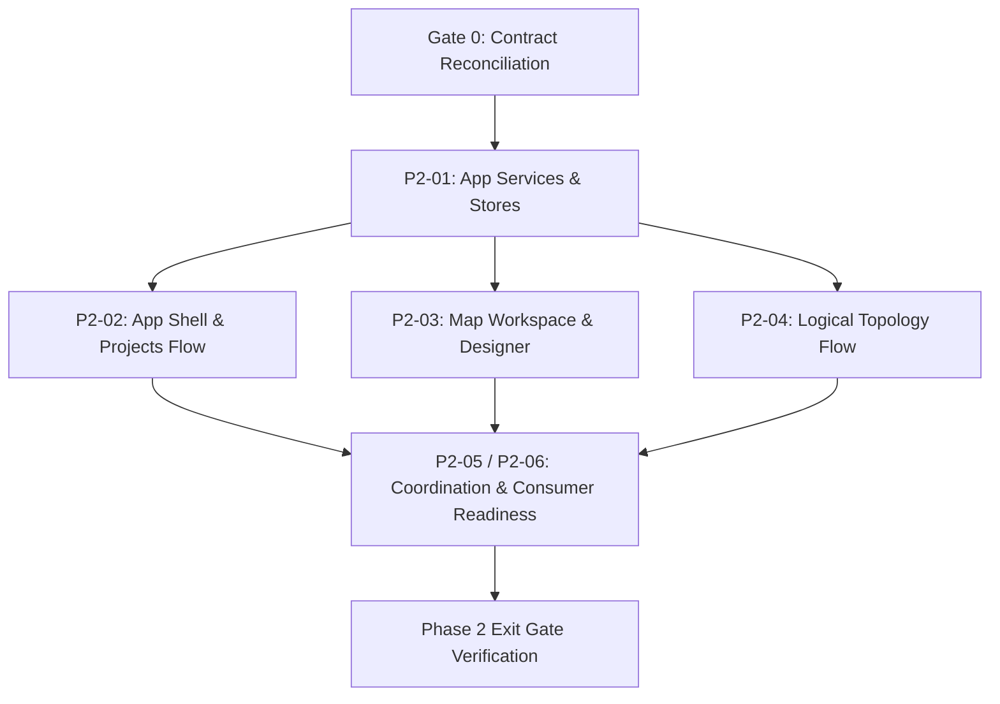

# NetScape — Phase 2 Execution Plan
**Application, Map and Topology Vertical Slice**

**Document:** `docs/PHASE_2_EXECUTION_PLAN.md`  
**Phase:** 2 — Application, Map and Topology Vertical Slice  
**Authority:** Agent 1 (Integration Lead / Platform Engineer)  
**Date:** 2026-11-04  
**Starting Commit:** `10488de` on branch `integration`  

---

## 1. Executive Summary & Vertical Slice Goals

Phase 2 transitions NetScape from the pure domain, persistence, and engine foundations delivered in Phase 1 into a persistent, visual network planning workstation.

The target user journey delivers 11 integrated workflow capabilities:
1. **Projects View:** Open NetScape and view locally saved projects from IndexedDB.
2. **Atomic Project Creation:** Create a project with one map region, immutable project frame, copied default settings, and exactly one baseline design.
3. **Map Workspace:** Open the design's map workspace with canvas-first design ergonomics.
4. **Resilient Place Search:** Search locations online using Nominatim (1 req/sec guard, client cache, fallback to neutral canvas when offline or tiles fail).
5. **Planning Boundary & Obstacles:** Draw planning boundaries and manual obstacles via Geoman; immediately discard temporary drawing layers upon command dispatch and render declaratively from committed projection.
6. **Device Management:** Place, inspect, move, and delete supported network devices (router, switch, access point, server) with catalogue-backed specifications.
7. **Two-Click Link Creation:** Connect devices on the map via a two-click link creation workflow emitting `link/add`.
8. **Logical Topology View:** Seamlessly switch to `@xyflow/react` logical topology view displaying the exact same devices and links with matching IDs.
9. **Bi-directional Link Creation:** Connect devices in the topology canvas and see links appear immediately on the map.
10. **Independent Logical Layout:** Adjust logical topology node positions without altering geographic coordinates or invalidating engineering analysis hashes.
11. **Total Local Persistence:** Reload the application in a fresh browser session and recover all committed authored changes from IndexedDB.

---

## 2. Core Architectural & Contract Invariants

1. **Commit-Then-Project Pattern:**
   The UI never updates authored state optimistically. All user actions dispatch domain commands through `DesignSession.dispatch`. The command is validated by `applyCommand`, written to Dexie IndexedDB in an atomic transaction, and only then projected into the Zustand `designStore`.
2. **Dexie Authority:**
   IndexedDB is the sole source of truth for authored data (`projects`, `mapRegions`, `obstacles`, `designs`, `devices`, `links`, `subnets`, `deviceCatalog`).
3. **Renderers are Gesture Surfaces Only:**
   Neither Leaflet nor React Flow hold authoritative state. They read from Zustand projections and emit user gestures. Temporary interaction artifacts (e.g. Geoman draw layers) are cleared immediately upon command generation.
4. **Coordinate Space Separation:**
   - Geographic coordinates are WGS84 GeoJSON (`[longitude, latitude]`).
   - Project metric coordinates (`x, y` in meters) are derived relative to the immutable `ProjectFrame` origin.
   - Logical topology coordinates (`x, y` in canvas pixels) are stored in `Design.logicalLayout` (`LogicalPoint`). Logical moves never alter geographic positions or analysis hashes.
5. **Online Search Compliance:**
   Nominatim queries are limited to 1 request per second with an in-memory client cache. If offline or geocoding fails, editing proceeds uninterrupted on a neutral grid canvas.

---

## 3. Work Breakdown & Implementation Packages



### Stage A: Gate 0 Reconciliation (Agent 1 & Agent 2) — COMPLETED
- Reconciled 11 Dexie table names against `DATA_MODEL_AND_CONTRACTS.md §9.2`.
- Enforced `LINK_LIMIT_EXCEEDED` (1000 links) alongside `DEVICE_LIMIT_EXCEEDED` (500 devices) in `applyCommand.ts`.
- Reinforced 20,000 m planning extent guard in `buildCoverageEngineInput` and `coverageEngine.ts`.
- Verified catalog seed integrity and provenance.
- Recorded in `docs/PHASE_2_GATE_0_AUDIT.md`.

### Stage B: P2-01 — Application Services & Stores (Agent 1)
- **`DesignSession` (`src/application/session/DesignSession.ts`):**
  - Serialized command queue per design to eliminate race conditions.
  - Lifecycle: `open(designId)`, `dispatch(command)`, `close()`.
  - Transactional commit to Dexie via `IDesignRepository`.
  - Event emitter for session lifecycle: `opened`, `committed`, `closed`, `rejected`.
  - Error handling with structured `ValidationIssue[]`.
- **`ProjectService` (`src/application/services/ProjectService.ts`):**
  - Atomic `createProject`: creates project, region, immutable frame, default settings copy, and baseline design.
  - `duplicateProject`: deep copy with full ID remapping, preserving exactly one baseline, omitting analysis blobs.
  - `renameProject`, `deleteProject`, `updateSettings`, `setRegion`.
- **Zustand Application Stores:**
  - `designStore`: holds current committed `DesignAggregate`, save status (`saved`, `saving`, `error`), revision.
  - `editorStore`: active tool (`select`, `pan`, `place-device`, `connect-link`, `draw-boundary`, `draw-obstacle`), selection state, draft link endpoints, map viewport.
  - `analysisStore`: current analysis records, input hashes, calculation states (`idle`, `computing`, `stale`, `error`), progress.
  - `prefsStore`: app preferences (`autoRecalculateCoverage`, distance/area display units).
- **`AnalysisCoordinator` (`src/application/coordinator/AnalysisCoordinator.ts`):**
  - Ingestion of design commit events.
  - Input builder dispatch and input hashing (`computeInputHash`).
  - Cache lookup in `IAnalysisRepository`.
  - Synchronous execution for IP & Cost; native Web Worker execution for Coverage & Simulation.
  - Freshness policy: obsolete worker runs discarded; results saved with matching input hash.

### Stage C: UI Scaffolding & Feature Slices

#### Step 1: Toolchain & Dependency Installation (Agent 1)
- Install:
  - `leaflet` + `@types/leaflet`
  - `@geoman-io/leaflet-geoman-free`
  - `@xyflow/react`

#### Step 2: P2-02 — Application Shell & Project Flow (Agent 1)
- **Projects Screen:** Real IndexedDB project list, project card metadata (last opened, device count, design count), project create modal, project delete confirmation.
- **Project Header & Global Nav:** Project context title, design switcher dropdown, save indicator badge (`Saved to browser` / `Saving...`), view switcher pills (`Map`, `Topology`, `Settings`).
- **Settings & Preferences Panes:** Project settings modal, currency/cable pricing inspection, app preferences toggle.
- **Geocoding Service:** Online Nominatim client with 1 req/sec token bucket, cache, error toast, offline fallback.
- **Map Tile Source Configuration:** OpenStreetMap standard raster source + neutral offline canvas layer with proper attribution.

#### Step 3: P2-03 — Map Workspace & Network Designer (Agent 3)
- **Canvas-first Workspace:** Leaflet map container filling viewport, zoom controls, attribution.
- **Viewport Persistence:** Map center and zoom saved to `editorStore` and restored across navigation.
- **Geoman Boundary & Obstacle Drawing:**
  - Boundary polygon drawing: immediate layer purge on finish -> emit `region/setBoundary` -> render from store.
  - Obstacle polygon drawing: modal to pick material (`glass`, `drywall`, `brick`, `concrete`) -> emit `obstacle/add` -> render from store.
- **Device Palette & Placement:**
  - Palette floating dock with 4 types: Router, Switch, Access Point, Server.
  - Click-to-place gesture on canvas -> emit `device/add`.
  - Device marker icons with selection ring.
  - Device drag-and-drop: updates position on `dragend` -> emits `device/move`.
  - Device properties inspector panel: name, hostname, catalogue specs, overrides, delete button (`device/delete`).
- **Two-Click Link Creation:**
  - Connect tool: click source device -> temporary rubber-band line -> click target device -> emit `link/add`.
  - Link rendering: LineString connecting devices; click to inspect and select medium (`copper` / `fiber` / `wireless`) or delete.
- **Topology Templates:** Star and Tree template previews and atomic application.

#### Step 4: P2-04 — Logical Topology (Agent 3)
- **React Flow Canvas:** `@xyflow/react` integration under the `Topology` route.
- **Node & Edge Projection:** Nodes mapped from `aggregate.devicesById`, edges mapped from `aggregate.linksById`.
- **Node IDs & Edge IDs:** Exact 1:1 match with `DeviceId` and `LinkId`.
- **Layout Storage:** Abstract logical positions stored in `Design.logicalLayout`. Node drag stop emits `design/updateLayout` (layout-only update, does NOT invalidate analysis hashes).
- **Topology Edge Creation:** Connect handle gesture on nodes emits `link/add` with identical validation and storage impact.
- **Shared Selection:** Selecting a device or link in Topology updates `editorStore.selectedEntityId`, reflected upon returning to Map.

#### Step 5: P2-05 & P2-06 — Consumer Readiness & Integration (Agents 4 & 5)
- Wire `AnalysisCoordinator` to auto-trigger or manual-trigger analyses on design commits.
- Verify engine and worker executions with real aggregates from `DesignSession`.
- Prepare coverage overlay placeholder hooks and addressing panel docking points for Phase 3.

---

## 4. Phase 2 Exit Gate Verification (15 Scenarios)

The Phase 2 exit gate verifies all 11 user journey steps plus resilience scenarios in a fresh browser profile:
1. Open application with empty IndexedDB -> seeds catalogue -> shows empty projects state.
2. Create project with region and baseline design atomically.
3. Search location online via Nominatim -> repositions map; test offline fallback to neutral canvas.
4. Draw and commit planning boundary polygon -> verifies temporary Geoman layer removed and committed boundary renders.
5. Draw manual obstacle with brick material -> verifies obstacle renders across designs.
6. Place router, switch, and access point from palette -> verifies coordinates and catalogue attributes.
7. Drag device to new position -> verifies `device/move` commit and incident link geometry updates.
8. Connect switch to router via map two-click link tool -> verifies LineString creation.
9. Inspect device properties and update name -> verifies persistence.
10. Delete a device -> verifies cascade cleanup of incident links.
11. Navigate to Logical Topology view -> verifies exact same device and link IDs appear on React Flow canvas.
12. Drag topology node -> verifies layout update commits without changing geographic coordinates or invalidating analysis hashes.
13. Connect switch to access point from topology canvas -> switch back to map -> verifies link appears on map.
14. Simulate failed Dexie transaction -> verifies UI save indicator displays error without corrupting projection.
15. Hard refresh browser tab -> verifies every committed change (project, boundary, obstacles, devices, links, layout) restores completely from IndexedDB.

---

## 5. Verification Command Suite

All deliverables must pass the complete check pipeline:
```bash
npm run typecheck    # 0 errors
npm run lint         # 0 warnings/errors
npm run test         # 100% pass across all unit and integration tests
npm run deps:check   # 0 architecture or boundary violations
npm run build        # clean Vite production build
```

