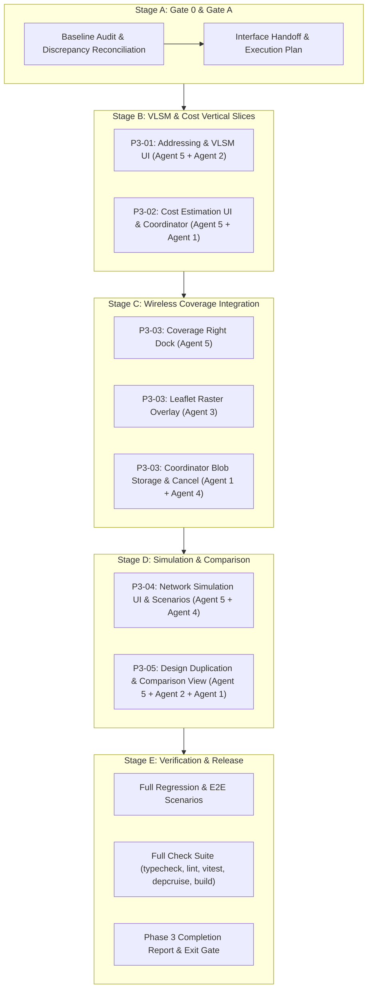

# Phase 3 Execution Plan — Analysis Modules and Design Comparison

**NetScape — Smart Map-Based Network Infrastructure Planning Workstation**  
**Role:** Agent 1 — Integration Lead / Platform Engineer  
**Document:** `docs/PHASE_3_EXECUTION_PLAN.md`  
**Date:** 2026-11-11  
**Status:** Approved & Ready for Execution  

---

## 1. Staged Execution Strategy & Agent Ownership

Phase 3 is executed in five sequential stages (Stage A through Stage E) maintaining strict file ownership:

---

## 2. Work Package Breakdown & Tasks

### Stage B: VLSM & Cost Vertical Slices

#### P3-01: IPv4 Addressing & VLSM Subsystem
- **Accountable Owner:** Agent 5 (UI), Agent 2 (Domain/Storage), Agent 1 (Integration), Agent 4 (Engine Verification).
- **Deliverables:**
  - `src/features/addressing/AddressingView.tsx`: Replace `AddressingPlaceholder`.
  - Top configuration bar: Parent IPv4 CIDR input, canonical validation message, "Allocate addresses" action.
  - Subnet requirements table: Name, hosts required, serving device dropdown (populated from active design's devices), allocated CIDR, usable capacity, wastage, allocation status (`current`, `outOfDate`, `notAllocated`), row actions (edit, delete).
  - Add Subnet modal or inline add row.
  - Right summary rail: Total requested hosts, allocated address space, unused space / wastage, unallocated subnets count with reason tags.
  - Recalculation triggers: Host requirement changes or parent CIDR edits mark existing allocation out of date.
  - Synchronous allocation through `allocateVlsm` pure engine. Persists to Dexie via `addressing/applyAllocation`.
- **Target Tests:** `tests/unit/features/addressing.test.tsx` and integration suite.

#### P3-02: Cost Estimation Subsystem
- **Accountable Owner:** Agent 5 (UI), Agent 1 (AnalysisCoordinator), Agent 2 (Storage), Agent 4 (Engine Verification).
- **Deliverables:**
  - `src/features/cost/CostView.tsx`: Replace `CostPlaceholder`.
  - Three aligned numeric summary headers: CAPEX, Annual OPEX, Total Cost of Ownership (5-year default).
  - Main left area (65%): Grouped line-item table categorized into Hardware, Cabling/Media, Installation/Civil Work, Labour, Energy, Maintenance.
  - Known subtotal vs missing price semantics: Incomplete items display "Not configured / incomplete" without fabricating zero.
  - Right area (35%): Clean SVG distribution bar chart with textual legend, category percentages, assumptions panel (TCO horizon, tariff, duty cycle), and sample-price provenance disclaimer.
  - Explicit "Calculate estimate" action invoking `analysisCoordinator.run("cost", designId)`.
  - Freshness badge: Displays "Current", "Out of date", or "Not calculated".
- **Target Tests:** `tests/unit/features/cost.test.tsx` and integration suite.

---

### Stage C: Wireless Coverage Integration

#### P3-03: Wireless Coverage Dock & Map Raster Overlay
- **Accountable Owner:** Agent 5 (UI Dock), Agent 3 (Leaflet Overlay), Agent 1 (Coordinator/Storage), Agent 4 (Worker).
- **Deliverables:**
  - `src/features/coverage/CoverageDock.tsx`: Collapsible right dock inside `MapWorkspaceView`.
  - Parameters: Path loss model (logDistance), frequency (2400 MHz), reference loss, path loss exponent, grid resolution (5 m default), wall loss per crossing, RSSI thresholds.
  - Execution controls: "Run coverage" button, worker progress indicator (phase + percentage), Cancel button.
  - Results summary: Coverage percentage at minimum acceptable RSSI, area counts per class, dead-zone count and list with selectable focus.
  - Overlay controls: Visibility toggle, opacity slider (0.1 to 1.0), show dead-zones toggle.
  - `MapCanvas.tsx` raster overlay:
    - Generates off-screen `<canvas>` from `AnalysisBlob.rssiDbm` and `CoverageGrid`.
    - Distinguishes mask sentinels: `254` (transparent outside mask) and `255` (inside mask, no serving AP).
    - Renders as `L.imageOverlay` with exact geographic bounds.
    - Cleans up overlay safely on unmount, design switch, worker cancel, or stale state.
  - `AnalysisCoordinator`: Stores `AnalysisBlob` in `repos.analyses.put(record, blob)`.
- **Target Tests:** `tests/unit/features/coverage.test.tsx` and integration suite.

---

### Stage D: Simulation & Comparison

#### P3-04: Network Simulation Subsystem
- **Accountable Owner:** Agent 5 (UI), Agent 1 (Coordinator/Integration), Agent 2 (Storage), Agent 4 (Worker/Engine).
- **Deliverables:**
  - `src/features/simulation/SimulationView.tsx`: Replace `SimulationPlaceholder`.
  - Left rail (28%): Traffic flows setup (source subnet $\rightarrow$ destination server) and failure scenarios configuration (disable devices/links).
  - Center region (48%): "Run simulation" action, baseline vs scenario comparison table, reachability status, offered demand, bottleneck capacity, delivered rate, link utilization.
  - Right rail (24%): Selected flow path details (hop sequence, propagation + transmission + processing latency; queueing noted as null/unmodeled), model assumptions disclosure.
  - Stale state detection: Changes to topology, subnets, or settings flag previous run as "Out of date".
  - Clean cancel and offline execution.
- **Target Tests:** `tests/unit/features/simulation.test.tsx` and integration suite.

#### P3-05: Design Duplication & Comparison View
- **Accountable Owner:** Agent 5 (UI), Agent 1 (Service/Integration), Agent 2 (Domain/Comparison).
- **Deliverables:**
  - `src/features/comparison/ComparisonView.tsx`: Replace `ComparisonPlaceholder`.
  - Dual design selectors for Design A and Design B (enforcing $A \neq B$).
  - Read-only comparison table comparing:
    - Structural differences: Device groups, link groups, total device/link counts (via `computeStructuralDiff`).
    - Engineering metrics: CAPEX, OPEX, TCO, Coverage %, Reachability, Latency, Delivered Rate (via `compareMetric`).
    - Direction indicators: Higher is better, lower is better, informational, or tie.
    - Freshness state for each design: "Current", "Out of date", or "Not calculated", with targeted run action.
- **Target Tests:** `tests/unit/features/comparison.test.tsx` and integration suite.

---

### Stage E: Verification, Acceptance & Release Handoff

#### P3-06: Verification & Exit Gate
- **Accountable Owner:** Agent 1 (Integration Lead).
- **Deliverables:**
  - Comprehensive integration test suite: `tests/integration/phase3Analysis.test.ts` exercising all 20 end-to-end scenarios defined in Section 10.3 of the prompt.
  - Full check suite run: `npm run check:full` (`typecheck`, `lint`, `test`, `deps:check`, `build`).
  - Coverage engine benchmark recording actual runtime on standard fixture.
  - Completion report: `docs/PHASE_3_COMPLETION_REPORT.md` and brain artifact.
