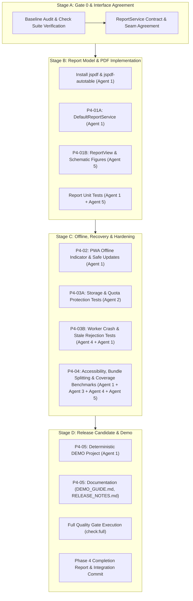

# Phase 4 Execution Plan — Reporting, Offline Behaviour, Hardening and Release Preparation

**Project:** NetScape — Smart Map-Based Network Infrastructure Planning Workstation  
**Phase:** 4 — Reporting, Offline Behaviour, Hardening and Release Preparation  
**Integration Authority:** Agent 1 — Integration Lead / Platform Engineer  
**Document:** `docs/PHASE_4_EXECUTION_PLAN.md`  
**Date:** 2026-11-12  
**Starting Commit:** `39453d0`  
**Status:** Approved for Execution  

---

## 1. Architecture & Execution Strategy

Phase 4 follows a strictly staged integration model, ensuring data protection, contract adherence, and zero feature creep:



---

## 2. Work Package Details & Responsibilities

### Stage B: Report Model Service and PDF Implementation

#### P4-01A: ReportModel Assembly Boundary
- **Owner:** Agent 1 (Integration Lead / Platform Engineer)
- **Files:** `src/application/services/ReportService.ts`, `src/application/container.ts`
- **Contract Interface:**
  ```typescript
  export interface ReportService {
    buildReportModel(projectId: ProjectId, designId: DesignId): Promise<ReportModel>;
    getCoverageBlob(designId: DesignId): Promise<AnalysisBlob | null>;
  }
  ```
- **Operational Rules:**
  1. Reads authored project, region, and design aggregate from Dexie repositories.
  2. Reads latest stored `AnalysisRecord` for cost, coverage, and simulation.
  3. Classifies section freshness using `analysisCoordinator.inspect(designId)` (`"current" | "missing" | "outOfDate"`).
  4. **Strictly never runs calculations** or silently updates analysis records during report building.
  5. Includes standard disclaimer strings and project settings assumptions.
  6. Does not persist `ReportModel` to Dexie.

#### P4-01B: Report Preview & PDF Generation
- **Owner:** Agent 5 (Analysis Experience & Reporting Engineer)
- **Files:** `src/features/reports/ReportView.tsx`, `src/features/reports/components/*`
- **Required Sections in Exact Order (§6 P4-01B):**
  1. Cover and project/design summary (project name, author/date, region center, design name, revision).
  2. Design overview with device table (name, type, catalog item, position) and link table (endpoints, medium, length, capacity).
  3. Schematic geographical figure (project boundary, obstacles, devices, links rendered via canvas/SVG from local metric coordinates; **never Leaflet map screenshots**).
  4. Logical topology figure (rendered from `design.logicalLayout` + devices + links).
  5. IPv4 addressing plan (parent CIDR, allocation status, subnets table with requested vs usable capacity and allocated CIDR).
  6. Cost breakdown and chart (CAPEX, OPEX, 5-year TCO, category breakdown table, SVG/canvas distribution chart, partial estimate labels, illustrative INR disclaimers).
  7. Coverage figure, statistics, and dead-zone list (derived from saved `AnalysisBlob` raster; separated from schematic; clearly labeled if stale or missing).
  8. Simulation baseline and failure-scenario results (flow table, reachability, throughput, latency breakdown, failed links/devices, unmodeled queueing disclosure).
  9. Assumptions, input parameters, and estimate disclaimers.
- **Preview States:** Ready, Partial (missing/stale clearly labeled), Generating (disabled duplicate clicks), Failure (error banner + retry), Offline.

---

### Stage C: Offline, Recovery, Storage Safety, and UX Hardening

#### P4-02: PWA & Offline Behaviour
- **Owner:** Agent 1
- **Files:** `src/pwa/register.ts`, `src/features/shell/AppShell.tsx`, `src/features/shell/UpdatePrompt.tsx`
- **Deliverables:**
  - Online/offline connectivity detection and status badge in the app shell.
  - Non-blocking update-available notification dialog with "Update Now" and "Later" options.
  - Verification that update prompt never triggers during active edits, analysis calculations, or PDF downloads.
  - Confirmed offline routing and editing on neutral canvas when tiles are absent.

#### P4-03: Failure Recovery & Storage Safety
- **Owner:** Agent 1 + Agent 2 + Agent 4
- **Deliverables:**
  - `clearDerivedCache` verification: strictly removes only `analysisCache` and unreferenced `analysisBlobs`; **never** touches authored entities.
  - Quota exceeded and revision conflict handling.
  - Worker crash, timeout, and stale worker result rejection (ensuring stale worker completions are never presented as current).

#### P4-04: Accessibility, Performance & Code Splitting
- **Owner:** Agent 1 + Agent 3 + Agent 5
- **Deliverables:**
  - Route-level lazy loading for `ReportView` and `SimulationView` to optimize chunking without breaking offline precaching.
  - Comprehensive accessibility audit: keyboard focus order, visible outlines, ARIA labels, form field labels, reduced-motion adherence.
  - Coverage engine benchmark execution and realistic larger fixture verification.

---

### Stage D: Release Candidate, Demo Project & Final Acceptance

#### P4-05: Release Package & Demo
- **Owner:** Agent 1 (leading all agents)
- **Deliverables:**
  - Deterministic `DEMO` project fixture in `src/demo/demoProject.ts` loaded on explicit user action.
  - `docs/DEMO_GUIDE.md`: Step-by-step viva presentation script (9-step walkthrough).
  - `docs/RELEASE_NOTES.md`: Comprehensive release notes detailing MVP capabilities, fidelity limits, and system requirements.
  - `docs/PHASE_4_COMPLETION_REPORT.md`: Final completion report and exit gate evidence.
  - Clean execution of `npm run check:full`.
