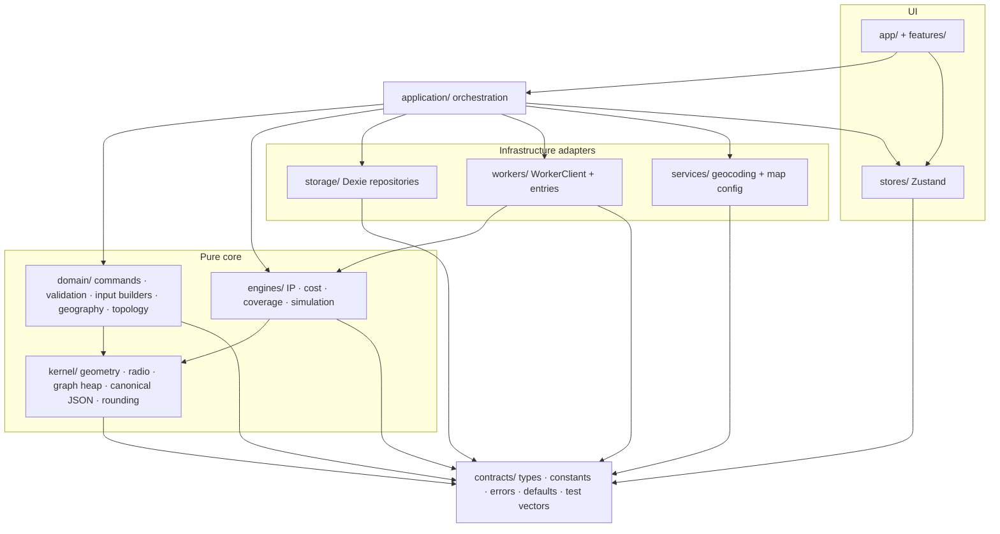
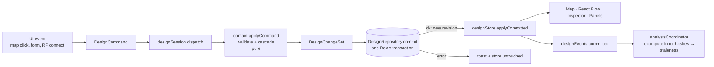
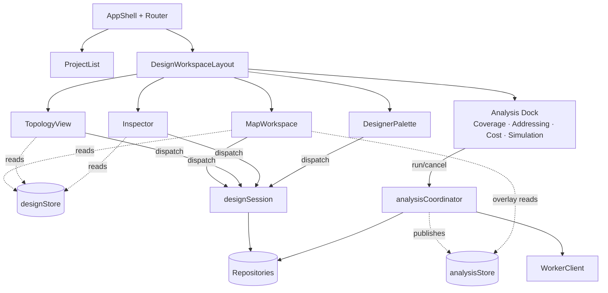
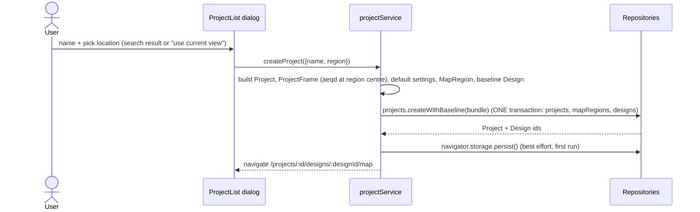
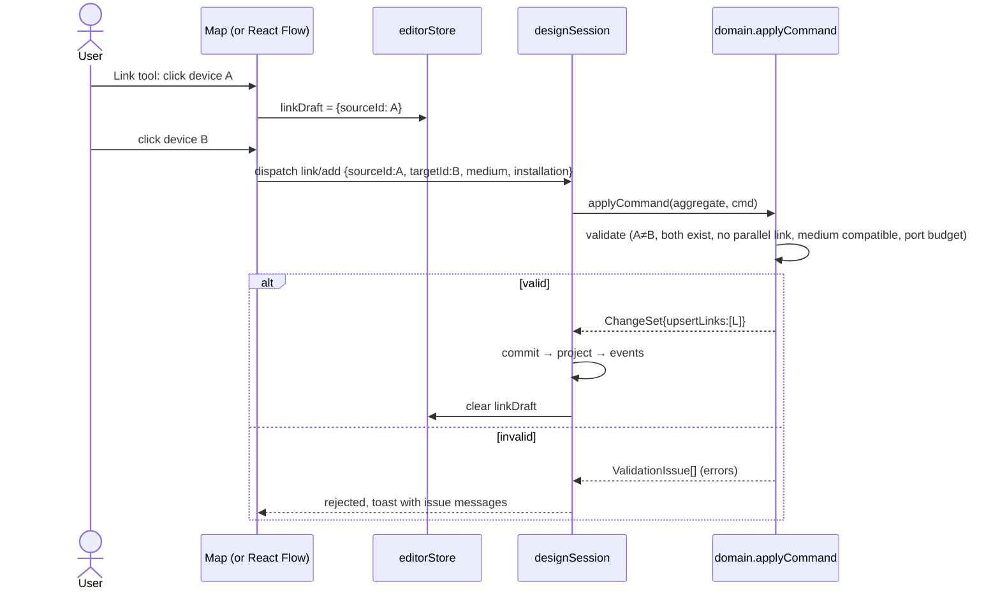
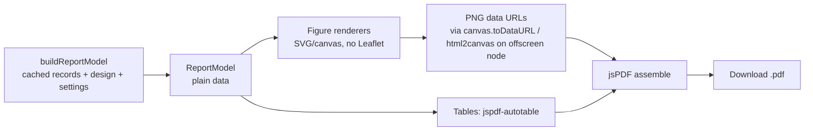

# NetScape — System Architecture

**Status:** MVP architecture baseline v1.3 (frozen implementation baseline)
**Audience:** Project team and AI coding agents (Antigravity)
**Companion specifications:** `DATA_MODEL_AND_CONTRACTS.md` (exact types, database schema, engine and worker contracts) and `DEVELOPMENT_CONTRACTS.md` (file ownership, import rules, agent workflow and integration gates).

> Reading order for agents: this document (system boundaries and behaviour) → `DATA_MODEL_AND_CONTRACTS.md` (exact data shapes and APIs) → `DEVELOPMENT_CONTRACTS.md` (ownership and process).
> Authority: this document owns system behaviour and architecture; `DATA_MODEL_AND_CONTRACTS.md` owns exact shapes; `DEVELOPMENT_CONTRACTS.md` owns development process. Any conflict must be raised and resolved explicitly—agents must not silently choose whichever interpretation is convenient.

---

## 1. Purpose and Scope

NetScape is a **local-first, client-side, single-repository** web application for planning network infrastructure on a map. The MVP runs entirely in the browser with no backend. Authored project data and derived analysis cache data are stored locally in IndexedDB. Coverage and simulation computations run in Web Workers. After the application has been loaded and its service worker installed at least once, users must be able to reopen and edit saved projects offline. Geocoding requires a network connection. Basemap tiles are best-effort and are not an offline capability of the MVP. The original project brief mentions a small cached map area; for this baseline that is a non-blocking stretch item, implementable only with a provider or locally packaged extract whose licence explicitly permits offline use.

### 1.1 MVP in scope

Foundations and local persistence · map workspace · network designer · Star and Tree templates · IPv4 CIDR/VLSM · cost estimation (CAPEX/OPEX/TCO) · Coverage v1 (log-distance, walls) · Dijkstra simulation · basic failure injection · offline editing · basic PDF report · design duplication and comparison.

### 1.2 Explicitly deferred (do not build, do not stub UI for)

Authentication/accounts · cloud sync · FastAPI/PostgreSQL/PostGIS · OSM building import · terrain/elevation-aware coverage · automatic network/AP optimisation · failure prediction · downloadable/offline map regions or tile packages · undo/redo · antenna height / 3-D propagation · IPv6 · packet-level simulation (including ns-3) · dynamic routing protocol implementations such as OSPF/RIP · interference/channel planning and detailed Wi-Fi capacity modelling.

### 1.3 Product outcome

A user selects a real place, defines a planning boundary, places network equipment, connects it, and evaluates the resulting design through subnetting, cost estimation, wireless coverage and simplified routing/failure simulation. The map view and logical topology are two views of one saved design. Results are engineering **estimates** whose assumptions and parameters must be visible. The MVP is a planning and teaching tool—not a network controller, packet capture tool, RF survey instrument or substitute for a licensed site survey.

---

## 2. Architectural Principles

| # | Principle | Consequence |
|---|---|---|
| P1 | **One domain model, many views.** Map and logical topology are two projections of the same `Device`/`Link` records. | No view owns data. React Flow holds *layout only*; Leaflet holds *rendering only*. |
| P2 | **Dexie/IndexedDB is the only authority for saved data.** | Every edit is committed to Dexie first, then projected into Zustand ("commit-then-project"). |
| P3 | **Zustand holds transient UI state and a disposable projection** of the open design. | Never persisted by Zustand. Can be discarded and rebuilt from Dexie at any time. |
| P4 | **Engines are pure TypeScript.** No React, no DOM, no Dexie, no Zustand, no `Date.now`, no `Math.random`. | Engines run identically in Vitest, Node and Web Workers. |
| P5 | **Engines never see longitude/latitude.** They receive metres in a local frame. | Projection happens once, in `domain/inputBuilders`. Web Mercator is never used for measurement. |
| P6 | **Derived data is keyed by an input hash, not by a timestamp.** | Staleness = "current input hash ≠ cached hash". Caches self-invalidate. |
| P7 | **Contracts first.** Types, constants, test vectors and fixtures land before implementations. | Parallel agents never invent shapes. |
| P8 | **External services sit behind interfaces** and fail gracefully offline. | Geocoder, tile configuration and (future) backend are swappable. |
| P9 | **Estimates are labelled estimates.** Every model output carries its parameters and `isEstimate: true`. | Reports and UI never present modelled values as measurements. |
| P10 | **Prefer fewer layers.** A new abstraction needs a concrete second consumer. | Prevents over-engineering for a college-scale project. |

---

## 3. Baseline Design Resolutions

The following decisions resolve cross-cutting design questions so that implementation agents do not need to infer behaviour independently.

| # | Tension | Resolution |
|---|---|---|
| R1 | "Zustand must not be a second database" vs. React needs synchronous, reactive reads of devices/links. | **Commit-then-project.** Commands are validated by pure domain code, committed to Dexie in one transaction, and only then applied to a *read-only projection* in `useDesignStore`. Only `application/designSession` may write that store. |
| R2 | `analysisCache` table vs. `AnalysisResult` entity ("belongs to designs, associated with parameters"). | They are the same thing: `analysisCache` stores `AnalysisRecord` rows (envelope + params + input hash + payload). They are *derived, evictable* data — deleting them loses nothing a user authored. |
| R3 | Large rasters vs. "don't bloat project records". | Raster typed arrays live in a separate table `analysisBlobs` (one row per coverage record). `analysisCache` rows hold only the summary and a blob reference. Project/design/device rows never contain rasters. Old derived records may be pruned using a bounded per-design/per-analysis retention rule; deleting a cache record also deletes its unreferenced blob. |
| R4 | Obstacles belong to *projects*, but changing one affects every design's coverage. | Obstacles stay project-level (matches the original schema). Coverage inputs include the current project obstacle set, so every design's coverage hash changes when those obstacles change. Only analyses whose actual inputs changed become stale; a project revision change alone does not invalidate unrelated analyses. Per-design obstacle toggles are deferred. |
| R5 | Where does the geographic boundary live? | In `MapRegion.boundary` (the project's planning area). `Project.regionId` points to it. One project → one active region in MVP; the table shape allows more later. |
| R6 | Cable/fibre characteristics are required but no `CableCatalogItem` entity is listed. | Cable specs are a **code-level registry** (`CABLE_SPECS`) keyed by `LinkMedium`. Unit prices are overridable in `ProjectSettings.cost.pricing`. Avoids a second catalog table. |
| R7 | Subnets need host counts but end devices are not placeable. | Hosts are **numbers, not nodes**. A `Subnet` carries `hostsRequired` and an optional `servedByDeviceId` (the device its hosts attach through). Simulation demand derives from it. |
| R8 | "All heavy computation in workers" vs. IP/Cost being small and deterministic. | Only **Coverage** and **Simulation** run in workers. IP and Cost engines are synchronous pure functions on the main thread because MVP-sized inputs are small. Uniformity is provided by the `analysisCoordinator`, not by forcing every calculation into a worker. |
| R9 | PDF via html2canvas vs. Leaflet (CSS-transformed tiles, tainted canvases). | Reports do **not** screenshot Leaflet. A dedicated *schematic figure renderer* (SVG/canvas from domain data, no basemap) produces report images. Basemap-in-PDF is excluded from the MVP (see §17). |
| R10 | Devices reference catalog items, but catalog items can change. | Devices store `catalogItemId` + sparse `overrides`. A pure `resolveDevice()` merges them *before* any engine runs. Engine inputs are fully resolved; the input hash therefore changes when catalog values change. Built-in items are immutable; custom items cannot be deleted while referenced. |
| R11 | IndexedDB cannot index booleans, but `Design.isBaseline` exists in the original schema. | `isBaseline` remains a field but is **not indexed**. Exactly-one-baseline-per-project is enforced inside repository transactions. |
| R12 | Link length: stored or derived? | **Derived** from the complete `Link.geometry` LineString after projection into the project local frame (never stored), with an optional user `lengthOverrideM`. The MVP creates a straight endpoint-to-endpoint line; the calculation already supports multiple segments. |
| R13 | Staleness when a design changes during a worker run. | Every request carries a `DesignStamp` (design/project revisions plus input hash). Freshness is decided by the current input hash, not by raw revision equality, because some edits (such as logical layout) do not affect an analysis. Results for old inputs may be cached, but are never presented as current. |
| R14 | Dependency tooling (fake IndexedDB, jsdom, lint boundaries, PDF tables) is not in the locked list. | Allowed as **test/tooling additions** only (§4.2). No runtime framework is replaced or added. |
| R15 | The original MVP mentions a small cached map area, but the default public OSM tile endpoint does not permit offline tile use or prefetch. | Core offline editing is mandatory. A small offline basemap is out of MVP unless a separately approved provider/licence is selected; never download public OSM tiles for offline use. |
| R16 | UI features need VLSM, catalogue, geocoding and tile configuration without importing engines/infrastructure directly. | `AddressingService`, `CatalogService` and `MapWorkspaceService` are application-layer APIs owned by Agent 1. Features call these APIs; they do not import `IpEngine`, Dexie or service adapters. |
| R17 | Project settings/obstacles and catalogue records can affect designs that are not currently open. | Application data-change events trigger hash-only freshness reconciliation across all affected designs. Reconciliation never runs calculations; input hashes alone decide staleness. |
| R18 | The cost formula needs an explicit device power duty ratio. | Fixed `devicePowerDutyRatio = 1.0` (100% continuous nameplate draw) is part of CostEngineInput and CostEstimate assumptions, is included in the input hash and is not user-editable in the MVP. |
| R19 | A college demo needs useful initial catalogue/cost data without implying vendor accuracy. | Seed four generic vendor-neutral built-in sample devices and editable illustrative INR cost assumptions. Clearly label every value as illustrative; no real model/vendor claims or quotes. |
| R20 | Port/installation details require one shared compatibility interpretation. | Accept the contract's copper/fibre/wireless port-capability matrix and wired installation methods (`indoor`, `underground`, `aerial`). An unclassified wired link remains valid authored data but makes its applicable cost estimate partial. |
| R21 | VLSM pool and subnet attachment need precise ownership. | `Design.addressing.parentCidr` is the design-specific parent network. `Subnet.linkId` is an optional same-design informational attachment; it does not force a route and is cleared when the referenced link is deleted. |
| R22 | The MVP simulation needs one consistent fidelity statement. | The MVP models reachability, Dijkstra paths, link-capacity-based throughput estimates, propagation/transmission/processing latency and failure scenarios. It does not model queueing, M/M/1, packet loss or queue stability. |
| R23 | Missing cost inputs must not be mistaken for free inputs. | `null` means unknown/incomplete for an applicable cost line; explicit ₹0 means known zero. `taxRatePct: null` explicitly excludes tax and leaves a complete pre-tax estimate valid. |

---

## 4. Technology Responsibilities

### 4.1 Locked stack — what each technology owns, and what it must not do

| Technology | Owns | Must NOT |
|---|---|---|
| Node 24 LTS, npm | Build/test tooling, lockfile (`package-lock.json`) | Be used at runtime in the browser app |
| React + TS + Vite | UI composition, build, worker bundling (`new Worker(new URL(...), { type: 'module' })`) | Contain engineering logic |
| React Router | Route tree, URL ↔ (project, design, view) | Hold design data; use `createHashRouter` (ADR-012) |
| Tailwind + shadcn/ui + Lucide | Styling, primitives, icons | Be imported by `engines/`, `domain/`, `storage/` |
| Zustand | Editor state, design **projection**, analysis run state, UI prefs | Use `persist` middleware; be written by anything but its owning module |
| Leaflet + React-Leaflet | Map rendering and pointer events | Own device/link/boundary data; compute distances |
| Leaflet-Geoman Free | Drawing/editing **boundary and obstacle** geometry | Own layers after the draw event (see §6.5) |
| React Flow (`@xyflow/react`) | Logical-topology rendering, node dragging, connect gesture | Store geographic coordinates; be treated as authoritative for links |
| Turf.js | Topological helpers on lng/lat (bbox, point-in-polygon, centroid, simplify, geometry validity checks) | Compute **engineering** distances/areas. `@turf/distance`, `@turf/length`, `@turf/area`, `@turf/along` are lint-banned |
| proj4 | The single place lng/lat ⇄ local metres conversion is defined (`domain/geo/localFrame.ts`) | Be called from React components directly |
| Recharts | Charts (cost breakdown, latency/throughput comparison, RSSI histogram) | Compute chart data (selectors/engines do) |
| Dexie + IndexedDB | Persistence, transactions, migrations | Be imported outside `storage/` |
| Native Web Workers | Coverage and Simulation execution | Import React, Zustand, Dexie, DOM APIs |
| vite-plugin-pwa + Workbox | App-shell precache and update prompt | Cache user data or impose an app-managed offline cache on a tile provider whose terms do not permit it |
| jsPDF + html2canvas | PDF assembly; rasterising offscreen HTML/SVG figures | Capture the live Leaflet map |
| Vitest + RTL | Unit, contract, worker, storage and component tests | — |

### 4.2 Permitted additions (tooling/test only, no approval needed)

`fake-indexeddb` (Dexie tests in Node) · `jsdom` and `@testing-library/jest-dom`, `@testing-library/user-event` · `@types/*` packages · ESLint with `eslint-plugin-boundaries` (or `import/no-restricted-paths`) · `dependency-cruiser` (cycle detection) · Prettier · `@geoman-io/leaflet-geoman-free` (the Geoman package itself) · modular `@turf/*` packages · `jspdf-autotable` (a jsPDF plugin; tables are core to the report). These are supporting packages, not reasons to introduce a second runtime framework.

**Anything else** (runtime state library, schema validator such as Zod, graph library, UI kit, date library, ID library) requires a written justification under the contract-change process in `DEVELOPMENT_CONTRACTS.md` §9. The architecture deliberately uses hand-written validators and `crypto.randomUUID()` to avoid them.

---

## 5. Layered Architecture and Module Boundaries

### 5.1 Layers

Dependencies point toward the pure core and public contracts. UI features call application services and read stores; application services orchestrate domain logic, engines, stores and infrastructure adapters. Adapters depend on contracts and only the core modules they actually need. No dependency may point back from the core into UI or infrastructure, and `domain/` and `engines/` remain siblings.



Key rules (full matrix in `DEVELOPMENT_CONTRACTS.md` §3):

- `engines/` and `domain/` are **siblings**. Engines import only `contracts/` and `kernel/`. Domain imports `contracts/`, `kernel/` and proj4/Turf. Neither imports the other. This keeps engines free of lng/lat, and domain free of algorithm implementations. The asynchronous Web Crypto hash operation is an application/infrastructure concern, not an engine or kernel dependency.
- `workers/` imports `engines/`, `contracts/`, `kernel/` only.
- `features/` never imports `storage/`, `workers/` or `services/` directly — only `application/`, `stores/`, `domain/` (pure selectors/helpers) and `contracts/`.
- `stores/` import only `contracts/` (plus pure `domain/` helpers for selectors).

### 5.2 The twelve required modules

| # | Module | Responsibility | Primary locations | Depends on | Exposes |
|---|---|---|---|---|---|
| 1 | **Application shell & navigation** | Router, layout, project list, settings, catalog browser, error boundaries, offline/update banners | `app/`, `features/shell/`, `features/projects/` | application, stores | Route tree, layout slots |
| 2 | **Map workspace** | Leaflet map, search box, boundary/obstacle drawing, device markers, link polylines, coverage overlay, tool modes | `features/map/` | application, stores, domain/geo | `<MapWorkspace/>` |
| 3 | **Network designer** | Device palette, inspector forms, link properties, template wizard, validation panel | `features/designer/` | application, stores | `<DesignerPalette/>`, `<Inspector/>` |
| 4 | **Logical topology** | React Flow view of the same devices/links; layout editing | `features/topology/` | application, stores, domain/topology | `<TopologyView/>` |
| 5 | **IP addressing & subnetting** | Subnet table, VLSM allocation UI, wastage summary; **engine in `engines/ip`** | `engines/ip/`, `features/addressing/` | contracts, kernel | `ipEngine` pure API |
| 6 | **Cost estimation** | Pricing settings UI, estimate panel; **engine in `engines/cost`** | `engines/cost/`, `features/cost/` | contracts, kernel | `costEngine` pure API |
| 7 | **Wireless coverage** | Params UI, overlay controls, dead-zone list; **engine in `engines/coverage`** | `engines/coverage/`, `workers/coverage.worker.ts`, `features/coverage/` | contracts, kernel | `coverageEngine`, worker task `coverage.compute` |
| 8 | **Network simulation** | Flow/failure setup UI, results; **engine in `engines/simulation`** | `engines/simulation/`, `workers/simulation.worker.ts`, `features/simulation/` | contracts, kernel | `simulationEngine`, worker task `simulation.run` |
| 9 | **Reporting** | Schematic figure renderer, PDF composition | `features/reports/` | application, stores, domain | `generateReport(designId)` |
| 10 | **Persistent storage** | Dexie schema, migrations, repositories, seeding | `storage/` | contracts | `Repositories` interface impl |
| 11 | **External data services** | Geocoding, tile source configuration | `services/` | contracts | `GeocodingService`, `TileSourceConfig` |
| 12 | **Web Workers** | Typed protocol, client, cancellation, worker runtime | `workers/` | engines, contracts, kernel | `WorkerClient` |

Cross-cutting: `comparison` (design-vs-design) is a pure function in `domain/comparison` plus UI in `features/comparison/`.

---

### 5.3 Recommended repository layout

Use one repository and one Vite application. Keep the top-level folders aligned with the dependency layers above. This is the target structure; Phase 0 may create only the folders needed initially, but agents must not invent a competing layout.

```text
netscape/
├── docs/
│   ├── SYSTEM_ARCHITECTURE.md
│   ├── DATA_MODEL_AND_CONTRACTS.md
│   └── DEVELOPMENT_CONTRACTS.md
├── public/
│   └── icons/
├── src/
│   ├── app/
│   │   ├── router/
│   │   ├── layout/
│   │   └── providers/
│   ├── features/
│   │   ├── shell/
│   │   ├── projects/
│   │   ├── map/
│   │   ├── designer/
│   │   ├── topology/
│   │   ├── addressing/
│   │   ├── cost/
│   │   ├── coverage/
│   │   ├── simulation/
│   │   ├── comparison/
│   │   └── reports/
│   ├── application/
│   │   ├── designSession/
│   │   ├── analysisCoordinator/
│   │   ├── projectService/
│   │   ├── hashService.ts
│   │   └── events/
│   ├── stores/
│   ├── domain/
│   │   ├── commands/
│   │   ├── validation/
│   │   ├── inputBuilders/
│   │   ├── geo/
│   │   ├── topology/
│   │   ├── catalog/
│   │   └── comparison/
│   ├── engines/
│   │   ├── ip/
│   │   ├── cost/
│   │   ├── coverage/
│   │   └── simulation/
│   ├── kernel/
│   ├── contracts/
│   ├── workers/
│   ├── storage/
│   ├── services/
│   │   ├── geocoding/
│   │   └── maps/
│   ├── components/
│   │   └── ui/
│   ├── hooks/
│   ├── lib/
│   └── main.tsx
├── tests/
│   ├── fixtures/
│   ├── vectors/
│   ├── integration/
│   └── e2e/
├── package.json
├── package-lock.json
├── tsconfig.json
└── vite.config.ts
```

`contracts/` contains shared public types/constants. `kernel/` contains small pure primitives used by both domain and engines. `domain/` converts authored records into validated commands and engine inputs. `engines/` contains algorithms only. `application/` coordinates side effects. `features/` contains React UI. `storage/`, `services/` and `workers/` are infrastructure adapters.

## 6. Core Design Decisions in Detail

### 6.1 Single source of truth and commit-then-project



Properties that follow:

- **Autosave is the default; there is no manual Save button.** Form controls may hold a short-lived local draft while the user is typing. The UI distinguishes `Editing`, `Saving…`, `Saved` and `Save failed`; pending drafts are committed on debounce/blur and flushed before in-app route changes. Only a successful Dexie transaction becomes saved authored data.
- **Commits are serialised** per design through a promise queue in `designSession`, guaranteeing a monotonic revision chain.
- **Optimistic concurrency.** `commit()` receives `baseRevision`; a mismatch (e.g., the same project open in a second tab) throws `REVISION_CONFLICT` and the UI offers "Reload design".
- **High-frequency gestures commit once at the end.** Marker drag → one `device/move` on `dragend`; React Flow node drag → one `layout/set` on `onNodeDragStop`; typing → local component draft, committed on blur or after a 300 ms debounce. Route changes must flush any pending component draft before unmount.
- **Rebuild** of the projection = `designRepository.loadAggregate(designId)` → `designStore.hydrate(...)`.

### 6.2 Three kinds of state

| Kind | Where | Persisted? | Examples |
|---|---|---|---|
| **Authored data** | Dexie (authority) → `designStore` (projection) | Yes | project, region, design, devices, links, subnets, obstacles, logical layout, settings |
| **Derived data** | `analysisCache` + `analysisBlobs` (authority) → `analysisStore` (in-memory) | Yes (evictable) | coverage, simulation, cost results |
| **Transient UI state** | `editorStore`, `analysisStore` run status, component state | No (except tiny prefs in `appMeta`) | selection, active tool, link-draft source, hover, panel layout, task progress, overlay opacity |

### 6.3 Geography vs. logical layout

- **Geographic truth**: `Device.position` is a GeoJSON `Point` in WGS84 `[lng, lat]`. A `Link` stores a GeoJSON `LineString`; its first and last coordinates are kept aligned with its endpoint devices. MVP link creation produces a straight two-point line. Engineering length is derived from every line segment after projection into the project frame, never from Leaflet's display measurement.
- **Logical layout** is `Design.logicalLayout: Record<DeviceId, {x, y}>` in *abstract canvas pixels*. It is a separate field with a different type (`LogicalPoint`, not `GeoPoint`) so the compiler prevents mixing them.
- **Addressing ownership**: `Design.addressing.parentCidr` stores the design-specific IPv4 parent pool for VLSM. `Subnet.linkId` is an optional informational association to a Link in the same design; it does not force routing and is cleared transactionally if that Link is deleted.
- Layout changes do **not** change any analysis input hash (layout is excluded from every input builder). Geographic moves **do**.
- Devices without a layout entry get a deterministic position from `suggestLogicalPosition()` (assigned inside the `device/add` command so the entry always exists after commit).
- React Flow node id = `device.id`; edge id = `link.id`. These identities are the join keys between the two views.

### 6.4 Geographic conventions and the local frame

- Stored coordinates: **WGS84 / EPSG:4326, `[longitude, latitude]`**, GeoJSON geometry.
- Each project has an immutable `ProjectFrame` created with the project: an **azimuthal-equidistant projection centred on the initial region centre** (`+proj=aeqd +lat_0 +lon_0 +datum=WGS84 +units=m`). The local frame is the chosen engineering coordinate system; distortion across the MVP's ≤ 20 km planning extent is accepted as negligible. There is no UTM zone-boundary logic. The frame never changes after creation, even if the user later edits the boundary or map centre.
- Local coordinates: `Vec2 = { x: east metres, y: north metres }`.
- **MVP size guard:** the planning boundary's bounding-box diagonal and the maximum device distance from the project-frame origin must remain within 20 km. Exceeding the limit produces a blocking validation issue (`AREA_TOO_LARGE`) for coverage analysis; the UI may still allow the user to view and edit the project.
- Leaflet's Web Mercator is a *display* CRS only. Leaflet/Geoman-reported lengths and areas are never used for engineering or reports.
- The coverage heat-map is an `L.imageOverlay` positioned by converting the grid's four corners back to lng/lat. At MVP scale the aeqd-vs-Mercator skew is sub-cell and accepted as a display approximation (documented in the overlay tooltip).

### 6.5 Leaflet and Geoman ownership rule

Geoman creates Leaflet layers imperatively. To keep the store authoritative:

1. On `pm:create`, read the temporary layer's GeoJSON, remove that temporary layer from the map, and dispatch a command (`region/setBoundary`, `obstacle/add`).
2. After the commit, the store projection re-renders the geometry through declarative React-Leaflet components.
3. For edit mode (`pm:edit`/`pm:update`), use the same pattern: read GeoJSON, dispatch a command, then re-render from the committed projection. Deletion also dispatches a domain command; a Leaflet layer is never deleted as the only source of truth.

Device markers and link polylines are declarative React-Leaflet components; marker `dragend` dispatches `device/move`. Link creation is a custom two-click tool driven by `editorStore.linkDraft`, not Geoman.

### 6.6 Derived data, hashing and staleness

For each analysis type, `domain/inputBuilders` produces a **fully resolved, metric, ID-bearing engine input**. `kernel/canonicalJson` produces deterministic JSON (sorted object keys, no `undefined`, stable ordering for set-like arrays). The application-level `hashService` (`application/hashService.ts`) then computes SHA-256 with `crypto.subtle`; Web Crypto is not imported by `engines/` or `kernel/`.

```
cacheKey = SHA256(canonicalJson({ engineId, engineVersion, input }))
```

- **Staleness** = `currentInputHash !== latestRecord.inputHash`. The coordinator refreshes hashes for affected analysis types after a committed change. Input builders are scoped so unrelated edits do not stale every analysis (for example, moving a React Flow node does not stale coverage). The UI may retain the previous result, but must label it **Out of date** and must never present it as current.
- **No auto-recalculation by default.** Coverage and simulation run on explicit user action. An optional `autoRecalculateCoverage` preference may trigger coverage after a completed relevant edit; it defaults off and never recalculates during a drag gesture. Cost is calculated on demand through the coordinator/cache path.
- Bumping an `ENGINE_VERSIONS` constant invalidates all older cached results automatically.

### 6.7 Propagation of changes across modules

Consistency comes from **one write path** plus **derived reads**, not from event choreography:

| Change | Cascade performed inside `applyCommand` (same transaction) | Downstream effect |
|---|---|---|
| Remove device | Remove its links; clear `Subnet.servedByDeviceId`; remove its layout entry; remove it from simulation flows/scenarios | Map, React Flow and tables update from the same projection; only analyses whose input changes become stale |
| Remove link | Remove link from failure scenarios; clear `Subnet.linkId` | same |
| Move device (geo) | Update the first/last coordinate of each connected link geometry | Link lengths re-derive; only dependent coverage/cost/simulation inputs change (for example, an AP move affects coverage) |
| Change device overrides / catalog item | none | Only analyses that consume the changed resolved specification become stale (radio, price, power, bandwidth, etc.) |
| Move node (logical) | updates `logicalLayout` only | No analysis impact |
| Change project settings / obstacles / region | `Project.revision++`; publish `projectDataChanged` after commit | `analysisCoordinator` enumerates every design in the project and recomputes only current input hashes; it does not run engines. Unchanged hashes remain current. |
| Change a custom catalogue item | Catalogue record revision/timestamp updates; publish `catalogItemChanged` after commit | Find all devices referencing the item, deduplicate affected design IDs and rehash each design. Only dependent analyses become stale; no calculation is triggered. |

### 6.8 Analysis input dependency matrix

Input builders must include only values that can affect the corresponding result. This is the guard against unnecessary stale results:

| Analysis | Inputs that affect its hash | Explicitly excluded |
|---|---|---|
| Cost | Resolved device prices/power/lifespan, device quantities, link geometry-derived lengths or overrides, cable specs, slack, labour/civil-work rates, tariff, maintenance and currency | Map viewport, logical node positions, coverage raster, simulation flows |
| Coverage | Planning boundary, AP geographic positions and radio specs, project obstacles/material losses, path-loss parameters, frequency, grid resolution and RSSI thresholds | Logical layout, cost prices, simulation flows, non-AP device fields that do not alter obstacles or RF inputs |
| Simulation | Active graph devices and links, routing weights, link capacities/lengths, device/link failure setup, subnet host demand/served-by relationships and traffic/latency assumptions | Map viewport, logical layout, cost prices and coverage raster |
| VLSM | Parent network, subnet names/host requirements and allocation settings | Physical map positions, wireless settings and cost data |

VLSM remains a synchronous pure calculation whose resulting allocations are saved as authored subnet data; it does not need a separate analysis-cache record in the MVP.

### 6.9 Error philosophy

- **Typed errors only** (`NetScapeError` with a `code` from a closed union). Never throw strings.
- Pure engines throw `EngineInputError` only for contract violations; **expected domain outcomes are returned in-band** (e.g., `unallocated[]`, unreachable flows).
- Repositories reject with `StorageError` subtypes. Services reject with `ServiceError`. Workers serialise errors into `failure` messages.
- Validation produces `ValidationIssue[]` with `severity: 'error' | 'warning'`; errors block commits/engine runs, warnings are shown.

### 6.10 MVP modelling boundaries

The engines model only the level of detail needed for the DCCN MVP:

- **Network graph:** devices and links form a simplified connectivity graph. Links are bidirectional in the MVP. A link can be disabled by a failure scenario. Device types provide display/specification information; the simulator does not implement Ethernet switching internals, ARP, VLAN/STP, TCP/UDP, packet retransmission or vendor-specific router configuration.
- **Routing:** Dijkstra finds a minimum-cost path using non-negative `routingWeight` values on links. The default weight is `1` (hop-count behaviour). The model is not an OSPF or RIP implementation. Bellman–Ford is not required in the MVP.
- **Throughput:** a path's raw capacity ceiling is the minimum configured link capacity on that path. When multiple configured flows share a link, the MVP uses a deterministic equal-share estimate among active flows traversing that link. A flow's estimated rate is bounded by its demand and the minimum equal-share capacity along its path. Show offered demand, bottleneck capacity, estimated delivered rate and link utilisation separately. This is an explainable planning estimate, not a real packet scheduler or max-min fairness algorithm.
- **Latency:** MVP latency is the sum of propagation delay (`lengthM / 2 × 10^8 m/s`), transmission delay (configured average packet bits divided by link bit rate) and processing delay (1 ms per intermediate forwarding device by default, or a device-specific value when present). Queueing delay is not modelled. M/M/1, packet loss, retransmission and queue stability are explicitly outside the MVP; do not implement queueing controls or display queue-derived claims.
- **Coverage:** Coverage v1 uses log-distance path loss with configurable exponent and reference loss, optional FSPL reference calculation, and fixed wall loss per polygon-boundary crossing. Shadow fading, interference/SINR, channel assignment, terrain, floors and detailed client-capacity modelling are outside the MVP. The best-server RSSI is the strongest AP at each grid cell.
- **IP:** IPv4 CIDR/VLSM only. Address allocation is based on required host counts, not simulated end-host objects.
- **Cost:** values are estimates based on editable sample prices and project assumptions. No live supplier quote or procurement connection exists.

These boundaries prevent the UI from implying packet-level or field-measured fidelity that the MVP does not provide.

---

## 7. Application Architecture

### 7.1 Route tree (React Router, `createHashRouter`)

| Path | View | Notes |
|---|---|---|
| `/` | Project list (create, open, duplicate, delete) | Recent first (`lastOpenedAt`) |
| `/catalog` | Device catalog browser + custom item editor | Built-ins read-only |
| `/settings` | App prefs (auto-recalc toggle, units display) | `appMeta` |
| `/projects/:projectId` | Redirect → baseline design workspace | |
| `/projects/:projectId/designs` | Design list, duplicate, set baseline, start comparison | |
| `/projects/:projectId/designs/:designId` | **Workspace layout** (palette, inspector, bottom dock) with child routes: | Loads aggregate via `designSession.open` |
| …`/map` | Map view (default) | |
| …`/topology` | React Flow view | |
| …`/addressing` | Subnet/VLSM table | |
| …`/cost` | Cost panel | |
| …`/simulation` | Simulation setup and results | |
| …`/report` | Report preview and "Download PDF" | |
| `/projects/:projectId/compare?a=:designId&b=:designId` | Side-by-side comparison | `a` defaults to baseline |

Coverage controls live in the workspace's right dock as a panel (overlay on the map), not a separate route.
Switching map ↔ topology is a **route change** that unmounts the other view; the map viewport is kept in `editorStore.mapViewport` and restored on remount.

### 7.2 Stores (Zustand) — exact responsibilities

| Store | Contents | Written by |
|---|---|---|
| `editorStore` | `activeTool`, `selection: {deviceIds, linkIds, subnetId?}`, `linkDraft`, `hover`, `mapViewport`, `panelLayout`, `overlay: {showCoverage, opacity, showDeadZones}` | UI event handlers (features) |
| `designStore` | **Projection**: `status`, `project`, `region`, `design`, `devicesById`, `linksById`, `subnetsById`, `obstaclesById`, `catalogById`, `pendingCommits`, `lastSavedAt`, `error` | **Only** `application/designSession` |
| `analysisStore` | per-type `{status, progress, stale, record, raster}`, current input hashes, run errors | **Only** `application/analysisCoordinator` |
| `prefsStore` | Small UI prefs mirrored to `appMeta` (not via Zustand `persist`) | Settings UI via `projectService.setPref` |

### 7.3 Application services (`application/`)

| Service | Responsibility |
|---|---|
| `designSession` | `open(designId)`, `dispatch(cmd)`, `close()`. Owns the commit queue, runs `applyCommand`, calls the repository, updates `designStore`, emits design lifecycle events and project-data-change notifications when required. |
| `projectService` | List/get/open projects and designs; create project (project + region + baseline design in one transaction); duplicate/delete/rename; set baseline; duplicate design; update project settings/region; persist app preferences. |
| `catalogService` | List/read catalogue items; create/update/delete custom items; protect referenced items; emit catalogue-change notifications after successful commits. |
| `mapWorkspaceService` | Feature-facing location search and tile-source configuration; delegates to geocoding/tile adapters behind the application boundary. |
| `addressingService` | Build VLSM input, invoke the synchronous pure IP engine, and persist allocations through `designSession`; no feature imports the IP engine directly. |
| `analysisCoordinator` | Builds inputs, hashes, checks cache, dispatches worker/main-thread runs, handles progress/cancel/stale policy, persists records, publishes `analysisStore`, and reconciles freshness across affected closed/open designs after project/catalogue changes. |
| `applicationDataEvents` | Typed in-process notifications for project-level data and catalogue changes; not a persistent audit log. |
| `designEvents` | Tiny typed emitter (`committed`, `opened`, `closed`). Used by `analysisCoordinator` and the save indicator. |
| `repositories` | Composition root: `getRepositories()` returns the Dexie implementation; tests inject the in-memory fake. |

**Feature-facing application API rule:** `features/addressing` calls `AddressingService`; `features/map` calls `MapWorkspaceService`; catalogue UI calls `CatalogService`. No feature imports `engines/ip`, `storage/`, `workers/` or external service adapters directly. `AddressingService` persists VLSM outcomes through `designSession.dispatch({ type: "addressing/applyAllocation", ... })`.

`ProjectService` also exposes typed `listProjects`, `getProject`, `listDesigns` and `openProject` read operations so feature components never query repositories directly. `CatalogService` exposes list/get/custom-item CRUD; `MapWorkspaceService` exposes explicit `searchLocations` and `getTileSourceConfig`. `AnalysisCoordinator.inspect(designId)` exposes current/missing/out-of-date analysis state without executing calculations. Exact signatures are normative in `DATA_MODEL_AND_CONTRACTS.md` §17.

**Cross-design freshness rule:** `projectService` emits a project-data-change event after settings/region updates; `designSession` emits one after project-level obstacle changes; `catalogService` emits a catalogue-change event after custom catalogue updates. `analysisCoordinator` rehashes all designs affected by the event, including designs not currently open. This is hash reconciliation only, never an implicit cost/coverage/simulation run. The comparison view uses `analysisCoordinator.inspect(designId)` to show `notCalculated`, `current` or `outOfDate` without running engines.

Project duplication is a supported MVP action in the Projects screen. It is implemented as one transaction that deep-copies the project, active map region, project-level obstacles, settings and every design; remaps all owned IDs and internal references; preserves exactly one baseline; retains references to app-wide catalogue records; and does not copy derived analysis records or raster blobs.

### 7.4 Component relationships



---

## 8. Application Data Flow (the 11 required scenarios)

Notation: `designSession.dispatch` = pure `applyCommand` → single Dexie transaction → `designStore` projection → `designEvents`. Every scenario that edits a design ends with that tail; it is abbreviated **[commit]** below.

### 8.1 Creating and saving a project



There is **no manual "Save"**. The header shows a save indicator; "Save" is not a button. Project rename/settings changes commit immediately via `projectService`.

### 8.2 Searching for a location and drawing a boundary

1. User submits the search (on Enter/button — **no as-you-type requests**). `GeocodingService.search(query)` is rate-limited to at most one public Nominatim request per second, supports cancellation, and returns `GeocodeResult[]`. A small client-side query/result cache prevents duplicate requests.
2. Selecting a result flies the map to its bbox. If the project has no boundary, offer "Use this area" which dispatches `region/update {label, center, bbox}`. Region centre changes do **not** move the immutable frame origin.
3. User picks the Geoman polygon tool and draws. On `pm:create` the layer is removed and `region/setBoundary { geometry }` is dispatched. **[commit]** The boundary re-renders declaratively.
4. Validation runs: polygon valid, at least three distinct vertices, no self-intersection, area greater than zero, and planning extent within the 20 km guard.

### 8.3 Placing a device on the map

1. User selects a palette entry (`activeTool = {kind:'place', catalogItemId}`), clicks the map.
2. Handler builds `device/add { catalogItemId, position: [lng, lat] }`. IDs and timestamps are created in `designSession` using injected `IdGenerator`/`Clock` (not inside the pure reducer).
3. `applyCommand`: resolves catalog item → creates `Device` (default name `"Router 3"`) → computes `suggestLogicalPosition` → emits `ChangeSet { upsertDevices, layout }`. A warning `DEVICE_OUTSIDE_BOUNDARY` is produced if outside the region boundary (Turf point-in-polygon; not blocking).
4. **[commit]**. Map marker and React Flow node appear from the same projection. Only analysis types whose resolved input actually depends on the new device become stale (for example, a new AP changes coverage; any priced device changes cost; a new network node changes simulation).

### 8.4 Creating a connection between devices



In React Flow, `onConnect(connection)` dispatches the **identical** command; the edge is rendered only after the commit (edges are derived, never created locally). In the MVP, a newly created map link is a straight `LineString` between its endpoint devices; its engineering length is derived by projecting the line into the project frame and summing segment lengths. If route waypoints are added later, the same calculation naturally sums every segment. A warning `LINK_EXCEEDS_MAX_LENGTH` appears if the derived or overridden length exceeds the cable's `maxLengthM`.

### 8.5 Switching between geographical and logical views

1. Route change `/map` → `/topology`. `MapWorkspace` unmounts after writing its viewport to `editorStore.mapViewport`.
2. `TopologyView` reads `devicesById`, `linksById`, `design.logicalLayout` from `designStore`, derives `nodes`/`edges` with `toFlowNodes/toFlowEdges` (pure, in `domain/topology`).
3. Selection (`editorStore.selection`) is shared, so the selected device stays highlighted.
4. Dragging a node updates *local* React Flow state; `onNodeDragStop` dispatches `layout/set { positions }` → **[commit]** (layout only, no analysis invalidation).
5. "Auto-arrange" dispatches `layout/set` with `computeAutoLayout(design)` (deterministic layered BFS from the highest-degree router).

### 8.6 Modifying device properties

1. Inspector form edits live in local component state; on blur or 300 ms debounce it dispatches `device/update { deviceId, patch }` (`patch` limited to `name`, `hostname`, `notes`, `overrides`, `catalogItemId` — **type is immutable**).
2. Changing `catalogItemId` requires the new item to have the same `DeviceType`; overrides that no longer apply are dropped by the reducer.
3. **[commit]**. If the device is an AP and its radio params changed, coverage becomes stale; if power/price changed, cost becomes stale.

### 8.7 Triggering coverage recalculation

```mermaid
sequenceDiagram
  actor U as User
  participant P as CoveragePanel
  participant AC as analysisCoordinator
  participant IB as inputBuilders
  participant R as AnalysisRepository
  participant WC as WorkerClient
  participant W as coverage.worker
  U->>P: Recalculate
  P->>AC: run('coverage')
  AC->>IB: buildCoverageInput(snapshot)  (projects to metres, resolves specs, walls)
  IB-->>AC: input + validation issues
  AC->>AC: hash = sha256(engineId|version|canonical(input))
  AC->>R: findByHash(designId,'coverage',hash)
  alt cache hit
    R-->>AC: record + blob
    AC->>AC: publish result (no worker)
  else miss
    AC->>WC: request(task 'coverage.compute', stamp)
    WC->>W: postMessage(request)
    loop every ≤ 100 ms
      W-->>WC: progress {fraction, phase}
      WC-->>AC: progress → analysisStore
    end
    W-->>WC: success {output} (+ transfer rssi/serving buffers)
    WC-->>AC: output
    AC->>AC: compare current inputHash with stamp.inputHash
    AC->>R: put record + blob (always, keyed by its own input hash)
    AC->>AC: if input hash still current → publish; otherwise cache only and keep UI marked stale
  end
```

If the user edits the design while a run is in flight, the coordinator marks the in-flight request **superseded**: the new run (if any) cancels it; otherwise its result is cached but not displayed (§9.4).

### 8.8 Generating a cost estimate

1. `analysisCoordinator.run('cost')` → `buildCostInput` (resolved device pricing, wired-link lengths in metres from the local frame, settings) → hash → cache lookup.
2. On miss: `costEngine.estimate(input)` runs **synchronously on the main thread** (no worker).
3. Result stored as `AnalysisRecord(type:'cost')` and published. Recharts reads `CostEstimate.capex.byCategory` etc. from selectors.
4. The cost panel marks "Out of date" when the current hash differs from the stored one.

### 8.9 Running network simulation

1. User configures **flows** (default auto-derived from LAN subnets with `servedByDeviceId`, to every `server`) and **failure scenarios** (`failedDeviceIds`, `failedLinkIds`), stored on `Design.simulationSetup` through `simulation/setup` commands.
2. `run('simulation')` → `buildSimulationInput` → hash → cache lookup → worker task `simulation.run`.
3. Worker computes the baseline outcome and one outcome per scenario, then the deltas (`ScenarioComparison`). It reports progress per scenario.
4. Result published; Recharts compares baseline vs. each scenario (latency, throughput, reachability). Unreachable flows and rerouted paths are listed.

### 8.10 Duplicating a design and comparing with the baseline

1. `projectService.duplicateDesign(designId, name?)` → repository `designs.duplicate()` in **one transaction**: copy design row, remap IDs for devices/links/subnets (old→new map; `logicalLayout`, `simulationSetup`, `Subnet.servedByDeviceId/linkId` remapped), set `parentDesignId`, `isBaseline=false`, `revision=1`. **Analysis cache is not copied** (IDs differ, so hashes differ; recomputation is the correct behaviour).
2. User edits the copy normally.
3. Compare route `/compare?a=<baseline>&b=<copy>`: `comparisonService` reads **latest cached** records for each design (cost, coverage, simulation) and calls pure `compareDesigns(a, b)` from `domain/comparison`. If a record is missing or stale, the UI shows "Run analysis" buttons that invoke the coordinator for that design (a design can be analysed without being open: the coordinator loads its aggregate via the repository).
4. Output: `DesignComparison` (metric table with deltas and better/worse indicators + structural diff of devices/links by catalog item and position) → Recharts.

### 8.11 Opening and editing a previously saved project offline

1. App shell loads from the Workbox precache (service worker active). No network required.
2. `/` lists projects from Dexie. Opening a design calls `designSession.open(designId)` → `loadAggregate()` → `designStore.hydrate()`.
3. Map: the app does not promise cached basemap tiles offline. Without a network/basemap, it shows a neutral background with a "Basemap unavailable offline" badge while continuing to render the planning boundary, devices, links and any locally stored coverage overlay. **All editing remains functional** because no feature depends on fresh tiles or geocoding.
4. Geocoding search is disabled with an explanatory tooltip when `navigator.onLine === false` or the service reports `SERVICE_UNAVAILABLE`.
5. Edits commit to Dexie as usual. Coverage/simulation run in workers offline. PDF generation works offline (schematic figures need no tiles).
6. Service-worker updates use `registerType: 'prompt'`: a banner offers "Update available — Reload", never forcing a reload mid-edit.

---

## 9. Worker Architecture

### 9.1 Topology

| Worker | Entry file | Task kinds | Reason for separation |
|---|---|---|---|
| Coverage | `workers/coverage.worker.ts` | `coverage.compute` | Long, CPU-bound, cancelable. Must not delay a simulation. |
| Simulation | `workers/simulation.worker.ts` | `simulation.run` | Shorter, multi-scenario. Independent cancellation. |

Each worker is a thin file: `createWorkerRuntime(handlers)` from `workers/runtime`, binding the engine function to the protocol. All logic is in `engines/`. One worker instance per kind, **lazily created**, kept alive, recreated after hard-cancel or crash. A `WorkerClient<TTaskMap>` is the only thing UI/application code touches.

### 9.2 Protocol summary (full types in `DATA_MODEL_AND_CONTRACTS.md` §13)

`request {requestId, taskId, kind, payload, stamp}` → `progress {requestId, fraction, phase}`* → `success {requestId, result}` | `failure {requestId, error}` | `cancelled {requestId}`. Control messages: `cancel {requestId}`. Envelope carries `protocolVersion: 1`.

### 9.3 Cancellation

1. **Cooperative (primary):** engines accept a `RunContext { shouldCancel(): boolean; reportProgress(f, phase) }` and are written as **chunked loops** that `await yieldToEventLoop()` at least every ~25 ms (via the runtime's `yieldNow`, a `MessageChannel` tick). This lets the worker process the incoming `cancel` message; the runtime sets the flag; the engine throws `CancelledSignal` at the next check; the runtime replies `cancelled`.
2. **Hard (fallback):** `WorkerClient.cancel()` sends `cancel`, starts a 500 ms timer; if no `cancelled/success/failure` arrives, it calls `worker.terminate()` and creates a fresh worker on next use, rejecting the pending promise with `WORKER_CANCELLED`.
3. `SharedArrayBuffer` is **not** used (it requires COOP/COEP headers that static hosting often cannot set).

### 9.4 Stale-result policy

Every request carries a `DesignStamp { projectId, designId, designRevision, projectRevision, inputHash }`. Revisions are diagnostic/concurrency context; `inputHash` determines analysis freshness. Policy is **latest-wins per `(kind, designId)`**:

- Issuing a new run cancels the in-flight run for the same key.
- On any response, the coordinator first checks that the response `requestId` is still the active/latest request for `(kind, designId)`, then compares the request `inputHash` with the current input hash. Raw design/project revision equality is **not** the freshness test because layout-only or unrelated project edits may increment revisions without changing an engine input.
  - latest request + hash current → publish to `analysisStore` and persist;
  - superseded request or hash not current → **persist only** (valid for its own input hash); retain any previous result only with an explicit `stale`/`out-of-date` label, never as the current result.
- Editing the design during a run does not cancel it automatically (user may be mid-edit); the panel shows "Result is outdated" once it lands and the hash differs. (If auto-recalc is enabled, the new run supersedes it.)

### 9.5 Serialization and transferables

- Requests/results are plain structured-clone data (no class instances, functions, `Map`/`Set` — use arrays/records).
- Coverage raster arrays (`Int8Array rssiDbm`, `Uint8Array servingIndex`) are **transferred** (listed in the transfer list) to avoid a copy. After transfer the worker must not touch them. The main thread owns them, writes them to `analysisBlobs`, and keeps them in `analysisStore` for rendering.
- Input is **never** huge (APs, wall segments, boundary ring, params) so it is cloned, not transferred.

---

## 10. Storage Architecture (summary)

Full schema, indexes, transactions and migrations are in `DATA_MODEL_AND_CONTRACTS.md` §9–§10. Essentials:

- Database name `netscape`, Dexie `version(1)` for the MVP. Tables: `projects, designs, devices, links, subnets, obstacles, deviceCatalog, analysisCache, analysisBlobs, mapRegions, appMeta`.
- No foreign-key enforcement exists in IndexedDB. **Repositories enforce referential integrity and cascades inside transactions.**
- Rule: **never `await` a non-Dexie promise inside a Dexie transaction** (e.g., `crypto.subtle.digest`, `fetch`) — the transaction would auto-commit. Hashing is done before the transaction opens.
- `deviceCatalog` is **seeded** from versioned built-in data on first run and re-seeded (upsert by stable ID) when `BUILTIN_CATALOG_VERSION` increases; custom items are never overwritten. Built-in records are immutable; a custom item cannot be deleted while a device references it.
- Analysis results are derived and evictable. Keep a small bounded history (recommended: latest three input-hash records per design and analysis type); when pruning a coverage record, remove its `analysisBlobs` row in the same transaction if no record references it. Never evict authored projects/designs/devices/links/subnets/obstacles automatically.
- Multi-tab: Dexie `versionchange` closes the connection and shows a reload prompt; revision checks protect against lost updates.
- Storage durability: request `navigator.storage.persist()`; surface `QuotaExceededError` as `QUOTA_EXCEEDED` with an explanatory message and a "clear analysis cache" action.

---

## 11. External Services, Offline and PWA

```ts
// contracts/services.ts (shape; full definition in DATA_MODEL_AND_CONTRACTS.md)
interface GeocodingService {
  search(query: string, opts?: { signal?: AbortSignal; limit?: number; viewbox?: BBox }): Promise<GeocodeResult[]>;
}
```

| Service | MVP implementation | Constraints |
|---|---|---|
| Geocoding | `NominatimGeocodingService` | Explicit user-submitted search only; at most 1 request/s to the public endpoint; browser Referer must not be suppressed; visible attribution; client-side result cache; no autocomplete or background/bulk geocoding. Never submit sensitive text. |
| Tiles | `TileSourceConfig` constant consumed by `<TileLayer/>` | Default: standard OSM raster tiles for light interactive demo use, with visible attribution and normal HTTP caching. No app-managed offline tile cache, prefetch or area download. The provider can be replaced without changing map components. |

Workbox: precache only the application shell and static assets; use the prompt-style update flow. Do **not** install a generic Workbox `CacheFirst` rule for `tile.openstreetmap.org` and do not add tile prefetch/download. Let normal HTTP caching follow the selected provider's policy. Geocoding is `NetworkOnly` at the service-worker layer; the geocoding service maintains a small client-side query/result cache to avoid repeated requests. IndexedDB is not an HTTP cache. The app **must render and edit with zero tiles**.

---

## 12. Reporting Architecture



- `ReportModel` is a plain object; it embeds the **parameters and `isEstimate` flags** of each analysis so the PDF can state its assumptions.
- Sections (MVP): cover/summary, design overview (device & link tables, schematic map figure, logical topology figure), addressing plan, cost breakdown (table + chart), coverage (heat-map figure + stats + dead zones), simulation (baseline vs. scenarios), assumptions and disclaimers.
- If an analysis has no record or is stale, the section prints "Not computed" / "Computed on an earlier version of the design" — the report never silently recomputes.
- Recharts charts are rasterised by rendering them into an offscreen, fixed-size DOM node and passing it to html2canvas.

---

## 13. Cross-Cutting Concerns

| Concern | Decision |
|---|---|
| **Determinism** | Engines take no clock/randomness. Tie-breaking is by stable ID order. Output quantisation (e.g., 1 dB RSSI) is part of the contract. Tests use tolerances only for floating results (stated per vector). |
| **Performance budgets** | ≤ 500 devices and ≤ 1 000 links per design; coverage grid ≤ 1 000 000 cells and ≤ 100 APs; walls ≤ 5 000 segments. Beyond these, validation returns `LIMIT_EXCEEDED`. Initial performance target: 250 k cells × 10 APs × 200 wall segments under ~5 s on a mid-range laptop, using spatial pruning; measure on the target laptop and optimise only if the MVP misses its target. |
| **Privacy** | Project/design data stays in the browser. External requests disclose submitted geocoder search text and requested tile coordinates to their providers. Explain this in an About/Privacy note; do not send project contents, device details or analysis data to external services. |
| **Accessibility** | shadcn/Radix primitives provide baseline a11y; map tools have keyboard-reachable toolbar buttons. Not an MVP acceptance criterion beyond that. |
| **Logging** | `lib/logger.ts` (thin wrapper over `console`) with levels; no telemetry. |
| **Units** | Names carry units (`lengthM`, `txPowerDbm`, `capacityMbps`, `frequencyMhz`). Money has no unit suffix but is always `Money` in the project currency. |
| **i18n** | Not in MVP. UI strings may be inline English. |

---

## 14. Architectural Decision Records

| ADR | Decision | Rationale | Trade-off / rejected alternative |
|---|---|---|---|
| 001 | Commit-then-project (Dexie first, then Zustand projection) | Satisfies "Dexie is authority" while giving React sync reads; autosave for free | Adds ~1–10 ms IndexedDB latency per command (acceptable: gestures commit once). Rejected: Zustand-as-working-copy with debounced flush (two authorities, data-loss window) and `liveQuery` everywhere (async flicker, awkward cascades) |
| 002 | Pure command reducer (`applyCommand`) producing a `DesignChangeSet` | Cascades and validation in one tested place; repository only persists a delta; enables future undo | Slightly more ceremony than direct table writes |
| 003 | `Design.revision` and `Project.revision` counters | Cheap stale/conflict detection | Extra bump logic in repositories |
| 004 | Input-hash caching | Self-invalidating; works for stale worker results and design copies | Canonicalisation must be rigorous (tested) |
| 005 | Local aeqd frame per project via proj4 | No UTM-zone logic; exact radial distances; trivial to explain | Not a standard EPSG code; documented as a local engineering CRS |
| 006 | Engines isolated from lng/lat | Testable with plain metre inputs; textbook vectors apply directly | Input builders carry the conversion burden |
| 007 | `kernel/` sibling layer for shared pure utilities | Lets domain and engines share geometry/radio/canonicalisation without importing each other; asynchronous SHA-256 stays in the application hash service | One more folder; justified by two concrete consumers |
| 008 | Only coverage and simulation in workers | IP/Cost trivial; fewer moving parts | Not uniform; hidden behind `analysisCoordinator` |
| 009 | Cooperative cancellation + hard terminate fallback | Works without COOP/COEP | Engines must be written in chunked style |
| 010 | Cable specs in code, prices in settings | No extra table; versioned with app | Users can't add custom cable types in MVP |
| 011 | No runtime validation library | Fewer deps; cross-entity rules need hand-written code anyway | More verbose validators; compensated by shared vectors |
| 012 | `createHashRouter` | Zero-config static hosting and robust offline navigation | Less pretty URLs |
| 013 | Prefixed UUID v4 IDs (`dev_<uuid>`) via `crypto.randomUUID()` | No dependency, collision-safe, type-branded, debuggable | Not time-sortable (sorting uses `createdAt`) |
| 014 | Epoch-ms numeric timestamps | Indexable, comparable, no timezone bugs | Less readable in raw DB (UI formats) |
| 015 | Manual analysis runs by default; optional coverage auto-recalculation; staleness badges | Avoids CPU thrash; clear UX; deterministic tests | Users normally press a button; the opt-in coverage toggle defaults off |
| 016 | Schematic report figures, not Leaflet screenshots | Reliable under CORS/transform constraints; works offline | No basemap in the PDF |
| 017 | Wall loss = fixed dB per crossing; polygon edges count each crossing | Simple, deterministic, textbook-style | Ignores frequency-dependent attenuation (documented) |
| 018 | Simulation reports path bottleneck capacity and an explicit equal-share estimate for flows sharing a link | Deterministic and easy to explain; avoids presenting offered demand as achieved throughput | Not a packet scheduler or max-min fair allocation; labelled estimate |
| 019 | `isBaseline` not indexed; invariant enforced transactionally | IndexedDB cannot index booleans | One in-memory filter over a handful of designs |
| 020 | Project-level settings only (no per-design overrides) | Fair comparisons; simpler model | Cannot test a different path-loss exponent per design in the MVP |

---

## 15. Scope Map

| MVP feature | Modules | Deferred counterpart (not built) |
|---|---|---|
| Local persistence, offline edit | storage, application, PWA | Cloud sync, accounts |
| Map workspace | features/map, services/geocoding | OSM building import, offline tile regions, terrain |
| Designer, Star/Tree | features/designer, domain/topology | Auto-optimisation of APs/topology |
| VLSM | engines/ip, features/addressing | IPv6, routing protocol config |
| Cost | engines/cost, features/cost | Procurement/vendor integration |
| Coverage v1 | engines/coverage, workers | Terrain/elevation, multi-floor |
| Simulation + failure injection | engines/simulation, workers | Failure *prediction*, packet-level simulation |
| PDF report | features/reports | Basemap imagery in PDF |
| Duplication/comparison | projectService, domain/comparison | Merge/branching of designs |

---

## 16. Delivery Phases (for planning agent work)

| Phase | Deliverable | Gate |
|---|---|---|
| **0 – Foundations (sequential)** | Repo scaffold, tooling, CI, `contracts/`, `kernel/` skeleton, test vectors, fixtures, in-memory repository fake | `typecheck`, `lint`, `deps:check` green; vectors compile |
| **1 – Parallel cores** | `storage/`, `domain/` (commands, validation, builders, frame, topology), `engines/ip`, `engines/cost`, `engines/coverage`, `engines/simulation`, `workers/runtime+client` | Each package passes its vector tests in isolation |
| **2 – Application & UI shells** | `application/`, `stores/`, shell, map workspace, designer, topology | End-to-end: create project → place devices → link → reload → data persists |
| **3 – Analysis UIs** | addressing, cost, coverage panel + overlay, simulation UI, comparison | Integration tests for each scenario in §8 |
| **4 – Reporting & hardening** | PDF report, PWA offline, performance checks, error UX | Offline checklist; budgets in §13 |

---

## 17. MVP Defaults and Deferred Decisions

The following defaults are adopted for the MVP so implementation agents can proceed without guessing. Deferred items remain out of scope. Any change to a locked default requires a recorded architecture decision.

| # | Topic | MVP decision | Status |
|---|---|---|---|
| D1 | Basemap | Standard OpenStreetMap raster tiles for light interactive demo use, behind `TileSourceConfig`; visible attribution; no prefetch, region download or app-managed offline tile cache. Switch provider if usage/availability terms require it. | Locked default |
| D2 | Geocoding | Public Nominatim behind `GeocodingService`; user-submitted searches only, no autocomplete, maximum 1 request/second and client-side result caching. Do not send private/confidential text. | Locked default; recheck policy before deployment |
| D3 | Currency and sample prices | `INR`; all seeded prices are illustrative placeholders, clearly marked as samples with a last-updated date. Users can edit them. They are not live vendor quotes. | Locked default |
| D4 | Analysis settings | Project-level settings only; no per-design overrides in MVP. | Locked |
| D5 | Obstacles | Obstacles are project-level and apply to all designs in that project. No per-design obstacle toggles. | Locked |
| D6 | Project import/export | JSON import/export is outside the MVP. Do not add it as an implicit requirement. | Deferred |
| D7 | PDF basemap | Reports use schematic geographical figures, not live basemap tiles or Leaflet screenshots. | Locked |
| D8 | Wall attenuation | Fixed, editable dB loss per polygon-boundary crossing; seeded values are 2.4 GHz reference estimates. No frequency scaling in Coverage v1. | Locked |
| D9 | Default simulation demand | 5 Mbps per configured host is the initial illustrative default, aligned with the project plan's example client-demand assumption; it is editable in project simulation settings and must be labelled an assumption. | Locked default |
| D10 | Undo/redo | Deferred; the command/change-set architecture may support it later, but no MVP UI or implementation. | Deferred |
| D11 | Coverage grid resolution | Default 5 m grid, configurable within validated limits. The UI may recommend 2–3 m for small areas and coarser resolution for large areas. | Locked default |
| D12 | Link geometry | New map links are straight endpoint-to-endpoint LineStrings in the MVP. Length is derived from the full geometry in the project metric frame; editable waypoints are not required for MVP. | Locked default |
| D13 | Simulation graph | Simplified, undirected connectivity graph. Dijkstra uses non-negative link routing weights (default 1 per hop); no protocol-level routing behaviour. | Locked default |
| D14 | Report output | PDF is generated on demand and downloaded; report files are not required to be stored in IndexedDB. | Locked default |
| D15 | Cost defaults | 15% cable slack, 7.5% annual maintenance, 12.5% contingency, 5-year TCO horizon, ₹8/kWh illustrative tariff, synthetic editable INR rates in project defaults; tax is excluded when tax rate is null. | Locked illustrative defaults |
| D16 | Device power duty | Fixed 1.0 duty ratio (100% continuous nameplate draw); included in CostEngine input/result assumptions and hash; not user-editable. | Locked default |
| D17 | Coverage parameters | 2400 MHz, 1 m reference distance, 40.0442 dB reference loss, exponent 3.0, receiver gain 0 dBi, -75 dBm minimum acceptable RSSI and fixed wall losses glass 3/drywall 3/brick 8/concrete 12.5 dB per crossing. | Locked illustrative defaults |
| D18 | Simulation assumptions | 5 Mbps per configured host, 1500-byte average packet, 1 ms per intermediate hop, nominal propagation speed 2×10^8 m/s; no queueing model. | Locked illustrative defaults |
| D19 | Built-in catalogue | Four vendor-neutral generic devices with synthetic specs and sample prices: router ₹8,000/15 W/5 y; switch ₹6,000/35 W/5 y; AP ₹4,500/12 W/4 y; server ₹45,000/150 W/5 y. | Locked illustrative seed; never vendor quotes |
| D20 | Link compatibility and installation | Copper/fibre/wireless endpoints require one free matching port at both ends; wired installation is indoor/underground/aerial; wireless has no installation method. | Locked contract |
| D21 | Cost completeness and power use | Applicable `null` pricing/rates mean unknown and produce a partial estimate; explicit ₹0 means known zero. `taxRatePct: null` explicitly means pre-tax. Device energy uses a fixed 1.0 (100%) nameplate duty ratio. | Locked contract |

---

## 18. Failure Handling, Recovery and User-Facing States

The app must fail in a way that preserves user-authored data and explains what is unavailable.

| Failure | Required behaviour |
|---|---|
| IndexedDB unavailable or blocked | Show a blocking storage error; do not pretend edits are saved. Do not silently switch to volatile-only mode. |
| IndexedDB quota exceeded | Reject the commit, leave the Zustand projection unchanged, show `QUOTA_EXCEEDED`, and offer to clear derived analysis cache. Never delete authored projects automatically. |
| Commit/revision conflict | Keep the last committed projection, stop further writes for that session, show a reload/reopen action; do not auto-merge. |
| Worker throws or crashes | Reject the task with a typed worker error, terminate/recreate the worker if necessary, retain project data, and let the user retry. |
| User cancels a worker task | Resolve as `cancelled`; do not persist partial analysis as a successful record. |
| Worker result belongs to old inputs | Cache under its own input hash, but do not publish as the current analysis. |
| Geocoder unavailable/offline | Disable new searches or show a retry message; saved project editing remains available. |
| Map tile provider unavailable | Show the map canvas, authored geometry and devices over a neutral background with a basemap-unavailable message. |
| Invalid geometry or engine input | Return field-level `ValidationIssue[]`; do not write invalid authored changes or run the engine. |
| PDF generation fails | Keep the project unchanged; show a report-generation error and allow retry. |
| Service-worker update available | Show a non-blocking reload prompt. Never force a reload during an active edit or computation. |

The save indicator must distinguish `Saving`, `Saved`, and `Save failed`. A failed commit must never be displayed as saved.

## 19. Security and Privacy Baseline

The MVP has no account system and stores data in the browser's IndexedDB. Treat the data as local application data, **not encrypted secure storage**. Users should not store credentials or highly sensitive network secrets in notes or device properties.

- No project, design, device, subnet, cost, coverage or simulation data is sent to a backend or third-party API.
- Geocoding requests disclose the user-entered search query to the selected geocoding provider.
- Map requests disclose tile coordinates and ordinary request metadata to the selected tile provider.
- Do not include project names, device labels, IP plans or analysis values in geocoder requests or telemetry.
- Do not add analytics/telemetry or remote error reporting in the MVP.
- Render user-provided labels as text; do not inject user strings as raw HTML. Validate imported/persisted values at repository boundaries even though project import/export is deferred.
- Keep dependencies and the lockfile checked in; review new runtime dependencies and avoid loading executable code from third-party CDNs.

## 20. Implementation and Acceptance Gates

A phase is complete only when its gate passes. A visually complete screen without its data flow and tests is not a completed feature.

| Gate | Acceptance condition |
|---|---|
| Foundations | Fresh clone installs with `npm ci`; `typecheck`, `lint`, unit tests and production build pass; routes load; service worker does not cache user data; Dexie opens and migrates. |
| Persistence vertical slice | Create project → add/move/remove device → add/remove link → reload browser → exact authored design is restored. A failed Dexie transaction does not update the design projection. |
| Map/topology consistency | The same device/link IDs appear in both views. A change committed in either view is visible after switching views and reloading. Layout-only changes do not invalidate engineering results. |
| IP and cost | Known textbook vectors pass; all money outputs use the project's currency; sample prices are visibly marked as illustrative. |
| Coverage | FSPL/log-distance vectors pass; manual obstacle crossings affect RSSI as configured; heatmap is rendered from raster data; coverage outputs and UI say **Estimate**. |
| Simulation | Dijkstra vectors pass; failed nodes/links alter reachability and paths predictably; throughput assumptions are visible; latency is labelled propagation + transmission + processing only. No queue model is presented. |
| Comparison | A duplicate has independent authored records and remapped IDs; baseline invariant is preserved; each design's analysis is shown with its freshness state. |
| PDF and offline | PDF can be generated without basemap tiles; after first successful online load, saved projects can be opened/edited and coverage/simulation can run offline; map search correctly reports unavailable. |

Minimum project scripts should include equivalents of `dev`, `build`, `preview`, `typecheck`, `lint`, `test`, and `check`. `check` should run type checking, linting and tests. Exact command names can be finalized in Phase 0.

## 21. External Service Policy References

These policies govern the public MVP defaults and must be checked again before a public deployment because providers can change their terms:

- OpenStreetMap standard raster tile usage policy: <https://operations.osmfoundation.org/policies/tiles/>. The policy permits ordinary interactive map viewing and compliant HTTP caching but prohibits bulk downloading and offline use/region features on `tile.openstreetmap.org`. NetScape therefore does not implement tile prefetch, region download or an app-managed offline tile cache for this endpoint.
- Nominatim usage policy: <https://operations.osmfoundation.org/policies/nominatim/>. NetScape uses explicit user-submitted searches, observes the maximum request rate, identifies the application through normal browser request metadata, displays attribution, and caches results client-side. No autocomplete or bulk geocoding.

If a different provider is selected, its terms must be reviewed independently. A provider that permits offline maps may be considered for a future offline-map feature, but that does not expand the MVP scope automatically.

